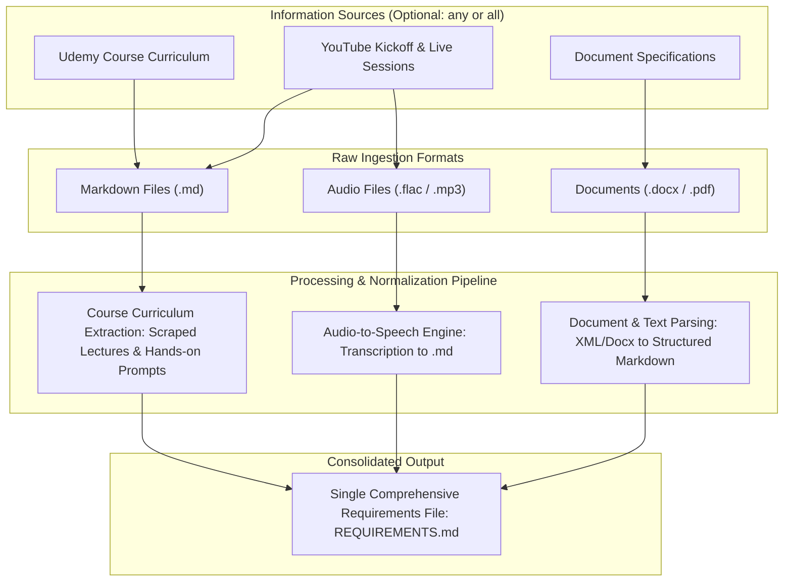

# StarkGroup-VMS & Stark Group Fleet Management System
## Unified Software Requirements Specification (SRS)

---

## 1. Requirement Gathering Architecture

As defined in the project blueprint and architectural model (`Requirement Gathering.png`), the requirement gathering process follows a multi-source ingestion pipeline:

### Ingestion & Processing Details:
1. **Sources Ingested**:
   - **Udemy Curriculum**: 7 full modules comprising 28 hands-on lecture guides, Antigravity AI prompts, design rules, and verification checklists.
   - **YouTube Live & Kickoff Sessions**: Kickoff Class transcript (`001 - full-stack-AI-with-flutter-spring-boot kickoff Class.md`) and Live TA Weekly Support Session audio/transcript (`002 - Session  Weekly Support 01   Full-Stack Web Development with Flutter & Spring Boot.mp3` / `.md`).
   - **Document Specification**: Formal Course & Product Launch Specification (`1.Requirement_Gathering/Document/Projecet Requirements DataV.docx`).
2. **Audio-to-Speech Pipeline**:
   - Audio file: `1.Requirement_Gathering/YoutubeScrapper/002 - Session  Weekly Support 01   Full-Stack Web Development with Flutter & Spring Boot.mp3`.
   - Converted to text/markdown format: `1.Requirement_Gathering/YoutubeScrapper/002 - Session  Weekly Support 01   Full-Stack Web Development with Flutter & Spring Boot.md`.

---

## 2. Audio-to-Speech Conversion Record

- **Source Audio File**: `1.Requirement_Gathering/YoutubeScrapper/002 - Session  Weekly Support 01   Full-Stack Web Development with Flutter & Spring Boot.mp3` `[Source: YouTube Scrapper - Session Weekly Support 01]`
- **Target Transcript File**: `1.Requirement_Gathering/YoutubeScrapper/002 - Session  Weekly Support 01   Full-Stack Web Development with Flutter & Spring Boot.md` `[Source: Audio-to-Speech Pipeline / YouTube Transcript Scrapper]`
- **Content Extracted**: Live troubleshooting and instructional walkthrough by instructors Naimul Haque Sagar & Chayan Mistry covering Spring Boot project initialization, Maven dependencies (`spring-boot-starter-web`, `spring-boot-starter-data-jpa`, MySQL driver, validation), port configuration, layered architecture (`controller`, `service`, `repository`, `entity`, `dto`), database connectivity troubleshooting in Antigravity, and REST API conventions (HTTP 200, 201, 400, 404, 409).

---

## 3. Comprehensive Project Requirements Specification

### 3.1 Business Context & Problem Statement
- **Organizational Background**: Stark Group (and Stark Group VMS) operates a diverse corporate fleet including private executive cars, employee transport microbuses, emergency ambulances, and logistics delivery vans. `[Source: Document - Projecet Requirements DataV.docx; Udemy - Section 01 / 01_Welcome to Stark Group.md]`
- **Current Problem**: Fleet information is maintained manually in fragmented spreadsheets. Adding a vehicle, looking up details, updating status, or verifying documents requires repeatedly cross-referencing multiple files. This leads to duplicate vehicle records, expired legal documents, untracked maintenance costs, and administrative inefficiency. `[Source: Udemy - Section 01 / 01_Welcome to Stark Group.md]`
- **Business Goal**: Build a responsive, reliable, and secure full-stack Vehicle Management System (VMS) replacing spreadsheets with a single source of truth backed by a persistent relational database. `[Source: Document - Projecet Requirements DataV.docx; Udemy - Section 01 / 02_What You Will Build.md]`

---

### 3.2 System Architecture & Technology Stack
- **Frontend Framework**: Flutter Web (Dart SDK 3.x), utilizing Material 3, responsive layout (Desktop admin workspace with tablet adaptiveness), and client-side routing. `[Source: Document - Projecet Requirements DataV.docx; Udemy - Section 02 / 01_Meet the VMS Frontend Project.md]`
- **Backend Framework**: Java 17/21 with Spring Boot 3.x, packaged via Apache Maven. `[Source: Document - Projecet Requirements DataV.docx; Udemy - Section 03 / 03_[Hands-on] Create & Run the Java Spring Boot Project.md; YouTube - Weekly Support 01]`
- **Persistence Layer**: Relational SQL Database (PostgreSQL / MySQL for production/local, Spring Data JPA / Hibernate ORM). `[Source: Document - Projecet Requirements DataV.docx; Udemy - Section 03 / 04_[Hands-on] Connect the SQL Database.md]`
- **Communication Protocol**: Stateless RESTful JSON APIs over HTTP/HTTPS with CORS configuration for Flutter Web clients. `[Source: Document - Projecet Requirements DataV.docx; Udemy - Section 03 / 06_[Hands-on] Create the Vehicle REST APIs.md; Udemy - Section 04 / 03_[Hands-on] Connect Flutter Web to the Spring Boot API.md]`
- **Version Control & Tooling**: Git & GitHub Desktop with Google Antigravity as the primary AI pair-programming environment. `[Source: Document - Projecet Requirements DataV.docx; Udemy - Section 02 / 02_[Hands-on] Set Up Google Antigravity & GitHub Desktop.md; YouTube - Kickoff Class]`
- **Target Deployment Platforms**: 
  - Frontend: Netlify static web hosting (`flutter build web --release`). `[Source: Document - Projecet Requirements DataV.docx; Udemy - Section 06 / 03_[Hands-on] Deploy Flutter Web to Netlify.md]`
  - Backend: Render cloud hosting (Docker or Java native service with hosted PostgreSQL). `[Source: Document - Projecet Requirements DataV.docx; Udemy - Section 06 / 04_[Hands-on] Deploy Spring Boot to Render.md]`

---

### 3.3 Core Functional Requirements (Assignment 1 Scope)

#### FR-01: Authentication & Authorization
- **Requirement**: Secure user login screen preventing unauthorized users from accessing the fleet management console or invoking vehicle modification APIs. `[Source: Document - Projecet Requirements DataV.docx; Udemy - Section 04 / 04_[Hands-on] Connect Login & Authentication.md]`
- **Credentials Validation**: Valid credentials grant access and establish session state; invalid credentials produce clear user-friendly error feedback. `[Source: Udemy - Section 04 / 04_[Hands-on] Connect Login & Authentication.md]`
- **Security Rule**: Passwords must never be logged in plain text or hardcoded in client source code. `[Source: Udemy - Section 04 / 04_[Hands-on] Connect Login & Authentication.md]`

#### FR-02: Vehicle Master Data Fields
Every vehicle record in the system must strictly maintain the following attributes:
1. `vehicleNumber` (String, Unique, Required, e.g., "DHAKA-METRO-GA-11-2233") `[Source: Udemy - Section 02 / 06_[Hands-on] Build the VMS UIUX.md; Udemy - Section 03 / 05_[Hands-on] Build the Vehicle Backend.md]`
2. `company` (String, Required, e.g., "Stark Group", "Stark Logistics", "Apex Pharma") `[Source: Udemy - Section 02 / 06_[Hands-on] Build the VMS UIUX.md; Udemy - Section 03 / 05_[Hands-on] Build the Vehicle Backend.md]`
3. `type` (String, Required, e.g., "Sedan", "Microbus", "Ambulance", "Delivery Van", "Pickup") `[Source: Udemy - Section 01 / 01_Welcome to Stark Group.md; Udemy - Section 02 / 06_[Hands-on] Build the VMS UIUX.md]`
4. `brand` (String, Required, e.g., "Toyota", "Nissan", "Hyundai", "Mercedes") `[Source: Udemy - Section 02 / 06_[Hands-on] Build the VMS UIUX.md; Udemy - Section 03 / 05_[Hands-on] Build the Vehicle Backend.md]`
5. `model` (String, Required, e.g., "HiAce", "Corolla", "Grand Starex") `[Source: Udemy - Section 02 / 06_[Hands-on] Build the VMS UIUX.md; Udemy - Section 03 / 05_[Hands-on] Build the Vehicle Backend.md]`
6. `status` (String/Enum, Required, e.g., `ACTIVE`, `INACTIVE`, `MAINTENANCE`) `[Source: Udemy - Section 02 / 06_[Hands-on] Build the VMS UIUX.md; Udemy - Section 03 / 05_[Hands-on] Build the Vehicle Backend.md]`
7. `id` (Long, Database Generated Primary Key) `[Source: Udemy - Section 03 / 05_[Hands-on] Build the Vehicle Backend.md]`

#### FR-03: Vehicle List & Overview
- **Requirement**: Display all registered fleet vehicles in a clean, scannable table/card view. `[Source: Udemy - Section 02 / 06_[Hands-on] Build the VMS UIUX.md]`
- **Visual Presentation**: Clearly highlight Vehicle Number and Status badge (e.g. Green for ACTIVE, Gray for INACTIVE, Orange for MAINTENANCE). `[Source: Udemy - Section 02 / 05_Stark Group Design Guideline.md; Udemy - Section 02 / 06_[Hands-on] Build the VMS UIUX.md]`
- **State Handling**: Explicitly display Loading Spinner during fetch, Empty State when no vehicles exist, and Error State when network or backend calls fail. Never fall back silently to mock data in production mode. `[Source: Udemy - Section 04 / 03_[Hands-on] Connect Flutter Web to the Spring Boot API.md; Udemy - Section 04 / 05_[Hands-on] Connect Vehicle CRUD.md]`

#### FR-04: Vehicle Registration (Create)
- **Requirement**: Authorized users can input vehicle attributes via a dedicated modal or form view. `[Source: Document - Projecet Requirements DataV.docx; Udemy - Section 02 / 06_[Hands-on] Build the VMS UIUX.md]`
- **Client Validation**: Validate mandatory fields, whitespace, and formatting before submission. `[Source: Udemy - Section 02 / 06_[Hands-on] Build the VMS UIUX.md]`
- **Persistence**: Save record to SQL database via Spring Boot REST endpoint and refresh UI list upon HTTP 201 response. `[Source: Udemy - Section 04 / 05_[Hands-on] Connect Vehicle CRUD.md; YouTube - Weekly Support 01]`

#### FR-05: Duplicate Vehicle Number Business Rule
- **Mandatory Business Rule**: Attempting to register or update a vehicle with a `vehicleNumber` that already exists in the system must be strictly rejected. `[Source: Document - Projecet Requirements DataV.docx; Udemy - Section 03 / 05_[Hands-on] Build the Vehicle Backend.md; Udemy - Section 05 / 03_[Hands-on] Test the Duplicate Vehicle Rule.md]`
- **Enforcement Layers**:
  1. Service Layer Rule: Explicit pre-check (`vehicleRepository.existsByVehicleNumber(number)`) throwing a `DuplicateResourceException`. `[Source: Udemy - Section 03 / 05_[Hands-on] Build the Vehicle Backend.md]`
  2. Database Layer Rule: `UNIQUE` constraint on the `vehicle_number` column. `[Source: Udemy - Section 03 / 05_[Hands-on] Build the Vehicle Backend.md]`
  3. Client Layer Feedback: Frontend must map the HTTP 409 Conflict / 400 Bad Request error into a distinct user-friendly alert message on the form. `[Source: Udemy - Section 04 / 05_[Hands-on] Connect Vehicle CRUD.md]`

#### FR-06: Vehicle Modification (Update)
- **Requirement**: Allow editing company, type, brand, model, or status of an existing record without creating duplicate entries. `[Source: Document - Projecet Requirements DataV.docx; Udemy - Section 04 / 05_[Hands-on] Connect Vehicle CRUD.md]`
- **Pre-population**: Form must load the current record values. `[Source: Udemy - Section 02 / 06_[Hands-on] Build the VMS UIUX.md]`
- **Confirmation**: Update must reflect immediately on the database and update the UI. `[Source: Udemy - Section 04 / 05_[Hands-on] Connect Vehicle CRUD.md]`

#### FR-07: Vehicle Deletion (Delete)
- **Requirement**: Remove a vehicle record safely when decommissioned or sold. `[Source: Document - Projecet Requirements DataV.docx; Udemy - Section 04 / 05_[Hands-on] Connect Vehicle CRUD.md]`
- **Safety Dialog**: A modal confirmation dialog must warn the user before issuing the delete call. `[Source: Udemy - Section 04 / 05_[Hands-on] Connect Vehicle CRUD.md]`
- **UI Update**: The record is removed from the UI list only after the backend returns a successful 200 OK / 204 No Content response. `[Source: Udemy - Section 04 / 05_[Hands-on] Connect Vehicle CRUD.md]`

---

### 3.4 Advanced Fleet Management Requirements (Assignment 2 Scope)

#### AFR-01: Vehicle Document Upload
- **Requirement**: Support uploading and associating legal and compliance documents per vehicle (Registration, Tax Token, Insurance Policy, Fitness Certificate, Route Permit). `[Source: Document - Projecet Requirements DataV.docx]`
- **Attributes**: Document Type, Document Number, Issue Date, Expiry Date, File URL/Attachment reference, Upload Timestamp. `[Source: Document - Projecet Requirements DataV.docx]`

#### AFR-02: Document Expiry Tracking & Proactive Alerts
- **Requirement**: Track expiration dates for all vehicle compliance documents. `[Source: Document - Projecet Requirements DataV.docx]`
- **Alert Thresholds**:
  - `EXPIRED` (Red badge / Critical alert): Expiry date has passed.
  - `EXPIRING_SOON` (Yellow/Orange badge / Warning alert): Expiry date within 30 days.
  - `VALID` (Green badge): Expiry date > 30 days. `[Source: Document - Projecet Requirements DataV.docx]`

#### AFR-03: Vehicle Maintenance Management
- **Requirement**: Record vehicle servicing, breakdown repairs, oil changes, tire replacement, and scheduled preventative maintenance. `[Source: Document - Projecet Requirements DataV.docx]`
- **Attributes**: Maintenance Date, Service Type, Odometer/Mileage Reading, Cost, Workshop/Vendor Name, Invoice Number, Notes/Remarks. `[Source: Document - Projecet Requirements DataV.docx]`

#### AFR-04: Maintenance History View
- **Requirement**: Provide a historical audit log of all maintenance actions performed on a specific vehicle, with cumulative maintenance expenditure. `[Source: Document - Projecet Requirements DataV.docx]`

#### AFR-05: Advanced Vehicle Status State Machine
- **Requirement**: Enforce operational lifecycle states:
  - `ACTIVE`: Available for daily fleet operations.
  - `INACTIVE`: Temporarily parked or decommissioned.
  - `MAINTENANCE`: Currently in workshop; locked from driver assignment or dispatch. `[Source: Document - Projecet Requirements DataV.docx; Udemy - Section 02 / 06_[Hands-on] Build the VMS UIUX.md]`

#### AFR-06: Fleet Search Capabilities
- **Requirement**: Fast search across the fleet primarily by `vehicleNumber`, with multi-field search support for `brand`, `model`, `company`, or `driverName`. `[Source: Document - Projecet Requirements DataV.docx]`

#### AFR-07: Server-Side Filtering, Sorting & Pagination
- **Requirement**: Implement scalable server-side pagination (`page`, `size`), sorting (`sortField`, `sortDirection`), and multi-attribute filters (`status`, `type`, `company`) to handle large enterprise fleets without browser memory degradation. `[Source: Document - Projecet Requirements DataV.docx]`

#### AFR-08: Driver Management (Driver CRUD)
- **Requirement**: Maintain driver records including Full Name, License Number, License Expiry Date, Phone Number, Emergency Contact, and Active Status. `[Source: Document - Projecet Requirements DataV.docx]`

#### AFR-09: Driver-to-Vehicle Assignment
- **Requirement**: Link an active driver to a specific vehicle, tracking assignment history and ensuring a driver is not simultaneously assigned to multiple active vehicles. `[Source: Document - Projecet Requirements DataV.docx]`

#### AFR-10: Fleet Dashboard & Analytical Summary
- **Requirement**: Visual executive dashboard displaying high-level KPI cards and summaries:
  - Total Fleet Count
  - Active Vehicles Count
  - Vehicles under Maintenance
  - Expiring / Expired Documents Count
  - Monthly Maintenance Expense Aggregate. `[Source: Document - Projecet Requirements DataV.docx]`

---

### 3.5 UI/UX Design System Guidelines
- **Visual Identity**: Clean, corporate, and distraction-free Stark Group / Stark Group design language. `[Source: Udemy - Section 02 / 05_Stark Group Design Guideline.md]`
- **Color Palette**:
  - Background: Crisp Light Gray / Slate (`#F8FAFC` / `#FFFFFF`).
  - Primary / Branding: Deep Navy (`#0F172A` / `#1E3A8A`) and Corporate Blue (`#2563EB`).
  - Accent / Success: Forest / Emerald Green (`#16A34A` / `#22C55E`).
  - Danger / Error: Crimson Red (`#DC2626` / `#EF4444`) for delete buttons, error alerts, and expired items.
  - Warning: Amber / Gold (`#D97706` / `#F59E0B`) for maintenance alerts and items expiring soon. `[Source: Udemy - Section 02 / 05_Stark Group Design Guideline.md]`
- **Layout Architecture**:
  - Left navigation sidebar for seamless screen switching (Dashboard, Vehicles, Maintenance, Drivers, Documents, Settings).
  - Top AppBar with search trigger, notifications/alerts, and user profile/logout.
  - Central responsive workspace container using standard 8px spacing increments (8px, 16px, 24px, 32px). `[Source: Udemy - Section 02 / 05_Stark Group Design Guideline.md]`
- **Component Consistency**: White card surfaces with subtle borders (`1px solid #E2E8F0`), high-contrast typography, and explicit action buttons (Primary filled for positive actions, Outlined/Ghost for secondary, Destructive red for deletes). `[Source: Udemy - Section 02 / 05_Stark Group Design Guideline.md]`

---

### 3.6 Backend REST API Contract

| Method | Endpoint | Description | Request Body | Response (Success / Error) | Source |
|---|---|---|---|---|---|
| `POST` | `/api/v1/auth/login` | Authenticate user & issue token | `{"username": "...", "password": "..."}` | `200 OK` (token, user details) / `401 Unauthorized` | `[Source: Udemy - Section 04 / 04]` |
| `GET` | `/api/v1/vehicles` | Retrieve vehicle list (supports pagination/filter) | None | `200 OK` `[VehicleResponseDto]` | `[Source: Udemy - Section 03 / 06]` |
| `GET` | `/api/v1/vehicles/{id}` | Get vehicle by ID | None | `200 OK` `VehicleResponseDto` / `404 Not Found` | `[Source: Udemy - Section 03 / 06]` |
| `POST` | `/api/v1/vehicles` | Register new vehicle | `VehicleRequestDto` | `201 Created` / `400 Validation Error` / `409 Duplicate Vehicle` | `[Source: Udemy - Section 03 / 06; YouTube - Weekly Support 01]` |
| `PUT` | `/api/v1/vehicles/{id}` | Update existing vehicle | `VehicleRequestDto` | `200 OK` / `400 Validation Error` / `404 Not Found` / `409 Duplicate` | `[Source: Udemy - Section 03 / 06]` |
| `DELETE` | `/api/v1/vehicles/{id}` | Delete vehicle record | None | `204 No Content` or `200 OK` / `404 Not Found` | `[Source: Udemy - Section 03 / 06]` |
| `GET` | `/api/v1/dashboard/stats` | Retrieve executive fleet KPIs | None | `200 OK` `DashboardStatsDto` | `[Source: Document - Projecet Requirements DataV.docx]` |

---

### 3.7 Quality Assurance & Verification Criteria
- **Backend Unit Tests**: Mocked service-layer tests asserting rejection of duplicate `vehicleNumber` and acceptance of valid unique records. `[Source: Udemy - Section 05 / 03_[Hands-on] Test the Duplicate Vehicle Rule.md]`
- **API Integration Tests**: Controller integration tests asserting correct HTTP status codes (200, 201, 400, 404, 409) and error payloads. `[Source: Udemy - Section 05 / 04_[Hands-on] Test the CRUD APIs.md]`
- **Frontend Code Quality**: Zero compiler warnings or errors via `flutter analyze` and clean production bundle creation via `flutter build web`. `[Source: Udemy - Section 02 / 06_[Hands-on] Build the VMS UIUX.md; Udemy - Section 04 / 03]`
- **End-to-End User Verification**: Walkthrough of complete lifecycle: Login → Register Vehicle → Verify in DB → View List → Update Record → Delete Record. `[Source: Udemy - Section 05 / 05_[Hands-on] Complete the E2E Journey.md]`

---

### 3.8 Deployment & CI/CD Strategy
- **Repository Separation / Decoupling**: Frontend and Backend projects isolated to prevent cross-stack code leakage. `[Source: Udemy - Section 06 / 02_[Hands-on] Push the Two Projects to GitHub.md]`
- **Security & Secret Management**: No database passwords, JWT secrets, or environment credentials committed to Git. `[Source: Udemy - Section 03 / 04_[Hands-on] Connect the SQL Database.md; Udemy - Section 06 / 02]`
- **Production Build Artifacts**:
  - Frontend: Netlify static hosting pointing to build output `build/web`. `[Source: Udemy - Section 06 / 03_[Hands-on] Deploy Flutter Web to Netlify.md]`
  - Backend: Render web service running Spring Boot JAR with environment variables (`SPRING_DATASOURCE_URL`, `SPRING_DATASOURCE_USERNAME`, `SPRING_DATASOURCE_PASSWORD`). `[Source: Udemy - Section 06 / 04_[Hands-on] Deploy Spring Boot to Render.md]`

