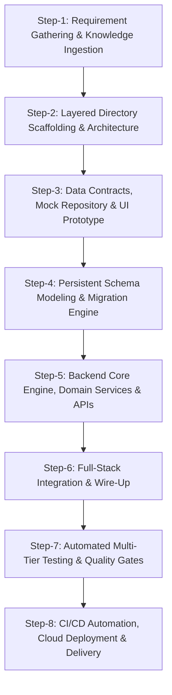

# Generic Project Engineering Template

This directory contains the **Universal, Framework-Agnostic Software Engineering Template** and pair-programming lifecycle methodology.

---

## 🎯 Purpose & Design Philosophy

1. **100% Framework & Technology Neutral**:
   - This template contains **zero mentions** of specific frameworks, libraries, database engines, cloud vendors, or domain terms.
   - It is designed to guide **any** software project across web, mobile, desktop, distributed systems, embedded, or enterprise backends.

2. **Core Deliverable**:
   - [`Any Project Skill.docx`](./Any%20Project%20Skill.docx): The master engineering guideline document defining:
     - **The AI-Assisted Pair Programming Framework** (Human Architect vs AI Implementer roles, 6-stage pair programming loop, multi-tier testing matrix, and architectural invariants).
     - **The 8-Step Universal Project Lifecycle** (Step-1 through Step-8) with strict placement rationales and quality gates.

---

## 🏛️ The Universal 8-Step Lifecycle

---

## ⚖️ Distinction: Template vs Project Specifications

| Directory | Scope | Specificity | Contents |
|---|---|---|---|
| [`Generic_Project_Template/`](.) | **Universal** | **100% Framework-Agnostic** | Reusable for ANY project (no vendor/framework names). |
| [`specifications/`](../specifications/) | **Project-Specific** | **100% StarkGroup-VMS Specific** | Formal specifications for StarkGroup-VMS (Spring Boot 3.3, Java 21, PostgreSQL 16, Flutter Web, Dio, Docker). |

