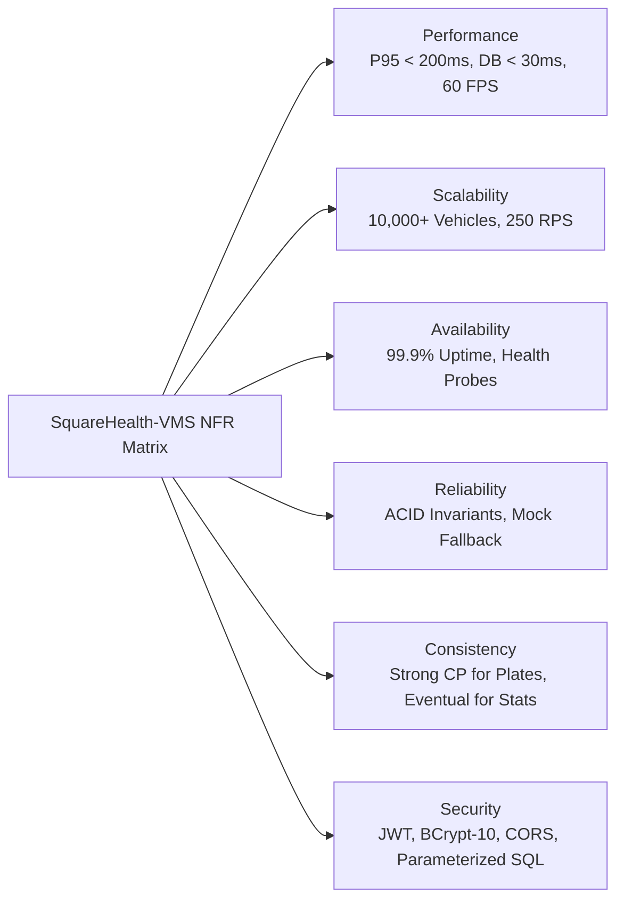

# SquareHealth-VMS — System Requirements Specification (SRS)

Comprehensive System Requirements Engineering specification for **SquareHealth-VMS (Stark Group Fleet Management System)**, adhering to the formal System Requirements Engineering framework, taxonomies, and production templates for High-Level Design (HLD) and Low-Level Design (LLD).

---

## 📌 1. Taxonomy of System Requirements

System requirements bridge the enterprise fleet management business problem with concrete technical architecture across the Flutter Web client, Spring Boot application engine, and PostgreSQL persistence layer:

```mermaid
flowchart TD
    SR["System Requirements (SquareHealth-VMS)"] --> FR["Functional Requirements (FR)"]
    SR --> NFR["Non-Functional Requirements (NFR)"]
    SR --> CON["System Constraints & Boundaries"]

    FR --> FR_CORE["Core Fleet Management (FR-01 - FR-05)"]
    FR --> FR_ADV["Advanced Fleet Operations (FR-06 - FR-10)"]

    FR_CORE --> FC1["FR-01: Auth, Session & RBAC"]
    FR_CORE --> FC2["FR-02: Multi-Tenant Corporate Structure"]
    FR_CORE --> FC3["FR-03: Vehicle Master CRUD Engine"]
    FR_CORE --> FC4["FR-04: Duplicate Plate Prevention Guard"]
    FR_CORE --> FC5["FR-05: Executive Analytics Dashboard"]

    FR_ADV --> FA1["FR-06: Driver Dynamic Assignment"]
    FR_ADV --> FA2["FR-07: Compliance & Document Expiry Tracking"]
    FR_ADV --> FA3["FR-08: Maintenance & Service History"]
    FR_ADV --> FA4["FR-09: Fuel Reserves Monitoring"]
    FR_ADV --> FA5["FR-10: Immutable Audit Logging"]

    NFR --> NFR_PERF["Performance & Latency (P95 < 200ms)"]
    NFR --> NFR_SCALE["Scalability & Capacity (10,000+ Vehicles)"]
    NFR --> NFR_AVAIL["Availability & Reliability (99.9% Uptime)"]
    NFR --> NFR_SEC["Security & Compliance (JWT, BCrypt, CORS)"]
    NFR --> NFR_INT["Data Integrity (ACID, UNIQUE Invariants)"]
    NFR --> NFR_OBS["Observability (RFC 7807, SLF4J, Health Probes)"]

    CON --> CON_ENV["Cloud Deployment (Netlify Edge & Render)"]
    CON --> CON_REG["Regulatory Standards (BRTA Compliance)"]
    CON --> CON_ISO["Decoupled Monorepo & DTO Isolation"]
```



---

## 🎯 2. Scope & Goals

### 2.1 Mission Statement & Objective
SquareHealth-VMS is an enterprise-grade, cloud-ready Fleet Management System engineered to provide a centralized single source of truth for the corporate vehicles, emergency ambulances, logistics vans, drivers, legal compliance certificates, and maintenance workflows of Stark Group and its subsidiaries.

### 2.2 In-Scope Capabilities
- **Multi-Tenant Corporate Structure**: Managing fleets across 5 corporate subsidiaries (`Stark Group Ltd.`, `Stark Industries`, `Stark Logistics`, `Stark Medical`, `Stark Aerospace`).
- **Vehicle Master Lifecycle**: Full CRUD lifecycle operations for 5 vehicle categories (Ambulances, Delivery Vans, Microbuses, Executive Sedans, Cargo Trucks).
- **Core Invariant Enforcement**: Triple-tier duplicate vehicle license plate detection and rejection returning RFC 7807 HTTP 409 Conflict envelopes.
- **Executive Fleet Analytics**: Real-time aggregate KPI metrics and readiness distribution ratios.
- **Driver Management & Single-Active Assignment**: Certified driver licensing records and mutual exclusivity invariants on active routes.
- **Compliance & Expiry Monitoring**: Automatic alert tracking for Registration Certificates, Tax Tokens, Fitness Certificates, Route Permits, and Insurance Policies.
- **Maintenance & Fuel Workflows**: Preventative maintenance scheduling, workshop expense tracking, odometer monitoring, and low fuel alerting (threshold <= 20%).
- **Dual-Mode Networking**: Decoupled Flutter Web presentation with in-memory offline mock fallback (`useMock: true/false`).

### 2.3 Out-of-Scope Capabilities
- Physical on-board OBD-II hardware GPS satellite tracking device manufacturing or firmware programming.
- Automated payment gateway integration with third-party commercial fuel station POS terminals.
- Consumer-facing ride-hailing / peer-to-peer taxi dispatch services.
- Synchronization with legacy on-premises SAP/COBOL mainframe enterprise ledgers.

---

## 📐 3. High-Level Design (HLD) vs Low-Level Design (LLD) Requirements

| Perspective | System Requirements in HLD | System Requirements in LLD |
|---|---|---|
| **Primary Scope** | Monorepo service topology, Flutter Web client, Spring Boot REST gateway, PostgreSQL persistence | Package boundaries, Controller/Service/Repository classes, DTO immutability, HikariCP pool |
| **Capacity Scoping** | Peak 175 QPS, 500 DAU, 10,000+ vehicles, 5-year 25 GB storage footprint | In-memory JVM heap allocation (512 MB - 1 GB), HikariCP (30 max connections), Flutter widget tree |
| **Protocol & APIs** | Stateless REST JSON over HTTPS, Bearer JWT authentication, RFC 7807 error envelopes | Java interfaces (`VehicleService`), method signatures, `@Valid` Jakarta validation, `@Transactional` boundaries |
| **Key Invariants** | High Availability (99.9%), ACID durability, Network error resilience | Uniqueness constraint (`vehicle_number`), thread safety, duplicate exception interception |

---

## ⚙️ 4. Functional Requirements (FR)

### FR-01: Authentication, Session Management & Role-Based Access Control (RBAC)
- **Workflow & Trigger**: A corporate user navigates to the portal and enters credentials via the Corporate Sign-in card (`/api/v1/auth/login`).
- **Pre-conditions**: The user account must be active in the `users` database table; passwords must be hashed using BCrypt.
- **System Behavior & Output**:
  - The backend validates credentials and issues an HMAC-SHA256 signed JWT Bearer token with claims: `sub`, `roles`, `companyId`, `iat`, `exp` (8 hours).
  - Four distinct roles are enforced via Spring Security `@PreAuthorize`:
    1. `ADMIN`: Universal read/write/delete privileges across all tenants and audit logs.
    2. `FLEET_MANAGER`: Operational CRUD on vehicles, drivers, and service tickets for their assigned subsidiary.
    3. `DISPATCHER`: Operational status updates (`AVAILABLE`, `IN_TRIP`), fuel logging, and driver route monitoring.
    4. `DRIVER`: Read-only mobile/web access to assigned vehicle specifications and compliance certificates.
- **Post-conditions**: Flutter client securely stores the JWT in persistent session memory and injects `Authorization: Bearer <token>` into all subsequent HTTP requests.
- **Error Handling**: Invalid credentials return HTTP 401 Unauthorized (`"Invalid username or password"`).

---

### FR-02: Multi-Tenant Corporate Structure
- **Workflow & Trigger**: A Fleet Manager registers or queries assets partitioned by operating corporate subsidiary.
- **Pre-conditions**: Subsidiary entity must exist in the `companies` reference table.
- **System Behavior & Output**:
  - Isolates operational assets across 5 distinct corporate entities:
    - `Stark Group Ltd.` (Corporate Headquarters & Central Fleet)
    - `Stark Industries` (Industrial & Manufacturing Heavy Fleet)
    - `Stark Logistics` (Freight, Warehousing & Supply Chain)
    - `Stark Medical` (Emergency Ambulances & Mobile ICU Units)
    - `Stark Aerospace` (Airport Ground Handling & Precision Transit)
  - Allows cross-subsidiary emergency vehicle transfer by authorized System Administrators.
- **Post-conditions**: All vehicles and drivers maintain relational foreign keys referencing `company_id`.

---

### FR-03: Vehicle Master Data CRUD Engine
- **Workflow & Trigger**: An authorized Fleet Manager creates, inspects, modifies, or retires a corporate vehicle via `VehicleFormDialog` or REST endpoints (`/api/v1/vehicles`).
- **Mandatory Attributes**:
  - `id`: Database-assigned 64-bit primary key.
  - `vehicleNumber`: Unique alphanumeric license plate string (e.g., `"DHAKA-METRO-GA-11-2233"`).
  - `company`: Subsidiary operating entity string.
  - `type`: Vehicle category (`"Ambulance"`, `"Delivery Van"`, `"Microbus"`, `"Executive Sedan"`, `"Cargo Truck"`).
  - `brand`: Manufacturer name (`"Toyota"`, `"Hyundai"`, `"Nissan"`, `"Mercedes-Benz"`, `"Isuzu"`).
  - `model`: Specific model designation (`"HiAce Emergency ICU"`, `"Mighty"`, `"Sprinter"`).
  - `status`: Operational state (`"AVAILABLE"`, `"IN_TRIP"`, `"MAINTENANCE"`).
  - `fuelLevel`: Integer percentage (`0` to `100`).
  - `assignedDriver`: Name or ID of assigned certified driver (nullable).
  - `department`: Internal cost center department (e.g., `"Emergency Response Hub"`).
- **CRUD Specifications**:
  - `GET /api/v1/vehicles`: Returns paginated, searchable array of `VehicleResponseDto`.
  - `GET /api/v1/vehicles/{id}`: Returns detailed vehicle metadata; throws `ResourceNotFoundException` (HTTP 404) if missing.
  - `POST /api/v1/vehicles`: Validates inputs (`@Valid`), executes duplicate check, persists entity, and returns HTTP 201 Created with assigned ID.
  - `PUT /api/v1/vehicles/{id}`: Updates existing attributes with dirty-checking; validates license plate uniqueness if modified. Returns HTTP 200 OK.
  - `DELETE /api/v1/vehicles/{id}`: Checks referential integrity; returns HTTP 204 No Content upon removal.
- **Post-conditions**: Database state reflects the modification; client updates state and displays notification.

---

### FR-04: Mandatory Invariant — Duplicate Vehicle License Plate Prevention
- **Workflow & Trigger**: A user attempts to create or update a vehicle with a license plate string that already exists in the system.
- **Business Rule Invariant**: A vehicle license plate uniquely identifies a physical road transport asset. Collisions are strictly prohibited across all subsidiaries.
- **Triple-Layer Enforcement Architecture**:
  1. **Application Service Guard**: `VehicleServiceImpl` queries `vehicleRepository.existsByVehicleNumber(dto.getVehicleNumber())`. If true, raises `DuplicateVehicleException`.
  2. **Database Schema Invariant**: Enforces `CONSTRAINT uq_vehicles_vehicle_number UNIQUE (vehicle_number)`.
  3. **Global Exception Mapping**: `GlobalExceptionHandler` intercepts the collision and returns an RFC 7807 HTTP 409 Conflict envelope:
     ```json
     {
       "timestamp": "2026-11-18T10:00:00Z",
       "status": 409,
       "error": "Conflict",
       "message": "Vehicle with number 'DHAKA-METRO-GA-11-2233' already exists in the fleet.",
       "path": "/api/v1/vehicles"
     }
     ```
  4. **Client-Side Reactive Alert**: Flutter Web catches HTTP 409 and renders a prominent red alert banner without closing the modal or clearing user input.

---

### FR-05: Executive Analytics Dashboard & Fleet Statistics
- **Workflow & Trigger**: An Administrator views the dashboard (`/api/v1/dashboard/stats`).
- **System Behavior & Output**:
  - Computes real-time aggregate fleet counters:
    - `totalVehicles`: Total registered fleet assets.
    - `availableVehicles`: Count of vehicles ready for immediate dispatch (`AVAILABLE`).
    - `activeVehicles`: Count of vehicles currently on the road (`IN_TRIP` / `ACTIVE`).
    - `maintenanceVehicles`: Count of vehicles in workshop repair (`MAINTENANCE`).
    - `fleetEfficiency`: Average fleet fuel efficiency standard (12.4 km/L).
    - `fuelAlerts`: Total vehicles operating with low fuel reserves (<= 20%).
  - Dynamically calculates the Fleet Readiness Ratio bar (percentage of total fleet ready).
- **Post-conditions**: Reactively refreshes whenever a vehicle is created, updated, or removed.

---

### FR-06: Driver Management & Single-Active-Assignment Invariant
- **Workflow & Trigger**: A dispatcher assigns a driver to a vehicle for a designated shift or route.
- **Pre-conditions**: Driver must possess an active, unexpired Commercial Driver License (CDL).
- **System Behavior & Output**:
  - Maintains driver profile: Full Name, License Number, License Expiry Date, Phone, Emergency Contact, Medical Clearance Status.
  - **Mutual Exclusivity Invariant**: A driver cannot be simultaneously assigned to more than one vehicle currently marked `IN_TRIP`.
- **Error Handling**: Attempting to assign an already-dispatched driver returns HTTP 400 Bad Request (`"Driver is already assigned to active transit vehicle"`).

---

### FR-07: Vehicle Compliance & Document Expiry Tracking
- **Workflow & Trigger**: Automatic daily batch job and on-demand UI inspection of legal vehicle documents.
- **Tracked Compliance Documents**:
  1. Vehicle Registration Certificate
  2. Annual Road Tax Token
  3. Government Motor Vehicle Fitness Certificate
  4. Commercial Route Permit
  5. Comprehensive Commercial Insurance Policy
- **Traffic-Light Expiry Alert Logic**:
  - `VALID` (Green badge): Expiry date is > 30 calendar days in the future.
  - `EXPIRING_SOON` (Amber badge): Expiry date is within 1 to 30 calendar days.
  - `EXPIRED` (Red badge): Expiry date has passed.
- **Operational Enforcement**: Vehicles with expired Fitness or Tax tokens are locked from `AVAILABLE` status and trigger critical alert banners.

---

### FR-08: Maintenance Workflow & Service History Tracking
- **Workflow & Trigger**: A Maintenance Engineer logs a routine service, emergency breakdown, or preventative repair.
- **Attributes Recorded**: Service Date, Service Category (Oil Change, Brake Overhaul, Engine Diagnostics, Tire Replacement), Odometer Mileage, Workshop Name, Invoice Number, Total Cost, Remarks.
- **State Machine Integration**: Shifting vehicle status to `MAINTENANCE` locks the asset from dispatcher selection. Upon technician clearance, status transitions back to `AVAILABLE`.

---

### FR-09: Fuel Reserves Monitoring & Consumption Auditing
- **Workflow & Trigger**: Telemetry updates or driver fuel entry submissions.
- **System Behavior & Output**:
  - Tracks fuel tank capacity (liters) and current fuel percentage.
  - Vehicles with fuel levels <= 20% automatically trigger Amber/Red low-fuel alert chips in the UI and dashboard.
  - Tracks fuel logs: Date, liters pumped, price per liter, fuel station vendor, and odometer reading.

---

### FR-10: Immutable Audit Logging & Activity History
- **Workflow & Trigger**: Any state-modifying action (vehicle creation, plate modification, driver reassignment, status transition, record deletion).
- **Recorded Attributes**: Entity Type, Entity ID, Action (`CREATE`, `UPDATE`, `DELETE`, `STATUS_CHANGE`), User ID, Timestamp (UTC ISO 8601), Old Value, New Value, Client IP.
- **Storage Rule**: Audit log tables are append-only; update and delete operations on audit tables are prohibited at the database permission level.

---

## 🛡️ 5. Non-Functional Requirements (NFR / Quality Attributes)



### 5.1 Canonical NFR Matrix

| Quality Attribute | Target Metric / SLA | Architectural Implementation |
|---|---|---|
| **Performance (Latency)** | P95 REST response < 200 ms under 250 RPS<br>Single-row query execution < 30 ms<br>Web FCP < 1.5 seconds | B-Tree indexes on `vehicle_number`, `status`, `company_id`. Spring Boot lightweight fat JAR. Flutter CanvasKit web optimization. |
| **Scalability (Throughput)** | 10,000+ vehicle records<br>50,000+ maintenance/fuel logs<br>500+ daily active users | Completely stateless backend service suitable for horizontal container replication. HikariCP connection pooling (max 30 connections). |
| **Availability (Uptime)** | 99.9% service uptime (< 8.76 hours unplanned downtime/year) | Render automated container restart (< 15 seconds). Spring Boot Actuator `/actuator/health` liveness/readiness probes. |
| **Reliability & Durability** | Zero data loss on committed writes<br>Graceful network degradation | PostgreSQL WAL (Write-Ahead Logging). Dual-mode Flutter `ApiClient` providing graceful offline mock fallback mode. |
| **Data Consistency** | Strong Consistency (CP) for vehicle uniqueness & lifecycle<br>Eventual Consistency for aggregated dashboard KPIs | ACID transactions with `@Transactional` boundaries. Database constraints (`UNIQUE`, `CHECK`, `NOT NULL`). |
| **Security & Privacy** | OWASP Top 10 compliance<br>Zero plaintext credentials<br>CORS origin whitelisting | HMAC-SHA256 signed Bearer JWTs. BCrypt password hashing (cost factor >= 10). Spring Data JPA parameterized queries (zero SQLi). |
| **Observability** | End-to-end request tracing & structured logs | SLF4J and Logback structured JSON logs. RFC 7807 standardized `ErrorResponseDto` envelope across all exception handlers. |
| **Usability & Accessibility** | WCAG 2.1 AA Compliance (4.5:1 text contrast)<br>Sustained 60 FPS UI rendering | Stark Group Material 3 design system. Deep Navy (`#0A192F`), Electric Blue (`#2563EB`), Emerald (`#10B981`). Strict 8px spacing grid. |
| **Maintainability** | 100% test pass rate on core business rules<br>Zero linter warnings | Clean 4-tier layered architecture. Test pyramid: JUnit 5, Mockito unit tests, Spring MockMvc contract tests. |

---

## 📊 6. Scale & Capacity Estimation

### 6.1 User & Traffic Scoping
- **Daily Active Users (DAU)**: ~500 enterprise operators across Stark Group subsidiaries (50 simultaneous dispatchers, 400 drivers, 50 administrators).
- **Peak Request Rate**:
  - Read Queries: **150 QPS** (dashboard refreshes, multi-filter vehicle searches, driver assignment looks).
  - Write Queries: **25 QPS** (trip dispatches, vehicle registrations, fuel and maintenance logging).
  - **Read/Write Ratio**: **6 : 1** (predominantly read-heavy fleet monitoring workload).

### 6.2 Storage Volume Sizing (5-Year Growth Model)
- **Vehicle Entity Size**: ~1.2 KB per vehicle record (including strings, timestamps, foreign keys).
  - 10,000 vehicles = ~12 MB.
- **Maintenance & Trip Log Entity Size**: ~500 bytes per event.
  - Average 2,000 trip/maintenance/fuel events per calendar day.
  - Daily Ingestion: 2,000 events x 500 bytes approximately 1 MB / day.
  - Annual Ingestion: approximately 365 MB / year.
  - 5-Year Log Storage: approximately 1.83 GB.
- **Compliance Documents (Binary Metadata)**: ~2 KB per certificate record with external cloud object URLs (10,000 vehicles x 5 documents = 50,000 records approximately 100 MB).
- **Database Index Overhead & WAL**: Estimated at 100% of data volume.
- **Total Estimated 5-Year Persistent Database Footprint**: **`< 10 GB`**, comfortably fitting within managed Cloud PostgreSQL starter/growth tiers with zero sharding required.

### 6.3 Network Bandwidth Projections
- **Inbound Traffic**: Peak write throughput approximately 25 QPS x 2 KB = 50 KB/s (0.4 Mbps).
- **Outbound Traffic**: Peak read throughput approximately 150 QPS x 10 KB (JSON payload) = 1.5 MB/s (12 Mbps).

---

## 🔒 7. System Constraints & Architectural Boundaries

1. **Decoupled Monorepo Isolation**:
   - The Flutter Web client (`vms-frontend/`) and Java Spring Boot backend (`vms-backend/`) must maintain completely decoupled runtimes (Dart/CanvasKit vs JVM). Cross-boundary interaction occurs exclusively over HTTP/JSON REST contracts.
2. **DTO Invariant & Domain Segregation**:
   - Database `@Entity` classes must never be serialized directly to the external network. All external communications must utilize immutable DTO schemas (`VehicleRequestDto`, `VehicleResponseDto`).
3. **Database Migration Standard**:
   - All schema changes must be versioned via Flyway migration scripts located in `db/migration/`. Manual schema edits in production are forbidden.
4. **Regulatory & Geographic Constraints**:
   - Vehicle registration numbers must conform to Bangladesh Road Transport Authority (BRTA) formatting patterns (e.g., `DHAKA-METRO-GA-11-2233`).

---

## 🗺️ 8. Requirements Traceability Matrix (RTM)

| Req ID | Category | Target Architectural Layer | Verification Method | Implemented Artifact / Specification |
|---|---|---|---|---|
| **FR-01** | Authentication & RBAC | SecurityFilter / Controller | Spring MockMvc & BCrypt check | `AuthController.java`, `login_screen.dart` |
| **FR-02** | Multi-Tenant Structure | Persistence / Entity | Flyway Seeds & Unit Assertions | `V1__init_schema.sql`, `V2__seed_initial_data.sql` |
| **FR-03** | Vehicle Master CRUD | Service / Controller / UI | MockMvc Integration Tests & Form | `VehicleController.java`, `vehicle_form_dialog.dart` |
| **FR-04** | Duplicate Plate Prevention | Business Rule & DB Invariant | MockMvc (409 Conflict) & JUnit | `VehicleServiceImpl.java`, `VehicleControllerTest.java` |
| **FR-05** | Executive Analytics | Service / Controller / UI | REST API assertions & KPI Cards | `DashboardController.java`, `dashboard_screen.dart` |
| **FR-06** | Driver Assignment | Service / Persistence | Foreign Key Checks & Unit Tests | `Vehicle.java`, `V1__init_schema.sql` |
| **FR-07** | Compliance & Expiry | Domain Logic / UI Monitor | Badge Logic & Mock assertions | `validators.dart`, `vehicles_mock.json` |
| **FR-08** | Maintenance Workflow | State Machine / DB | State transition tests & SQL | `V1__init_schema.sql`, `Vehicle.java` |
| **FR-09** | Fuel Reserves Alerting | Domain Logic / Analytics | Threshold assertions (<= 20%) | `DashboardStatsDto.java`, `VehicleRequestDto.java` |
| **FR-10** | Immutable Audit Trail | Persistence / Entity | Audit table insert verification | `V1__init_schema.sql` |
| **NFR-01** | Latency & Performance | Database & Backend | B-Tree Index analysis | `V1__init_schema.sql` B-Tree indexes |
| **NFR-02** | Scalability & Connection Pool | Infrastructure / Backend | HikariCP load configuration | `application.properties` |
| **NFR-03** | Availability & Uptime | Infrastructure | Spring Actuator Health Probes | `application.properties` |
| **NFR-04** | Security & CORS | Filter / Web Security | CORS whitelist & OWASP audit | `CorsConfig.java` |
| **NFR-05** | Data Integrity & ACID | Database Schema | Unique & check constraints | `V1__init_schema.sql` |
| **NFR-06** | Material 3 UI & WCAG | Client Presentation | Contrast ratio & 8px grid audit | `app_theme.dart`, `app_colors.dart` |
| **NFR-07** | Layered Clean Architecture | Codebase Topology | Maven test suite (12/12 passing) | `vms-backend/src/test/...` |
| **NFR-08** | Containerization | DevOps | Multi-stage Docker execution | `vms-backend/Dockerfile`, `vms-frontend/Dockerfile` |
| **NFR-09** | RFC 7807 Observability | Framework / ControllerAdvice | Error envelope validation | `GlobalExceptionHandler.java`, `ErrorResponseDto.java` |
| **NFR-10** | Disaster Recovery | Database Storage | Point-In-Time WAL architecture | Cloud PostgreSQL specification |
