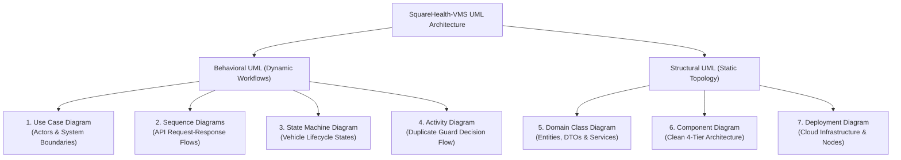
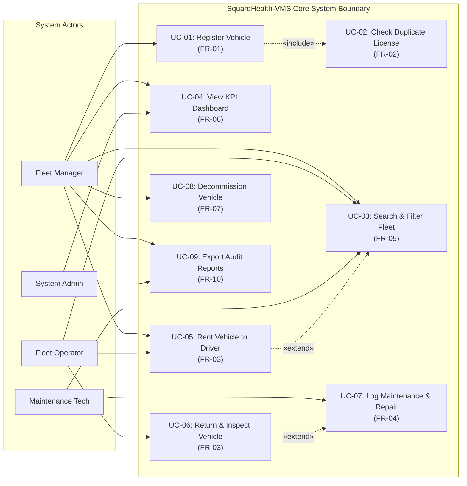
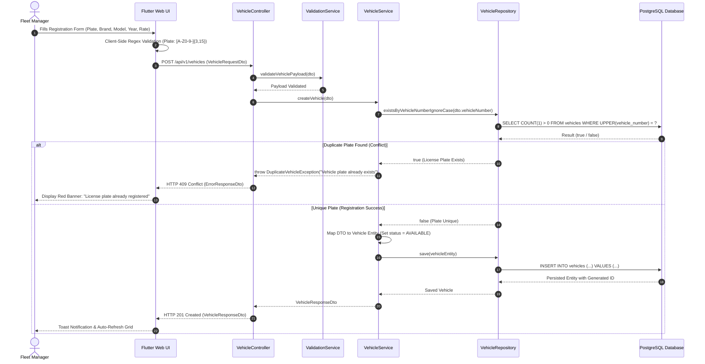
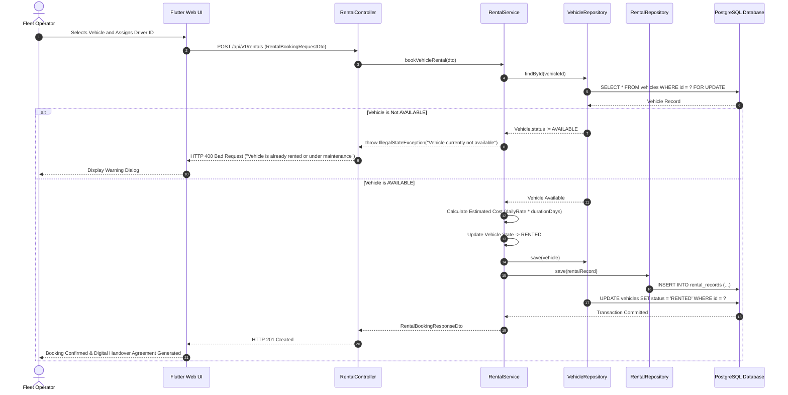
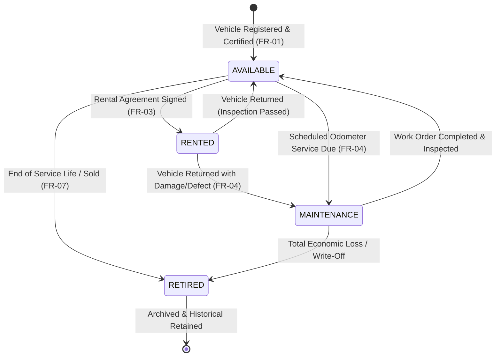
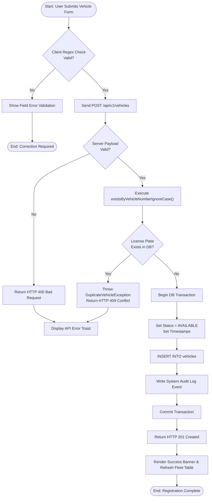
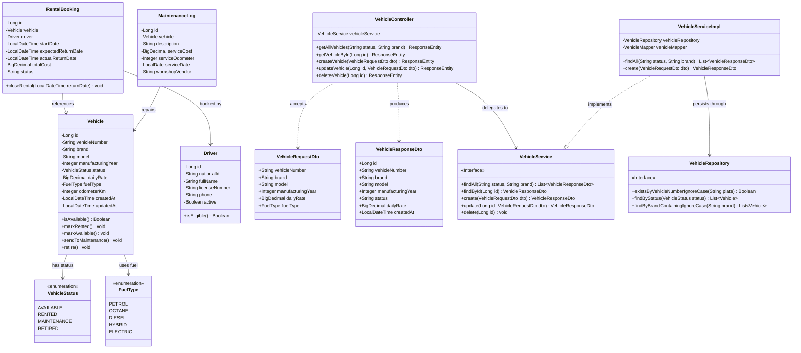
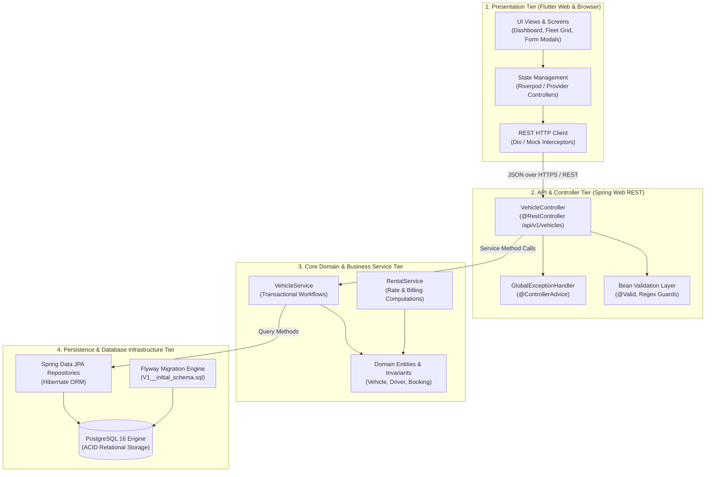
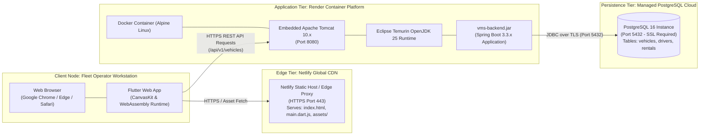

# StarkGroup-VMS — Unified Modeling Language (UML) Architecture Specification

This document provides the formal architectural blueprint and object-oriented modeling suite for the **StarkGroup-VMS (Stark Group Vehicle Management System)**. It bridges the textual requirements defined in [system requirements.md](file:///c:/Users/HP/Documents/GitHub/SquareHealth-VMS/AI_Pair_Programming/System_Requirements/system%20requirements.md) directly into concrete structural, behavioral, and deployment blueprints.

---

## 1. UML Architecture Taxonomy

The system architecture is formalized through two complementary UML modeling pillars:

---

## 2. Behavioral Modeling: System Use Case Diagram

The Use Case Diagram defines external actors and their direct interactions across system boundaries, enforcing the functional requirements (FR-01 through FR-10).

### 2.1 Actors Definition
1. **Fleet Manager**: Primary administrative operator managing fleet assets, registrations, and rental approvals.
2. **Fleet Operator / Staff**: Operational personnel executing daily check-ins, check-outs, and inspection logging.
3. **Maintenance Technician**: Specialized staff logging workshop service items, parts costs, and odometer intervals.
4. **System Administrator**: IT administrator managing user access, security roles, and system audit logs.

### 2.2 System Use Case Model

---

## 3. Behavioral Modeling: Sequence Diagrams

### 3.1 Sequence 1: Vehicle Registration with Duplicate License Plate Guard (FR-01 & FR-02)
This sequence illustrates the end-to-end execution of registering a new corporate vehicle, verifying license plate uniqueness, and handling either `201 Created` or `409 Conflict`.

### 3.2 Sequence 2: Vehicle Rental Allocation Flow (FR-03)
This sequence details renting an available vehicle to a designated corporate driver, computing rental billing, and transitioning entity state.

---

## 4. Behavioral Modeling: Vehicle State Machine Diagram

The State Machine Diagram formalizes all valid lifecycle states and transition guards for the `Vehicle` entity, preventing illegal business operations (e.g., renting a vehicle currently in workshop maintenance).

### State Transition Invariant Table
| Current State | Target State | Triggering Event | Guard Condition |
|---|---|---|---|
| `AVAILABLE` | `RENTED` | `allocateRental()` | Driver license valid, security deposit cleared |
| `RENTED` | `AVAILABLE` | `returnVehicle()` | Inspection passed, zero mechanical faults |
| `RENTED` | `MAINTENANCE` | `reportDamageOnReturn()` | Fault logged, insurance claim initiated |
| `AVAILABLE` | `MAINTENANCE` | `scheduleService()` | Odometer threshold exceeded or periodic inspection |
| `MAINTENANCE` | `AVAILABLE` | `completeWorkOrder()` | Technician sign-off, road test cleared |
| `AVAILABLE` | `RETIRED` | `decommissionVehicle()` | Vehicle age > 10 yrs or salvage decision |

---

## 5. Behavioral Modeling: Activity Diagram

### Duplicate Detection & Registration Decision Flow

---

## 6. Structural Modeling: Domain & Architecture Class Diagram

This class diagram defines the complete domain model, service layer contracts, repository interfaces, and Data Transfer Objects (DTOs) for the Spring Boot backend engine.

---

## 7. Structural Modeling: Clean 4-Tier Component Diagram

The Component Diagram visualizes high cohesion and loose coupling across system layers, enforcing dependency inversion.

---

## 8. Structural Modeling: Production Deployment Diagram

The Deployment Diagram details physical execution environments, network protocols, containerization boundaries, and external ports.

---

## 9. Requirements Traceability Matrix (RTM) to UML Artifacts

| Functional Requirement | Core UML Artifact | Description of Coverage |
|---|---|---|
| **FR-01: Vehicle Registration** | Use Case (`UC-01`), Sequence (`3.1`), Class (`Vehicle`, `VehicleRequestDto`) | Form fields, entity persistence, format regex validation. |
| **FR-02: Duplicate License Plate Guard** | Sequence (`3.1`), Activity Diagram, Repository (`existsByVehicleNumberIgnoreCase`) | Database check, 409 Conflict error envelope. |
| **FR-03: Vehicle Status & Rental** | Use Case (`UC-05`), Sequence (`3.2`), State Machine Diagram | Atomic state transitions between `AVAILABLE` and `RENTED`. |
| **FR-04: Maintenance Work Orders** | Use Case (`UC-07`), State Machine Diagram, Class (`MaintenanceLog`) | Transition to `MAINTENANCE`, expense tracking. |
| **FR-05: Real-Time Fleet Multi-Filter** | Use Case (`UC-03`), Component Diagram | Controller query parameters (`status`, `brand`). |
| **FR-06: Executive Dashboard Metrics** | Use Case (`UC-04`), Component Diagram | Aggregation endpoints for fleet status distribution. |
| **FR-07: Vehicle Retirement** | Use Case (`UC-08`), State Machine Diagram | Terminal state transition to `RETIRED`. |
| **FR-10: System Audit Logging** | Use Case (`UC-09`), Activity Diagram | Audited transaction boundary before commit. |

---

## 10. Summary & Downstream Implementation Directives

1. **For Database Generation**: Use the **Class Diagram** (Section 6) and **State Machine Diagram** (Section 4) to verify columns, types, and check constraints for [STEP_4_DATABASE_SPECIFICATION.md](file:///c:/Users/HP/Documents/GitHub/SquareHealth-VMS/AI_Pair_Programming/query/specifications/STEP_4_DATABASE_SPECIFICATION.md).
2. **For Spring Boot Controllers & Services**: Follow the **Sequence Diagrams** (Section 3) to implement method contracts, exceptions, and DTO mappings for [STEP_5_BACKEND_SPECIFICATION.md](file:///c:/Users/HP/Documents/GitHub/SquareHealth-VMS/AI_Pair_Programming/query/specifications/STEP_5_BACKEND_SPECIFICATION.md).
3. **For Frontend Development**: Bind UI screens and validation alerts according to the **Activity Diagram** (Section 5) and **Component Diagram** (Section 7).
