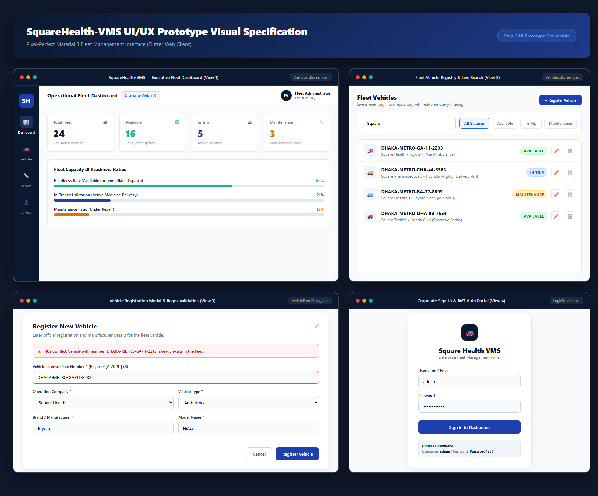
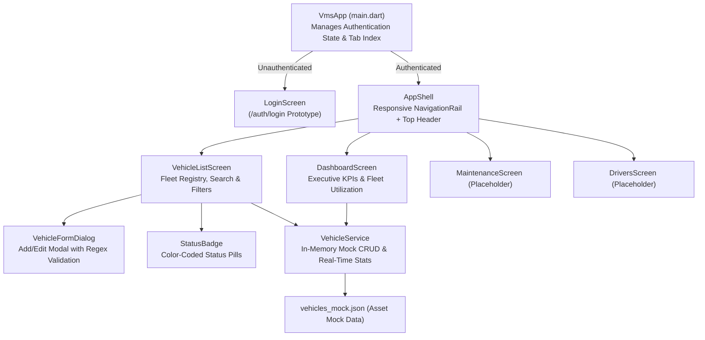

# Technical Specification: Step-3 — Data Contracts, Mock Repository & Interactive UI Prototype

## 1. Document Control & Objective

| Property | Value |
|---|---|
| **Specification ID** | `SPEC-STEP-03` |
| **Title** | Centralized API Data Contracts, Mock Repository & Flutter Web UI Prototype |
| **System** | StarkGroup-VMS (Vehicle Management System) |
| **Target Phase** | Phase 3 (Contract & Prototype Validation) |
| **Status** | Approved & Implemented |

### Purpose
This specification unifies the **Centralized REST API Data Contracts & DTO Schemas**, the **Offline Mock Repository Engine**, and the **Interactive Flutter Web Presentation Layer & Design System** for the StarkGroup-VMS enterprise platform.

---

## 2. Graphical Demonstration of UI Screens

The following visual demo showcases the exact layout, responsive components, color palette, and interactive modal dialogs implemented in the Flutter Web presentation layer:



### Key Visual Interfaces Displayed Above:
1. **Executive Fleet Dashboard (`DashboardScreen.dart` - View 1)**:
   - Deep navy sidebar navigation rail (`#0A192F`) with active tab highlights.
   - 4 High-contrast executive KPI cards: Total Fleet (24), Available (16), In Trip (5), Maintenance (3).
   - Real-time calculated fleet capacity & readiness ratio progress bars (66% Readiness, 21% Active Transit, 13% Workshop).
2. **Fleet Vehicle Registry (`VehicleListScreen.dart` - View 2)**:
   - Live multi-attribute search bar and status filter chips (`All Statuses`, `Available`, `In Trip`, `Maintenance`).
   - Dynamic contextual vehicle category icons (ambulance cross, freight truck, minibus, sedan).
   - Color-coded `StatusBadge` pills and inline action buttons (Edit, Delete with confirmation modal).
3. **Vehicle Registration Modal Dialog (`VehicleFormDialog.dart` - View 3)**:
   - High-visibility `409 Conflict` duplicate prevention alert banner.
   - License plate text input with strict regex enforcement (`^[A-Z0-9-]+$`).
   - Clean dropdown selectors for Operating Company, Vehicle Type, and Initial Fleet Status.
4. **Corporate Authentication Portal (`LoginScreen.dart` - View 4)**:
   - Stark Group branded sign-in card with instant demo credential helper (`admin` / `Password123!`).

---

## 3. Global Architectural Standards & Protocols

* **Base URL**: `/api/v1`
* **Content-Type**: `application/json`
* **Authentication**: `Authorization: Bearer <JWT_TOKEN>` (Public: `/api/v1/auth/**`)
* **Naming Convention**: `camelCase` for all JSON properties, query parameters, and DTO attributes.

---

## 4. Standardized Error Response Envelope

All error responses across both mock simulations and production Spring Boot backend return a uniform `ErrorResponseDto` envelope:

```json
{
  "timestamp": "2026-11-12T03:00:00Z",
  "status": 409,
  "error": "Conflict",
  "message": "Vehicle with number 'DHAKA-METRO-GA-11-2233' already exists in the fleet.",
  "path": "/api/v1/vehicles"
}
```

### Standard Status Codes

| Code | Reason | Description |
|---|---|---|
| `200 OK` | Success | Request succeeded with body. |
| `201 Created` | Created | Resource successfully created. Returns created object with assigned ID. |
| `204 No Content` | Deleted | Resource successfully deleted. Empty response body. |
| `400 Bad Request` | Validation Error | Missing mandatory fields, invalid format, or boundary violation. |
| `401 Unauthorized` | Auth Error | Missing, expired, or invalid Bearer JWT token. |
| `404 Not Found` | Resource Missing | Target entity ID does not exist in the database. |
| `409 Conflict` | Duplicate Record | Uniqueness constraint violation (e.g. duplicate license plate / VIN). |

---

## 5. Endpoints & Data Contracts

### 5.1 Authentication

#### `POST /api/v1/auth/login`
Authenticates a corporate fleet operator.

* **Request Body (`LoginRequestDto`)**:
```json
{
  "username": "admin",
  "password": "Password123!"
}
```
* **Response `200 OK` (`AuthResponseDto`)**:
```json
{
  "token": "eyJhbGciOiJIUzI1NiIsInR5cCI6IkpXVCJ9...",
  "username": "admin",
  "role": "ROLE_ADMIN",
  "name": "Fleet Administrator"
}
```
* **Response `401 Unauthorized`**: Invalid credentials.

---

### 5.2 Vehicle Management

#### `GET /api/v1/vehicles`
Retrieves a list of fleet vehicles with optional filtering.

* **Query Parameters (Optional)**:
  * `status`: Filter by status (`AVAILABLE`, `IN_TRIP`, `MAINTENANCE`)
  * `search`: Case-insensitive search on vehicle number or company
* **Response `200 OK` (`List<VehicleResponseDto>`)**:
```json
[
  {
    "id": 1,
    "vehicleNumber": "DHAKA-METRO-GA-11-2233",
    "company": "Stark Group",
    "type": "Ambulance",
    "brand": "Toyota",
    "model": "HiAce",
    "status": "AVAILABLE"
  },
  {
    "id": 2,
    "vehicleNumber": "DHAKA-METRO-CHA-44-5566",
    "company": "Stark Industries",
    "type": "Delivery Van",
    "brand": "Hyundai",
    "model": "Mighty",
    "status": "IN_TRIP"
  }
]
```

---

#### `POST /api/v1/vehicles`
Registers a new vehicle in the fleet registry.

* **Request Body (`VehicleRequestDto`)**:
```json
{
  "vehicleNumber": "DHAKA-METRO-BA-99-0011",
  "company": "Square Pharma",
  "type": "Microbus",
  "brand": "Toyota",
  "model": "Noah",
  "status": "AVAILABLE"
}
```
* **Validation Rules**:
  * `vehicleNumber`: Required, non-empty, regex `^[A-Z0-9-]+$`.
  * `company`: Required, non-empty.
  * `type`: Required, non-empty.
  * `brand`: Required, non-empty.
  * `model`: Required, non-empty.
  * `status`: Must be one of `AVAILABLE`, `IN_TRIP`, `MAINTENANCE`.
* **Response `201 Created` (`VehicleResponseDto`)**: Returns the created entity with database generated `id`.
* **Response `409 Conflict`**: If `vehicleNumber` already exists in fleet.

---

#### `GET /api/v1/vehicles/{id}`
Retrieves details of a specific vehicle.

* **Path Variable**: `id` (Long)
* **Response `200 OK` (`VehicleResponseDto`)**
* **Response `404 Not Found`**: When no vehicle matches ID.

---

#### `PUT /api/v1/vehicles/{id}`
Updates an existing vehicle record.

* **Path Variable**: `id` (Long)
* **Request Body (`VehicleRequestDto`)**
* **Response `200 OK` (`VehicleResponseDto`)**
* **Response `404 Not Found`**: ID does not exist.
* **Response `409 Conflict`**: If updating `vehicleNumber` to one already taken by another vehicle.

---

#### `DELETE /api/v1/vehicles/{id}`
Removes a vehicle from active fleet registry.

* **Path Variable**: `id` (Long)
* **Response `204 No Content`**
* **Response `404 Not Found`**: When no vehicle matches ID.

---

### 5.3 Dashboard Overview

#### `GET /api/v1/dashboard/stats`
Retrieves aggregated executive KPIs for the fleet overview screen.

* **Response `200 OK` (`DashboardStatsDto`)**:
```json
{
  "totalVehicles": 24,
  "availableVehicles": 16,
  "inTripVehicles": 5,
  "maintenanceVehicles": 3,
  "totalDrivers": 18,
  "activeTrips": 5
}
```

---

## 6. Design System Tokens & Visual Standards

The UI strictly adheres to the **Stark Group Material 3 Enterprise Design System**:

| Token Category | Token Name | Value / Hex Code | Usage |
|---|---|---|---|
| **Primary Palette** | `primaryNavy` | `#0A192F` | Sidebar navigation rail, primary brand elements, headings |
| **Accent Palette** | `corporateBlue` | `#1E40AF` | Action buttons, active navigation indicators, hyperlinks |
| **Status (Available)** | `successGreen` | `#10B981` | Available vehicles badge, dispatch readiness indicators |
| **Status (In Trip)** | `inTripBlue` | `#3B82F6` | Active transit badge, live dispatch indicators |
| **Status (Maintenance)** | `warningAmber` | `#F59E0B` | Workshop repair badge, maintenance alerts |
| **Status (Error/Alert)** | `dangerRed` | `#EF4444` | Form errors, duplicate conflict alert, delete confirmation |
| **Neutrals** | `backgroundLight` | `#F8FAFC` | Page scaffold background |
| **Borders** | `borderSubtle` | `#E2E8F0` | Card borders, table dividers, input field outlines |

---

## 7. Component Architecture & Screen Specifications



---

### 7.1 Authentication Screen (`LoginScreen`)
* **Path**: [`vms-frontend/lib/features/auth/presentation/login_screen.dart`](../vms-frontend/lib/features/auth/presentation/login_screen.dart)
* **Visual Elements**:
  * Centered responsive card (max width 420px) on light slate background.
  * Stark Group enterprise emblem and header typography.
  * Username text field with `Validators.emailOrUsername`.
  * Password text field with visibility toggle and `Validators.password`.
  * Full-width "Sign In to Dashboard" button with simulated network latency indicator.
  * Demo credentials helper card displaying `admin` / `Password123!`.

---

### 7.2 Responsive Navigation Shell (`AppShell`)
* **Path**: [`vms-frontend/lib/shared/widgets/app_shell.dart`](../vms-frontend/lib/shared/widgets/app_shell.dart)
* **Visual Elements**:
  * Fixed-width dark navy `NavigationRail` with corporate logo mark and destination tabs (Dashboard, Vehicles, Maintenance, Drivers).
  * Sign-out icon button at bottom of navigation rail.
  * Top navigation bar with active route title, environment pill badge ("Enterprise Web v1.0 (Step 3 Prototype)"), and operator profile avatar with designation ("Fleet Administrator - Stark Group Logistics HQ").

---

### 7.3 Executive Dashboard (`DashboardScreen`)
* **Path**: [`vms-frontend/lib/features/dashboard/presentation/dashboard_screen.dart`](../vms-frontend/lib/features/dashboard/presentation/dashboard_screen.dart)
* **Visual Elements**:
  * **4 Primary Metric Cards**:
    1. *Total Fleet*: Total count of registered assets (Navy theme).
    2. *Available*: Ready for immediate dispatch (Emerald green theme).
    3. *In Trip*: Active transit vehicles on logistics routes (Electric blue theme).
    4. *Maintenance*: Vehicles undergoing workshop servicing (Amber warning theme).
  * **Fleet Capacity & Utilization Panel**:
    * Linear progress bars rendering real-time calculated percentages for Readiness Rate, In-Transit Utilization, and Maintenance Ratio.
  * **Operations Summary**: Active certified driver headcount and dispatch trip trackers.

---

### 7.4 Fleet Registry & Management (`VehicleListScreen`)
* **Path**: [`vms-frontend/lib/features/vehicles/presentation/vehicle_list_screen.dart`](../vms-frontend/lib/features/vehicles/presentation/vehicle_list_screen.dart)
* **Visual Elements**:
  * Header toolbar with title, subtext, "Refresh" button, and "+ Register Vehicle" primary action button.
  * Filter control card containing:
    * Real-time search field matching license plate, company name, brand, or model.
    * Status filter chips: `ALL`, `AVAILABLE`, `IN_TRIP`, `MAINTENANCE`.
  * Responsive list of vehicle cards displaying:
    * Contextual avatar icon dynamically reflecting vehicle type (ambulance cross, freight truck, minibus, sedan).
    * Bold license plate number alongside color-coded `StatusBadge`.
    * Company name, manufacturer brand, model, and vehicle category tag.
    * Action icons for "Edit Vehicle" and "Remove from Fleet".
  * Delete confirmation modal preventing accidental asset de-registration.

---

### 7.5 Vehicle Registration & Modification Modal (`VehicleFormDialog`)
* **Path**: [`vms-frontend/lib/features/vehicles/presentation/vehicle_form_dialog.dart`](../vms-frontend/lib/features/vehicles/presentation/vehicle_form_dialog.dart)
* **Form Inputs & Validations**:
  1. *Vehicle License Plate Number*:
     * Text field with uppercase transformation.
     * Validated against regex pattern: `^[A-Z0-9-]+$` via `Validators.vehicleNumber`.
     * Minimum 5 characters required.
  2. *Operating Company*:
     * Dropdown selector: `Stark Group`, `Stark Industries`, `Stark Medical`, `Stark Logistics`, `Stark Aerospace`.
  3. *Vehicle Type*:
     * Dropdown selector: `Ambulance`, `Delivery Van`, `Microbus`, `Executive Sedan`, `Cargo Truck`.
  4. *Brand & Model*:
     * Mandatory text inputs (e.g. `Toyota`, `HiAce`).
  5. *Operational Status*:
     * Dropdown selector: `AVAILABLE`, `IN_TRIP`, `MAINTENANCE`.
* **Conflict & Error Banner**:
  * Inline error banner displayed dynamically when attempting to register a duplicate vehicle number (`409 Conflict`).

---

## 8. In-Memory Mock Repository & Service Specification

* **Path**: [`vms-frontend/lib/features/vehicles/services/vehicle_service.dart`](../vms-frontend/lib/features/vehicles/services/vehicle_service.dart)
* **Capabilities**:
  * **Dual-Mode Architecture**: Controlled by `bool useMock`. When `true`, all operations execute against static in-memory cache; when `false`, operations route through `ApiClient` to Spring Boot REST endpoints.
  * **Duplicate Constraint Simulation**: Scans existing mock records on `createVehicle` and `updateVehicle`; throws `ApiException(409, ...)` if license plate already exists.
  * **Dynamic ID Generation**: Auto-increments highest current numeric ID upon creation.
  * **Real-Time Aggregations**: Computes live KPI counts on demand via `getDashboardStats()`.

---

## 9. Verification Checklist

- [x] Client-side regex pattern `^[A-Z0-9-]+$` verified on input fields.
- [x] All 8 mock fleet vehicles render properly in browser.
- [x] Status badge visual variants verified for `AVAILABLE`, `IN_TRIP`, and `MAINTENANCE`.
- [x] In-memory duplicate license plate collision produces HTTP 409 error banner.
- [x] Responsive layout adapts cleanly across window resizing.
- [x] Canonical REST API DTO schemas match backend Java models.

