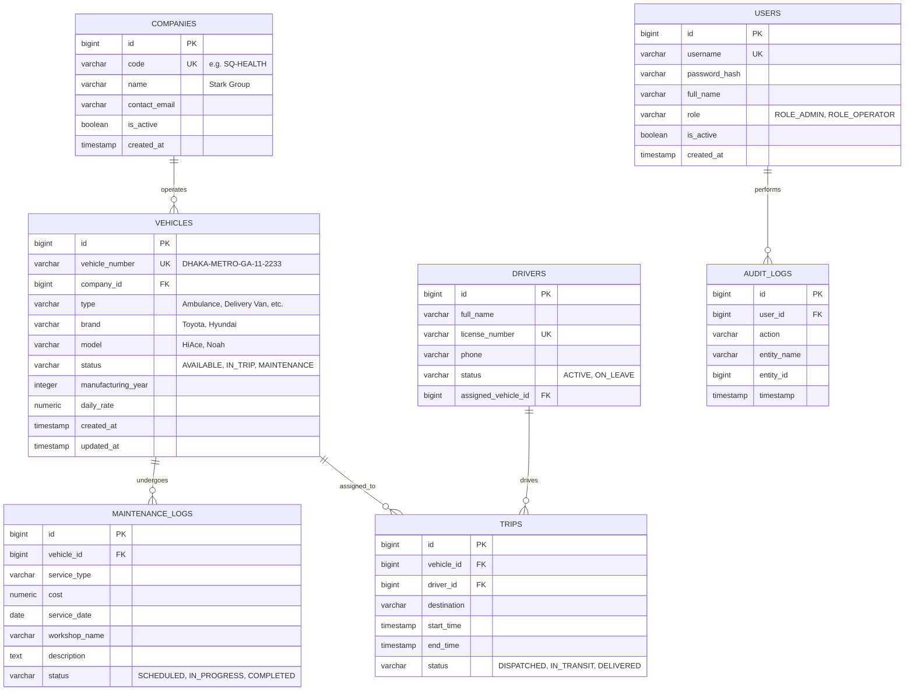

# Technical Specification: Step-4 — Database Architecture, Relational Schema & Migration Engine

## 1. Document Control & Objective

| Property | Value |
|---|---|
| **Specification ID** | `SPEC-STEP-04` |
| **Title** | Relational Database Architecture, DDL Schema & Migration Pipeline Specification |
| **System** | StarkGroup-VMS (Vehicle Management System) |
| **Target Phase** | Phase 4 (Persistent Storage & Data Integrity Foundation) |
| **Status** | Approved Specification |

### Purpose
This specification formalizes the **Relational Database Topology**, the **Data Dictionary**, **Storage-Level Constraint Invariants**, and the **Version-Controlled Flyway Migration Pipeline** for the PostgreSQL database underpinning the StarkGroup-VMS platform.

---

## 2. Entity-Relationship (ER) Architecture

The relational schema maps 1-to-1 with the validated Step-3 API data contracts while establishing strict referential integrity across corporate entities, fleet vehicles, maintenance logs, drivers, and authentication users:



---

## 3. Relational Data Dictionary

### 3.1 Table: `companies`
Represents the operating subsidiaries within the Square conglomerate.

| Column | Type | Constraints | Description |
|---|---|---|---|
| `id` | `BIGSERIAL` | `PRIMARY KEY` | Unique synthetic identifier. |
| `code` | `VARCHAR(30)` | `NOT NULL, UNIQUE` | Unique corporate code (e.g., `SQ-HEALTH`). |
| `name` | `VARCHAR(100)` | `NOT NULL` | Registered entity name (e.g., `Stark Group`). |
| `contact_email` | `VARCHAR(100)` | `NOT NULL` | Fleet coordinator email. |
| `is_active` | `BOOLEAN` | `NOT NULL DEFAULT true` | Soft-deletion and operational status flag. |
| `created_at` | `TIMESTAMP WITH TIME ZONE` | `NOT NULL DEFAULT CURRENT_TIMESTAMP` | Audit timestamp. |

---

### 3.2 Table: `vehicles`
The core fleet registry holding real-world commercial vehicles and ambulances.

| Column | Type | Constraints | Description |
|---|---|---|---|
| `id` | `BIGSERIAL` | `PRIMARY KEY` | Synthetic database sequence ID. |
| `vehicle_number` | `VARCHAR(50)` | `NOT NULL, UNIQUE` | License plate number (Regex: `^[A-Z0-9-]+$`). |
| `company_id` | `BIGINT` | `NOT NULL, REFERENCES companies(id) ON DELETE RESTRICT` | Owning corporate subsidiary. |
| `type` | `VARCHAR(50)` | `NOT NULL` | Category (`Ambulance`, `Delivery Van`, `Microbus`, `Executive Sedan`). |
| `brand` | `VARCHAR(50)` | `NOT NULL` | Manufacturer (e.g. `Toyota`, `Hyundai`, `Nissan`). |
| `model` | `VARCHAR(50)` | `NOT NULL` | Vehicle model (e.g. `HiAce`, `Mighty`, `Civic`). |
| `status` | `VARCHAR(20)` | `NOT NULL DEFAULT 'AVAILABLE'` | Enforced domain enum (`AVAILABLE`, `IN_TRIP`, `MAINTENANCE`). |
| `manufacturing_year`| `INTEGER` | `NULL` | Year of vehicle assembly. |
| `daily_rate` | `NUMERIC(10, 2)` | `NULL DEFAULT 0.00` | Operational charge rate. |
| `created_at` | `TIMESTAMP WITH TIME ZONE` | `NOT NULL DEFAULT CURRENT_TIMESTAMP` | Row creation timestamp. |
| `updated_at` | `TIMESTAMP WITH TIME ZONE` | `NOT NULL DEFAULT CURRENT_TIMESTAMP` | Last updated timestamp. |

---

### 3.3 Table: `drivers`
Certified operators assigned to transport duties.

| Column | Type | Constraints | Description |
|---|---|---|---|
| `id` | `BIGSERIAL` | `PRIMARY KEY` | Unique driver ID. |
| `full_name` | `VARCHAR(100)` | `NOT NULL` | Driver legal name. |
| `license_number` | `VARCHAR(50)` | `NOT NULL, UNIQUE` | National driver license ID. |
| `phone` | `VARCHAR(25)` | `NOT NULL` | Contact phone number. |
| `status` | `VARCHAR(20)` | `NOT NULL DEFAULT 'ACTIVE'` | Operational status (`ACTIVE`, `ON_LEAVE`, `SUSPENDED`). |
| `assigned_vehicle_id` | `BIGINT` | `NULL, REFERENCES vehicles(id) ON DELETE SET NULL` | Primary assigned vehicle. |

---

### 3.4 Table: `maintenance_logs`
Periodic servicing, oil changes, and mechanical repairs.

| Column | Type | Constraints | Description |
|---|---|---|---|
| `id` | `BIGSERIAL` | `PRIMARY KEY` | Unique log entry ID. |
| `vehicle_id` | `BIGINT` | `NOT NULL, REFERENCES vehicles(id) ON DELETE CASCADE` | Vehicle undergoing maintenance. |
| `service_type` | `VARCHAR(100)` | `NOT NULL` | Category (`Brake Inspection`, `Engine Tuning`, `Oil Change`). |
| `cost` | `NUMERIC(10, 2)` | `NOT NULL DEFAULT 0.00` | Repair invoice amount. |
| `service_date` | `DATE` | `NOT NULL` | Date service performed. |
| `workshop_name` | `VARCHAR(150)` | `NOT NULL` | Name of servicing garage/vendor. |
| `description` | `TEXT` | `NULL` | Technical mechanic notes. |
| `status` | `VARCHAR(20)` | `NOT NULL DEFAULT 'COMPLETED'` | Status (`SCHEDULED`, `IN_PROGRESS`, `COMPLETED`). |

---

### 3.5 Table: `users`
System operators, fleet managers, and administrators.

| Column | Type | Constraints | Description |
|---|---|---|---|
| `id` | `BIGSERIAL` | `PRIMARY KEY` | Unique account ID. |
| `username` | `VARCHAR(50)` | `NOT NULL, UNIQUE` | Operator username (e.g. `admin`). |
| `password_hash` | `VARCHAR(255)` | `NOT NULL` | BCrypt/Argon2 encrypted password. |
| `full_name` | `VARCHAR(100)` | `NOT NULL` | Display name (e.g. `Fleet Administrator`). |
| `role` | `VARCHAR(30)` | `NOT NULL DEFAULT 'ROLE_OPERATOR'` | Security role (`ROLE_ADMIN`, `ROLE_OPERATOR`). |
| `is_active` | `BOOLEAN` | `NOT NULL DEFAULT true` | Account active flag. |
| `created_at` | `TIMESTAMP WITH TIME ZONE` | `NOT NULL DEFAULT CURRENT_TIMESTAMP` | Account creation timestamp. |

---

## 4. Storage-Level Invariants & Performance Indexes

### 4.1 Invariant Rules & Constraints
1. **License Plate Uniqueness**:
   ```sql
   ALTER TABLE vehicles ADD CONSTRAINT uq_vehicles_vehicle_number UNIQUE (vehicle_number);
   ```
2. **Lifecycle State Check Constraint**:
   ```sql
   ALTER TABLE vehicles ADD CONSTRAINT chk_vehicles_status CHECK (status IN ('AVAILABLE', 'IN_TRIP', 'MAINTENANCE'));
   ```
3. **Vehicle License Plate Regex Check**:
   ```sql
   ALTER TABLE vehicles ADD CONSTRAINT chk_vehicles_plate_format CHECK (vehicle_number ~ '^[A-Z0-9-]+$');
   ```

### 4.2 Optimized B-Tree Query Indexes
To guarantee sub-10ms response times for the high-frequency search and filter queries specified in Step-3:
* **Status Filtering**: `CREATE INDEX idx_vehicles_status ON vehicles (status);`
* **Company Scoping**: `CREATE INDEX idx_vehicles_company_id ON vehicles (company_id);`
* **Composite Query Optimization**: `CREATE INDEX idx_vehicles_comp_stat ON vehicles (company_id, status);`
* **Trigram / Substring Search**: `CREATE INDEX idx_vehicles_number_pattern ON vehicles (vehicle_number varchar_pattern_ops);`

---

## 5. Version-Controlled Migration Pipeline (Flyway)

### 5.1 Architecture & Directory Standard
Database DDL scripts are maintained as code inside the backend repository:
`vms-backend/src/main/resources/db/migration/`

```
db/migration/
├── V1__initial_schema.sql         # DDL: Tables, constraints, foreign keys, indexes
├── V2__seed_baseline_data.sql     # DML: Company subsidiaries & Step-3 validated mock vehicles
└── V3__create_user_accounts.sql   # DML: Seed default admin operator account
```

### 5.2 Canonical DDL Script: `V1__initial_schema.sql`

```sql
-- Flyway Migration: V1__initial_schema.sql
-- Description: Create baseline schema for StarkGroup-VMS

CREATE TABLE companies (
    id BIGSERIAL PRIMARY KEY,
    code VARCHAR(30) NOT NULL UNIQUE,
    name VARCHAR(100) NOT NULL,
    contact_email VARCHAR(100) NOT NULL,
    is_active BOOLEAN NOT NULL DEFAULT true,
    created_at TIMESTAMP WITH TIME ZONE NOT NULL DEFAULT CURRENT_TIMESTAMP
);

CREATE TABLE vehicles (
    id BIGSERIAL PRIMARY KEY,
    vehicle_number VARCHAR(50) NOT NULL UNIQUE,
    company_id BIGINT NOT NULL REFERENCES companies(id) ON DELETE RESTRICT,
    type VARCHAR(50) NOT NULL,
    brand VARCHAR(50) NOT NULL,
    model VARCHAR(50) NOT NULL,
    status VARCHAR(20) NOT NULL DEFAULT 'AVAILABLE',
    manufacturing_year INTEGER,
    daily_rate NUMERIC(10, 2) DEFAULT 0.00,
    created_at TIMESTAMP WITH TIME ZONE NOT NULL DEFAULT CURRENT_TIMESTAMP,
    updated_at TIMESTAMP WITH TIME ZONE NOT NULL DEFAULT CURRENT_TIMESTAMP,
    CONSTRAINT chk_vehicles_status CHECK (status IN ('AVAILABLE', 'IN_TRIP', 'MAINTENANCE')),
    CONSTRAINT chk_vehicles_plate_format CHECK (vehicle_number ~ '^[A-Z0-9-]+$')
);

CREATE TABLE drivers (
    id BIGSERIAL PRIMARY KEY,
    full_name VARCHAR(100) NOT NULL,
    license_number VARCHAR(50) NOT NULL UNIQUE,
    phone VARCHAR(25) NOT NULL,
    status VARCHAR(20) NOT NULL DEFAULT 'ACTIVE',
    assigned_vehicle_id BIGINT REFERENCES vehicles(id) ON DELETE SET NULL,
    CONSTRAINT chk_drivers_status CHECK (status IN ('ACTIVE', 'ON_LEAVE', 'SUSPENDED'))
);

CREATE TABLE maintenance_logs (
    id BIGSERIAL PRIMARY KEY,
    vehicle_id BIGINT NOT NULL REFERENCES vehicles(id) ON DELETE CASCADE,
    service_type VARCHAR(100) NOT NULL,
    cost NUMERIC(10, 2) NOT NULL DEFAULT 0.00,
    service_date DATE NOT NULL,
    workshop_name VARCHAR(150) NOT NULL,
    description TEXT,
    status VARCHAR(20) NOT NULL DEFAULT 'COMPLETED',
    CONSTRAINT chk_maintenance_status CHECK (status IN ('SCHEDULED', 'IN_PROGRESS', 'COMPLETED'))
);

CREATE TABLE users (
    id BIGSERIAL PRIMARY KEY,
    username VARCHAR(50) NOT NULL UNIQUE,
    password_hash VARCHAR(255) NOT NULL,
    full_name VARCHAR(100) NOT NULL,
    role VARCHAR(30) NOT NULL DEFAULT 'ROLE_OPERATOR',
    is_active BOOLEAN NOT NULL DEFAULT true,
    created_at TIMESTAMP WITH TIME ZONE NOT NULL DEFAULT CURRENT_TIMESTAMP
);

-- Performance Indexes
CREATE INDEX idx_vehicles_status ON vehicles (status);
CREATE INDEX idx_vehicles_company_id ON vehicles (company_id);
CREATE INDEX idx_vehicles_comp_stat ON vehicles (company_id, status);
CREATE INDEX idx_vehicles_number_pattern ON vehicles (vehicle_number varchar_pattern_ops);
CREATE INDEX idx_maintenance_vehicle_id ON maintenance_logs (vehicle_id);
```

---

### 5.3 Canonical Seed Script: `V2__seed_baseline_data.sql`

```sql
-- Flyway Migration: V2__seed_baseline_data.sql
-- Description: Seed initial corporate subsidiaries and mock-validated fleet assets

INSERT INTO companies (id, code, name, contact_email) VALUES
(1, 'SQ-HEALTH', 'Stark Group', 'transport@starkgroup.com'),
(2, 'SQ-PHARMA', 'Stark Industries', 'logistics@squarepharma.com.bd'),
(3, 'SQ-HOSP', 'Stark Medical', 'ambulance@squarehospital.com'),
(4, 'SQ-TEXT', 'Stark Logistics', 'fleet@squaretextiles.com.bd'),
(5, 'SQ-TOIL', 'Stark Aerospace', 'supply@squaretoiletries.com.bd');

INSERT INTO vehicles (id, vehicle_number, company_id, type, brand, model, status) VALUES
(1, 'DHAKA-METRO-GA-11-2233', 1, 'Ambulance', 'Toyota', 'HiAce', 'AVAILABLE'),
(2, 'DHAKA-METRO-CHA-44-5566', 2, 'Delivery Van', 'Hyundai', 'Mighty', 'IN_TRIP'),
(3, 'DHAKA-METRO-BA-77-8899', 3, 'Microbus', 'Toyota', 'Noah', 'MAINTENANCE'),
(4, 'DHAKA-METRO-GHA-12-3456', 1, 'Ambulance', 'Nissan', 'Caravan', 'AVAILABLE'),
(5, 'DHAKA-METRO-DHA-98-7654', 4, 'Executive Sedan', 'Honda', 'Civic', 'AVAILABLE'),
(6, 'DHAKA-METRO-JA-55-6677', 2, 'Delivery Van', 'Isuzu', 'N-Series', 'IN_TRIP'),
(7, 'DHAKA-METRO-HA-33-4455', 3, 'Ambulance', 'Mercedes-Benz', 'Sprinter', 'AVAILABLE'),
(8, 'DHAKA-METRO-KA-88-9900', 1, 'Microbus', 'Toyota', 'HiAce Commuter', 'MAINTENANCE');

-- Reset sequences to prevent key collision on subsequent manual inserts
SELECT setval('companies_id_seq', (SELECT MAX(id) FROM companies));
SELECT setval('vehicles_id_seq', (SELECT MAX(id) FROM vehicles));
```

---

## 6. Verification & Test Acceptance Criteria

1. **Uniqueness Collision Test**: Attempting to insert a vehicle with an existing license plate must raise a PostgreSQL constraint violation `23505 (unique_violation)`.
2. **Enum Integrity Test**: Attempting to insert `status = 'FLYING'` must be rejected by check constraint `chk_vehicles_status`.
3. **Format Integrity Test**: Attempting to insert `vehicle_number = 'dhaka metro ga 11'` must be rejected by check constraint `chk_vehicles_plate_format`.
4. **Referential Integrity Test**: Deleting a company that currently has registered vehicles must be blocked with `ON DELETE RESTRICT`.
5. **Idempotent Boot Test**: Flyway migration must execute cleanly on both clean local Docker containers and cloud PostgreSQL instances without manual intervention.

