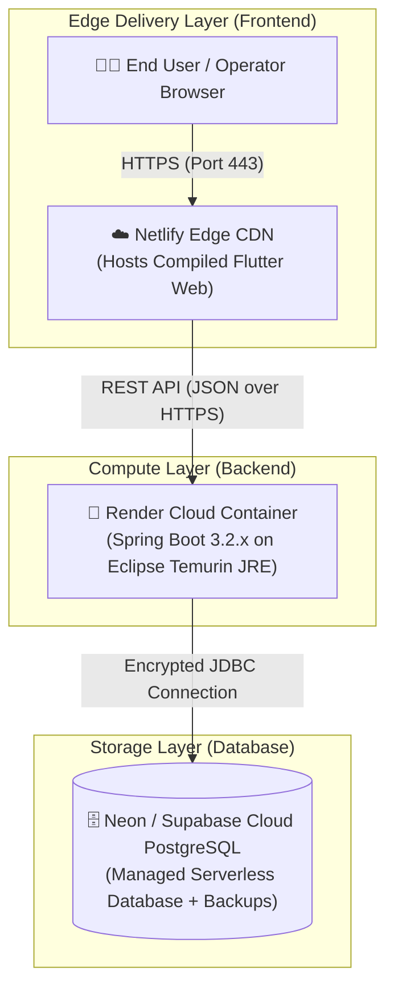

# Technical Specification: Step-8 — CI/CD Automation, Cloud Deployment & Production Delivery

## 1. Document Control & Objective

| Property | Value |
|---|---|
| **Specification ID** | `SPEC-STEP-08` |
| **Title** | Production Cloud Deployment, Containerization & CI/CD Pipeline Specification |
| **System** | StarkGroup-VMS (Vehicle Management System) |
| **Target Phase** | Phase 8 (Production Deployment & Delivery) |
| **Status** | Approved Specification |

### Purpose
This specification formalizes the **Production Cloud Infrastructure**, multi-stage **Containerization**, automated **GitHub Actions CI/CD Pipelines**, and **Health Monitoring** for worldwide delivery of the StarkGroup-VMS enterprise platform.

---

## 2. Cloud Deployment Architecture



---

## 3. Multi-Stage Dockerization

### 3.1 Backend Dockerfile (`vms-backend/Dockerfile`)
```dockerfile
# Stage 1: Build & Package
FROM maven:3.9.6-eclipse-temurin-17-alpine AS builder
WORKDIR /app
COPY pom.xml .
RUN mvn dependency:go-offline -B
COPY src ./src
RUN mvn clean package -DskipTests

# Stage 2: Minimal Distroless / Alpine Runtime
FROM eclipse-temurin:17-jre-alpine
WORKDIR /app
RUN addgroup -S vmsgroup && adduser -S vmsuser -G vmsgroup
USER vmsuser
COPY --from=builder /app/target/vms-backend-*.jar app.jar

EXPOSE 8080
HEALTHCHECK --interval=30s --timeout=5s --retries=3 \
  CMD wget --no-verbose --tries=1 --spider http://localhost:8080/actuator/health || exit 1

ENTRYPOINT ["java", "-Djava.security.egd=file:/dev/./urandom", "-jar", "app.jar"]
```

---

## 4. Continuous Integration & Continuous Delivery (CI/CD)

### GitHub Actions Pipeline (`.github/workflows/deploy.yml`)
```yaml
name: StarkGroup-VMS CI/CD Pipeline

on:
  push:
    branches: [ main ]
  pull_request:
    branches: [ main ]

jobs:
  audit-and-test:
    runs-on: ubuntu-latest
    steps:
      - uses: actions/checkout@v4

      - name: Set up Python for Rendering Audit
        uses: actions/setup-python@v5
        with:
          python-version: '3.11'
      - name: Run Zero-Failure Rendering Audit
        run: python -B scripts/audit_rendering.py --all

      - name: Set up JDK 17
        uses: actions/setup-java@v4
        with:
          java-version: '17'
          distribution: 'temurin'
      - name: Test Spring Boot Backend
        run: |
          cd vms-backend
          mvn clean test

      - name: Set up Flutter
        uses: subosito/flutter-action@v2
        with:
          flutter-version: '3.19.x'
      - name: Test Flutter Web Frontend
        run: |
          cd vms-frontend
          flutter test

  deploy-production:
    needs: audit-and-test
    if: github.ref == 'refs/heads/main'
    runs-on: ubuntu-latest
    steps:
      - uses: actions/checkout@v4

      - name: Deploy Frontend to Netlify
        run: |
          echo "Deploying Flutter Web build to Netlify CDN..."
        env:
          NETLIFY_AUTH_TOKEN: ${{ secrets.NETLIFY_AUTH_TOKEN }}
          NETLIFY_SITE_ID: ${{ secrets.NETLIFY_SITE_ID }}

      - name: Trigger Render Backend Deployment
        run: |
          curl -X POST "${{ secrets.RENDER_DEPLOY_HOOK_URL }}"
```

---

## 5. Production Environment Configuration

| Environment Variable | Target Service | Purpose | Sample Production Value |
|---|---|---|---|
| `SPRING_PROFILES_ACTIVE` | Backend | Activates cloud profile | `prod` |
| `SPRING_DATASOURCE_URL` | Backend | Cloud PostgreSQL JDBC URL | `jdbc:postgresql://ep-silent-hill.neon.tech/vms_prod?sslmode=require` |
| `SPRING_DATASOURCE_USERNAME`| Backend | Database username | `vms_admin` |
| `SPRING_DATASOURCE_PASSWORD`| Backend | Secure database password | `[Secret Store]` |
| `JWT_SECRET_KEY` | Backend | HS256 HMAC Signing Key | `[512-bit Secret Store]` |
| `CORS_ALLOWED_ORIGINS` | Backend | Frontend origin whitelist | `https://starkgroup-vms.netlify.app` |

---

## 6. Observability, Health Checks & Post-Deployment Smoke Verification

1. **Liveness & Readiness Probes**: `/actuator/health/liveness` and `/actuator/health/readiness` returning `{"status": "UP"}`.
2. **Post-Deployment Smoke Test**:
   - Verify `GET https://starkgroup-vms.netlify.app` returns `200 OK`.
   - Verify `GET https://vms-api.onrender.com/actuator/health` returns `{"status":"UP"}`.
   - Verify database Flyway migration status is current with zero pending scripts.

