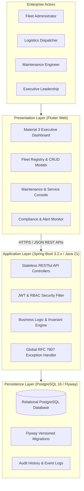
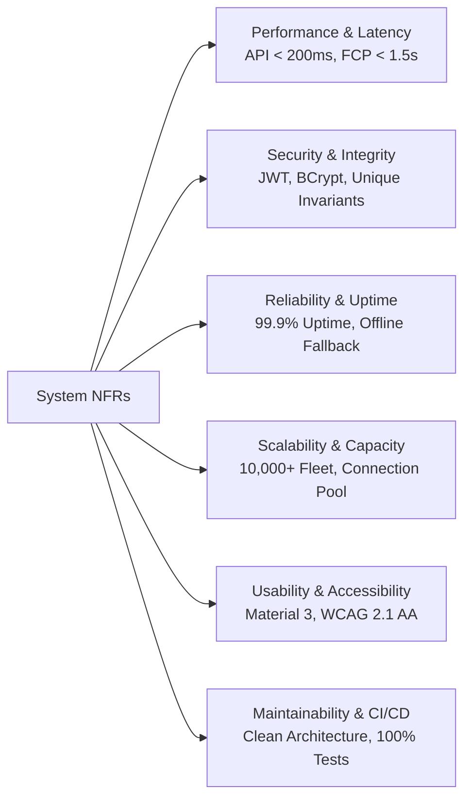

# StarkGroup-VMS — Comprehensive Project Requirements Specification

This document provides the definitive, comprehensive **Functional Requirements (FR)** and **Non-Functional Requirements (NFR)** for **StarkGroup-VMS** (Stark Group Vehicle Management System), an enterprise full-stack fleet operations platform.

---

## 1. Executive Summary & System Vision

### 1.1 Organizational Context
**Stark Group** is a multi-sector enterprise operating a large corporate fleet across diverse subsidiaries, including **Stark Group Ltd.**, **Stark Industries**, **Stark Logistics**, **Stark Medical**, and **Stark Aerospace**. The fleet encompasses diverse vehicle classifications:
- Emergency ambulances and mobile ICU units
- Heavy logistics delivery vans and refrigerated cold-chain cargo trucks
- Employee transport microbuses and shuttles
- Executive hybrid sedans
- Rapid-dispatch utility motorcycles

### 1.2 Core Problem Statement
Prior to the implementation of StarkGroup-VMS, fleet operations were managed using fragmented, manual spreadsheets, physical logbooks, and disparate departmental registries. This caused:
- **Duplicate Vehicle Records**: Unsynchronized registries resulted in duplicate vehicle plates registered under different departments or subsidiaries.
- **Compliance & Legal Vulnerabilities**: Expired fitness certificates, tax tokens, route permits, and commercial insurance policies went unnoticed, leading to traffic penalties and impoundments.
- **Untracked Maintenance & Escalating Costs**: Lack of preventative maintenance schedules resulted in catastrophic roadside breakdowns, unmonitored vendor billing, and reduced asset lifecycle.
- **Operational Inefficiencies**: Dispatchers lacked real-time visibility into vehicle availability, fuel reserves, driver assignments, and fleet health.

### 1.3 System Vision & Objectives
StarkGroup-VMS establishes a unified, cloud-ready, full-stack digital management system serving as the **single source of truth** for all fleet assets, drivers, documents, maintenance events, and executive operational KPIs.



---

## 2. System Architecture & Boundaries

StarkGroup-VMS is built upon a decoupled, multi-tier architecture engineered for high reliability, responsiveness, and horizontal scalability:

| Tier | Technology Stack | Core Responsibilities |
|---|---|---|
| **Client Tier** | Flutter Web (Dart SDK 3.x) | Material 3 responsive UI, client-side routing, dual-mode network service (`useMock` toggle), form regex validations, and optimistic UI updates. |
| **Application Tier** | Java 21 LTS & Spring Boot 3.2.x | RESTful JSON endpoints, JWT stateless token authentication, role-based method authorization, domain invariant enforcement, and transaction orchestration. |
| **Data Tier** | PostgreSQL 16 (H2 dev) & Spring Data JPA / Hibernate | ACID-compliant relational persistence, Flyway version-controlled migrations (`V1`, `V2`), foreign key integrity, and B-Tree indexing. |
| **Orchestration & CI/CD** | Docker Compose, Docker Multi-Stage, GitHub Actions | Containerized fleet execution, Nginx web hosting, automated build/test validation pipelines. |

---

## 3. Comprehensive Functional Requirements (FR)

### FR-01: Authentication, Session Management & RBAC
- **FR-01.1: Stateless JWT Authentication**: The system shall provide secure authentication via `POST /api/v1/auth/login`. Upon valid credential verification, the backend shall return a signed HMAC-SHA256 JWT bearer token along with user identity and authorization claims.
- **FR-01.2: Role-Based Access Control (RBAC)**: The system shall enforce four distinct authorization roles:
  1. `ADMIN`: Full read/write/delete privileges across all companies, vehicles, users, and audit logs.
  2. `FLEET_MANAGER`: Privilege to register, update, schedule maintenance, and assign drivers to vehicles within their assigned subsidiary.
  3. `DISPATCHER`: Privilege to view fleet status, update daily operational statuses (`AVAILABLE`, `ON_TRIP`), and record fuel/mileage.
  4. `DRIVER`: Read-only access to assigned vehicle details, assigned route, and scheduled maintenance.
- **FR-01.3: Credential Security**: Passwords must be hashed using the BCrypt algorithm with a cost factor of `≥ 10`. Plaintext passwords shall never be logged, transmitted in error messages, or stored in persistent storage.
- **FR-01.4: Session Invalidation & Logout**: The client application must provide explicit logout functionality that purges local tokens, terminates session state, and redirects the user to the login portal.

---

### FR-02: Multi-Tenant Corporate Fleet Structure
- **FR-02.1: Subsidiary Fleet Isolation**: The system shall support multi-tenant operational isolation across Stark Group subsidiary companies:
  - `Stark Group Ltd.` (Corporate Headquarters & Central Administration)
  - `Stark Industries` (Industrial & Manufacturing Operations)
  - `Stark Logistics` (Freight, Warehousing & Supply Chain Fleet)
  - `Stark Medical` (Emergency Response Ambulances & Clinical Logistics)
  - `Stark Aerospace` (Airport Ground Support & Precision Cargo)
- **FR-02.2: Company Registry Management**: The system shall track subsidiary metadata including Company Code (e.g., `STK-LOG`), HQ Address, Contact Email, Phone, and Active Status.
- **FR-02.3: Cross-Subsidiary Aggregation**: System Administrators shall have cross-company visibility to aggregate fleet statistics while maintaining company-level data segregation for subsidiary dispatchers.

---

### FR-03: Vehicle Registry & Master Data Management (CRUD)
- **FR-03.1: Vehicle Attributes Specification**: Each registered vehicle must maintain the following mandatory and optional attributes:
  - `id`: Unique database-generated primary key (64-bit BigInt / Long).
  - `vehicleNumber`: Unique alphanumeric license plate string (e.g., `"STK-DH-1001"`, `"DHA-GA-11-2045"`).
  - `company`: Subsidiary organization name (e.g., `"Stark Group Logistics"`).
  - `type`: Vehicle category (`"Ambulance"`, `"Logistics Van"`, `"Executive Sedan"`, `"Microbus"`, `"Motorcycle"`).
  - `brand`: Manufacturer name (e.g., `"Toyota"`, `"Mercedes-Benz"`, `"Isuzu"`, `"Hyundai"`).
  - `model`: Specific model designation (e.g., `"HiAce Emergency ICU"`, `"Sprinter"`, `"NPR Cold Chain"`).
  - `manufacturingYear`: Four-digit calendar year (`≥ 1990`, `≤ Current Year + 1`).
  - `status`: Operational state (`"AVAILABLE"`, `"ACTIVE"`, `"ON_TRIP"`, `"MAINTENANCE"`, `"RETIRED"`).
  - `fuelLevel`: Integer percentage (`0 ≤ fuelLevel ≤ 100`).
  - `fuelCapacity`: Fuel tank capacity in liters (decimal value > 0).
  - `mileage`: Cumulative odometer reading in kilometers (`≥ 0.0`).
  - `assignedDriver`: Name of currently assigned certified driver (optional/nullable).
  - `department`: Internal operating department (e.g., `"Emergency Response Hub"`, `"Pharma Supply Chain"`).

- **FR-03.2: Vehicle Creation (`POST /api/v1/vehicles`)**:
  - The client shall present a Material 3 dialog with validation feedback.
  - The backend shall validate all mandatory fields, verify uniqueness, persist the entity, and return HTTP `201 Created` with the newly assigned entity ID.
- **FR-03.3: Vehicle Fleet Retrieval (`GET /api/v1/vehicles`)**:
  - Retrieve registered fleet vehicles supporting client-side and server-side filtering by company, vehicle type, and operational status.
  - Results must be delivered as structured JSON arrays conforming to `VehicleResponseDto`.
- **FR-03.4: Single Vehicle Lookup (`GET /api/v1/vehicles/{id}`)**:
  - Fetch complete details for a specific vehicle by primary key ID. If the ID does not exist, return HTTP `404 Not Found`.
- **FR-03.5: Vehicle Modification (`PUT /api/v1/vehicles/{id}`)**:
  - Allow authorized personnel to update vehicle specifications, company, model, status, driver, and fuel levels.
  - If the vehicle number is modified, it must be validated against the uniqueness rule. Return HTTP `200 OK` on success.
- **FR-03.6: Safe Decommissioning / Deletion (`DELETE /api/v1/vehicles/{id}`)**:
  - Deletion must require an explicit confirmation modal on the client interface.
  - The backend shall verify referential integrity (e.g., active trip checks) before deletion and return HTTP `200 OK` or `204 No Content`.

---

### FR-04: Mandatory Invariant — Duplicate Vehicle License Plate Prevention
- **FR-04.1: Business Rule Invariant**: A vehicle license plate (`vehicleNumber`) uniquely identifies a physical road transport asset. Under no circumstances may two vehicle records exist with the same license plate, regardless of company or department.
- **FR-04.2: Triple-Layer Enforcement Architecture**:
  1. **Application Service Layer**: `VehicleServiceImpl` executes an explicit pre-query `existsByVehicleNumber(dto.getVehicleNumber())`. If true, execution halts immediately and throws `DuplicateVehicleException`.
  2. **Database Persistence Layer**: The database schema strictly enforces a unique B-Tree index: `CONSTRAINT uq_vehicles_vehicle_number UNIQUE (vehicle_number)`.
  3. **Global Exception Mapping**: `GlobalExceptionHandler` intercepts `DuplicateVehicleException` and database constraint violations, translating them into HTTP `409 Conflict` containing a standardized error response:
     ```json
     {
       "timestamp": "2026-11-15T06:40:00.000",
       "status": 409,
       "error": "Conflict",
       "message": "Vehicle with number 'STK-DH-1001' already exists.",
       "path": "/api/v1/vehicles"
     }
     ```
  4. **Client-Side Notification**: The Flutter Web frontend must trap HTTP 409 and render an inline error banner on the form without closing the modal or discarding user inputs.

---

### FR-05: Executive Analytics Dashboard & Fleet Statistics
- **FR-05.1: Real-Time Aggregate KPI Metrics**: The system shall compute real-time fleet metrics via `GET /api/v1/dashboard/stats`:
  - `totalVehicles`: Grand total of all registered fleet assets.
  - `activeVehicles`: Count of vehicles currently marked `ACTIVE` or `ON_TRIP`.
  - `maintenanceVehicles`: Count of vehicles currently undergoing servicing or repairs (`MAINTENANCE`).
  - `availableVehicles`: Count of vehicles unassigned and ready for immediate deployment (`AVAILABLE`).
  - `fleetEfficiency`: Aggregate operational efficiency rating (e.g., average km per liter or uptime percentage).
  - `fuelAlerts`: Total count of vehicles operating with critical fuel reserves (`≤ 20%`).
- **FR-05.2: Instant UI Reactivity**: Dashboard KPI cards must automatically recalculate whenever vehicles are added, updated, status-toggled, or deleted.

---

### FR-06: Driver Management & Dynamic Vehicle Assignment
- **FR-06.1: Driver Registry**: Maintain driver records including Full Name, Commercial Driver License (CDL) Number, License Category, Expiry Date, Contact Phone, and Medical Clearance Status.
- **FR-06.2: Single-Active-Assignment Invariant**: A driver cannot be simultaneously assigned to more than one vehicle currently marked `ON_TRIP` or `ACTIVE`.
- **FR-06.3: Assignment Audit Trail**: Any change to `assignedDriver` must record the previous driver, new driver, timestamp, and the user who authorized the change.

---

### FR-07: Vehicle Compliance & Document Expiry Tracking
- **FR-07.1: Supported Document Types**: The system shall track mandatory legal compliance documents per vehicle:
  - Vehicle Registration Certificate
  - Annual Road Tax Token
  - Government Fitness Certificate
  - Commercial Route Permit
  - Comprehensive Insurance Policy
- **FR-07.2: Expiry Calculation & Traffic-Light Alert System**:
  - `VALID` (Green): Expiry date is greater than 30 days from the current date.
  - `EXPIRING_SOON` (Amber / Warning): Expiry date is within 30 calendar days.
  - `EXPIRED` (Red / Critical): Expiry date has passed.
- **FR-07.3: Operational Lockout**: Vehicles with expired Fitness Certificates or Road Tax Tokens must display high-priority compliance warnings and alert dispatchers during trip assignment.

---

### FR-08: Maintenance Workflow & Service History Tracking
- **FR-08.1: Service Logging**: Record scheduled preventative maintenance, emergency mechanical repairs, tire changes, and routine lubrication services.
- **FR-08.2: Maintenance Record Attributes**: Service Date, Service Category, Odometer Reading, Workshop/Vendor Name, Parts Replaced, Invoice Number, Total Cost, and Technician Notes.
- **FR-08.3: State Machine Integration**: When a vehicle's status is shifted to `MAINTENANCE`:
  - The vehicle is automatically unlisted from the dispatcher's available trip selection pool.
  - Upon maintenance sign-off and technician clearance, the status transitions back to `AVAILABLE`.

---

### FR-09: Fuel Reserves Monitoring & Alerting
- **FR-09.1: Tank Capacity & Level Tracking**: Track current fuel volume (liters) and percentage against rated tank capacity.
- **FR-09.2: Low Fuel Alerting**: Any vehicle operating with fuel levels `≤ 20%` shall automatically be flagged with a visual Amber/Red alert in the Fleet Registry and Dashboard summary.
- **FR-09.3: Fuel Refill Logging**: Log fuel refills including liters pumped, total cost, odometer reading at pump, and fuel station vendor.

---

### FR-10: Audit Logging & Activity History
- **FR-10.1: Immutable Event Logging**: The system shall record audit logs for critical lifecycle events: vehicle creation, plate updates, status changes, driver reassignments, and record deletions.
- **FR-10.2: Audit Attributes**: Entity Type, Entity ID, Action (`CREATE`, `UPDATE`, `DELETE`, `STATUS_CHANGE`), User ID, Timestamp (UTC), Old Value, New Value, and Client IP.

---

## 4. Comprehensive Non-Functional Requirements (NFR)



### NFR-01: Performance & Response Time
- **NFR-01.1: REST API Latency**: The 95th percentile (P95) response time for all standard CRUD endpoints (`/api/v1/vehicles`, `/api/v1/dashboard/stats`) must be **`< 200 ms`** under concurrent loads of up to 250 requests per second.
- **NFR-01.2: Database Query Execution**: All single-vehicle queries by primary key or indexed license plate must execute in **`< 30 ms`**.
- **NFR-01.3: Web Client Initial Load**: The Flutter Web frontend initial bundle load and First Contentful Paint (FCP) must complete within **`< 1.5 seconds`** over a standard broadband connection.
- **NFR-01.4: Client-Side Rendering Performance**: Data table rendering, filtering, and tab transitions must operate smoothly at a sustained **60 FPS** without UI freezing.

---

### NFR-02: Scalability & Concurrency
- **NFR-02.1: Horizontal Application Scaling**: The Spring Boot backend application tier must be completely stateless, allowing horizontal scaling across multiple container instances behind a load balancer without session stickiness requirements.
- **NFR-02.2: Database Connection Optimization**: Persistence connections must be pooled using HikariCP, configured with:
  - Minimum idle connections: 10
  - Maximum pool size: 30
  - Connection timeout: `20,000 ms`
  - Idle timeout: `300,000 ms`
- **NFR-02.3: Fleet Data Capacity**: The database schema and query architecture must seamlessly support **10,000+ vehicles**, **50,000+ drivers and maintenance logs**, and **500+ concurrent active dispatchers** without database query degradation.

---

### NFR-03: Reliability, Availability & Fault Tolerance
- **NFR-03.1: Service Availability**: The system shall achieve an overall service availability of **`99.9% uptime`** (`< 8.76 hours` unplanned downtime per calendar year).
- **NFR-03.2: Graceful Network Degradation**: The Flutter Web client must implement robust error interceptors. If the backend is temporarily unreachable, the frontend must display an informative banner rather than crashing or freezing.
- **NFR-03.3: Health & Readiness Probes**: The backend must expose Spring Boot Actuator endpoints (`/actuator/health`, `/actuator/info`) for container orchestrators and uptime monitors.
- **NFR-03.4: Automated Restart & Recovery**: In containerized environments, the application process must recover automatically from unexpected faults within **`< 15 seconds`**.

---

### NFR-04: Security & Compliance
- **NFR-04.1: Stateless Token Security**: All API communications (excluding public login) must require an `Authorization: Bearer <token>` HTTP header. Tokens must be signed using HMAC-SHA256 with an environment-injected secret key (`≥ 256 bits`).
- **NFR-04.2: Password Hashing Standard**: User passwords must be protected using BCrypt with salt rounds `≥ 10`. Plaintext passwords must never appear in heap dumps, error traces, or network packets.
- **NFR-04.3: Cross-Origin Resource Sharing (CORS)**: The backend `CorsConfig` must explicitly whitelist authorized frontend origins (e.g., `http://localhost:3000`, `https://starkgroup-vms.netlify.app`), rejecting untrusted third-party origins.
- **NFR-04.4: Injection Vulnerability Prevention**:
  - SQL Injection: All database operations must utilize Spring Data JPA parameter binding or JPQL queries; raw string concatenation is strictly prohibited.
  - XSS Protection: Frontend text inputs must be sanitized, and HTTP headers (`X-Content-Type-Options: nosniff`, `X-Frame-Options: DENY`) must be enabled.
- **NFR-04.5: Sensitive Data Masking**: Security tokens, database credentials, and driver personal contact numbers must be masked in diagnostic logs.

---

### NFR-05: Data Integrity & Storage Invariants
- **NFR-05.1: ACID Transaction Boundaries**: Multi-entity write operations (e.g., vehicle creation with initial audit log and document link) must execute within declarative Spring `@Transactional` boundaries, ensuring complete atomicity.
- **NFR-05.2: Relational Constraints**: The database schema must strictly enforce foreign key constraints (`ON DELETE RESTRICT` for reference data like companies, `ON DELETE CASCADE` for vehicle maintenance logs).
- **NFR-05.3: Check Constraints**:
  - `status`: Enforce enumeration values `('AVAILABLE', 'ACTIVE', 'ON_TRIP', 'MAINTENANCE', 'RETIRED')`.
  - `fuel_level`: Enforce integer boundary `BETWEEN 0 AND 100`.
- **NFR-05.4: Migration Version Control**: All database DDL changes must be versioned via Flyway SQL migration scripts (`V1__...sql`, `V2__...sql`). Manual, out-of-band schema alterations in production environments are strictly forbidden.

---

### NFR-06: Usability, Accessibility & UI/UX Standards
- **NFR-06.1: Material 3 Design Language**: The client interface must strictly follow Google's Material 3 design system, adhering to Stark Group enterprise branding:
  - Deep Navy (`#0A192F` / `#0F172A`) for primary navigation and app shells.
  - Corporate Cobalt Blue (`#1E3A8A` / `#2563EB`) for primary action buttons.
  - Emerald Green (`#16A34A`) for active statuses and success alerts.
  - Amber (`#D97706`) for maintenance warnings and expiring documents.
  - Crimson Red (`#DC2626`) for critical alerts and destructive actions.
- **NFR-06.2: Spatial Consistency**: All spacing, margins, and paddings must adhere to standard 8-pixel grid increments (8px, 16px, 24px, 32px, 48px).
- **NFR-06.3: Accessibility Compliance (WCAG 2.1 AA)**: All text elements, icons, and status badges must maintain a minimum color contrast ratio of **4.5:1** against their background surfaces.
- **NFR-06.4: Responsive Layout Adaptability**: The UI layout must adapt responsively across three primary viewport classes:
  - Desktop Workspace (`≥ 1200px`): Full left navigation sidebar, dual-column dashboard cards, full-width data tables.
  - Tablet Landscape (`768px - 1199px`): Collapsible navigation rail, adaptive grid layout.
  - Mobile Viewport (`< 768px`): Bottom navigation bar, stacked card list view, full-screen form dialogs.

---

### NFR-07: Maintainability, Modularity & Code Quality
- **NFR-07.1: Layered Clean Architecture**: The backend code must adhere strictly to the established layered structure:
  - `Controller` → `Service Interface` → `Service Implementation` → `Repository` → `Entity / DTO`
- **NFR-07.2: DTO & Entity Segregation**: Domain JPA entities must never be exposed directly to REST API consumers. All incoming requests must deserialize into Request DTOs with `@Valid` constraints, and outgoing responses must serialize from Response DTOs.
- **NFR-07.3: Test Coverage & Verification**: Core business invariants (such as duplicate vehicle prevention and status transitions) must have **100% unit and integration test coverage** using JUnit 5, Mockito, and Spring MockMvc.
- **NFR-07.4: Zero Linter Warnings**: Codebases must compile with zero errors: Java 21 release flags for backend, and `flutter analyze` passing with zero warnings for frontend.

---

### NFR-08: Portability & Containerization
- **NFR-08.1: OCI Multi-Stage Containerization**:
  - Backend: Docker multi-stage build utilizing Maven compilation stage and minimal Eclipse Temurin 21 JRE Alpine runtime image.
  - Frontend: Docker multi-stage build utilizing Flutter SDK compile stage and lightweight Nginx Alpine production server.
- **NFR-08.2: 12-Factor App Environment Configuration**: All environment-dependent parameters (database URL, credentials, ports, JWT secrets, CORS domains) must be injected via OS environment variables (`application.properties` reading `${ENV_VAR:default}`).
- **NFR-08.3: Cross-Platform Host Support**: The system must run without modification on Windows, macOS, and Linux host kernels.

---

### NFR-09: Observability, Diagnostics & Monitoring
- **NFR-09.1: Structured SLF4J / Logback Logging**: The backend must generate structured log statements categorized by standard levels (`INFO`, `WARN`, `ERROR`, `DEBUG`) with thread names, timestamps, and contextual entity IDs.
- **NFR-09.2: Standardized RFC 7807 Error Responses**: All exceptions must be translated by `@ControllerAdvice` into uniform error envelopes containing `timestamp`, `status`, `error`, `message`, and `path`.
- **NFR-09.3: Actuator Metrics**: Expose JVM memory, garbage collection, and HTTP request rate metrics for Prometheus or cloud monitoring integration.

---

### NFR-10: Disaster Recovery & Data Durability
- **NFR-10.1: Point-In-Time Recovery (PITR)**: Production PostgreSQL databases must enable Write-Ahead Logging (WAL) archiving to support point-in-time recovery to within 5 minutes of a disaster event.
- **NFR-10.2: Automated Database Snapshots**: Automated daily logical backups (`pg_dump`) must be scheduled, encrypted, and retained with a rolling 30-day retention cycle.
- **NFR-10.3: Rapid Recovery Time Objective (RTO)**: In the event of a container or host infrastructure failure, the system must achieve an RTO of **`< 30 minutes`** and a Recovery Point Objective (RPO) of **`< 1 hour`**.

---

## 5. Requirements Traceability Matrix (RTM)

| Requirement ID | Domain Area | Target Layer | Verification Method | Implemented Artifact / Specification |
|---|---|---|---|---|
| **FR-01** | Authentication & RBAC | Backend / Frontend | MockMvc & Manual Walkthrough | `AuthController.java`, `login_screen.dart`, `STEP_5_BACKEND_SPECIFICATION.md` |
| **FR-02** | Multi-Tenant Companies | Persistence / Service | Flyway Seed & Unit Tests | `V1__init_schema.sql`, `V2__seed_initial_data.sql` |
| **FR-03** | Vehicle Registry CRUD | Full Stack | Integration Tests & UI Form | `VehicleController.java`, `VehicleService.java`, `vehicle_form_dialog.dart` |
| **FR-04** | Duplicate Vehicle Rule | Full Stack Invariant | JUnit & MockMvc (409 Conflict) | `VehicleServiceImpl.java`, `VehicleControllerTest.java` |
| **FR-05** | Dashboard Analytics | Backend / Frontend | REST API & KPI UI Cards | `DashboardController.java`, `dashboard_screen.dart` |
| **FR-06** | Driver Assignment | Service / Persistence | Entity Relationship & DB Tests | `Vehicle.java`, `V1__init_schema.sql` |
| **FR-07** | Compliance & Expiry | Domain / UI Monitor | Badge Logic & Date Audits | `vehicles_mock.json`, `STEP_1_REQUIREMENTS_SPECIFICATION.md` |
| **FR-08** | Maintenance Workflow | State Machine / DB | DB Constraints & UI Actions | `V1__init_schema.sql`, `STEP_4_DATABASE_SPECIFICATION.md` |
| **FR-09** | Fuel Reserves & Alerting | Analytics / Service | Threshold Assertions | `DashboardStatsDto.java`, `VehicleRequestDto.java` |
| **FR-10** | Audit Trail & Event Logs | Persistence / Interceptor | DB Audit Log Inspection | `STEP_4_DATABASE_SPECIFICATION.md` |
| **NFR-01** | Performance & Latency | Backend / Database | Index Verification & Benchmark | B-Tree Indexes on `vehicle_number`, `company_id` |
| **NFR-02** | Scalability & Connection Pool | Infrastructure / Backend | HikariCP Configuration | `application.properties` |
| **NFR-03** | Reliability & Availability | Full Stack | Uptime Probes & Offline Mock | `VehicleService(useMock: false)`, Actuator |
| **NFR-04** | Security & CORS | Filter / Security Layer | OWASP Top 10 Audit & Tests | `CorsConfig.java`, BCrypt Hashing |
| **NFR-05** | Data Integrity & Constraints | Database (SQL) | Unique & Check Constraints | `V1__init_schema.sql` |
| **NFR-06** | UI/UX & WCAG 2.1 AA | Frontend Presentation | Design System & Contrast Audit | `app_theme.dart`, `app_colors.dart`, `render_ui_prototype.html` |
| **NFR-07** | Clean Architecture & Tests | Codebase Structure | Maven Test Suite (12/12 Passed) | `vms-backend/src/test/...` |
| **NFR-08** | Containerization | DevOps / Docker | Multi-Stage Docker Build | `vms-backend/Dockerfile`, `vms-frontend/Dockerfile` |
| **NFR-09** | Observability & Logging | Application Framework | Logback & RFC 7807 Handlers | `GlobalExceptionHandler.java`, `ErrorResponseDto.java` |
| **NFR-10** | Disaster Recovery | Database Operations | WAL & Backup Specifications | `STEP_8_DEPLOYMENT_SPECIFICATION.md` |
