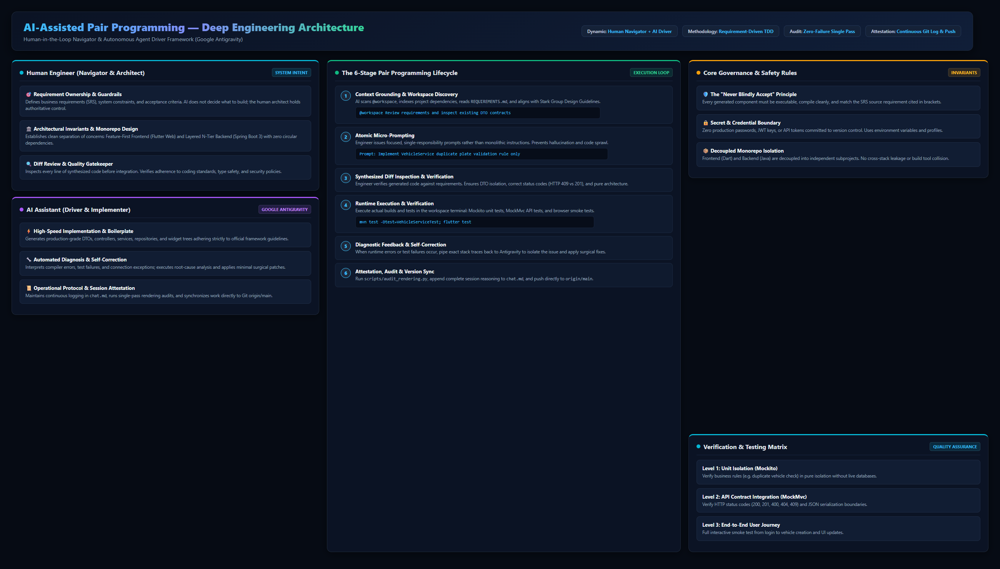
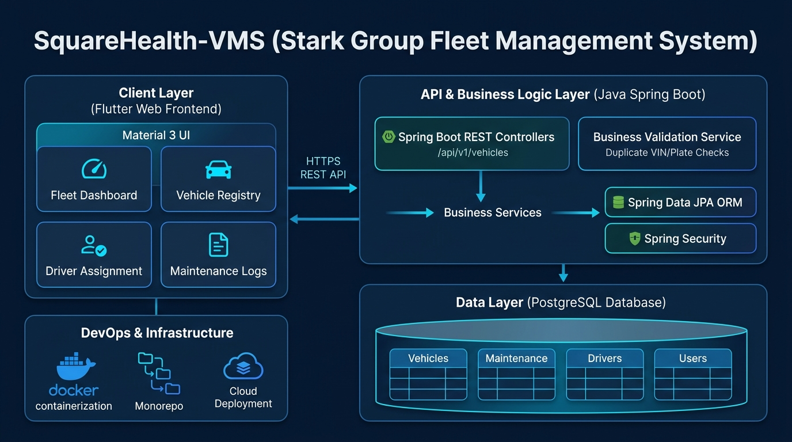
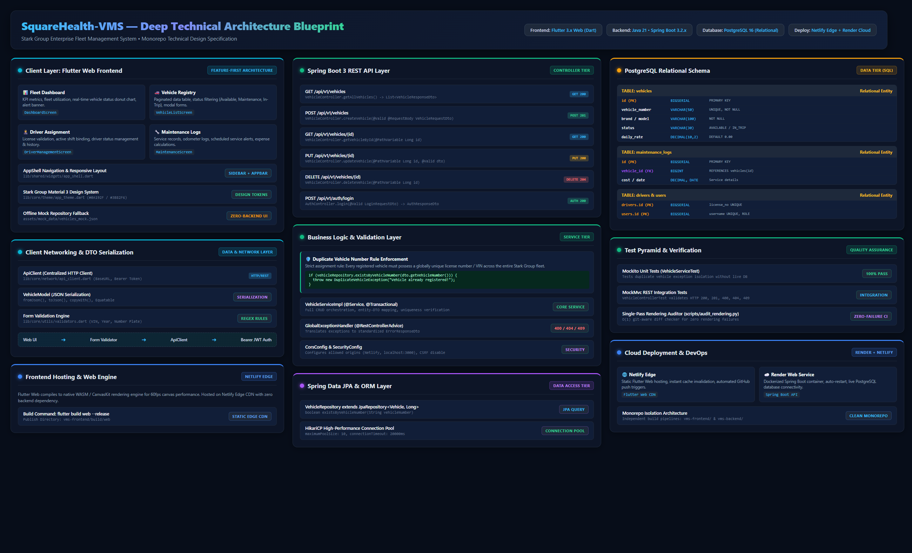
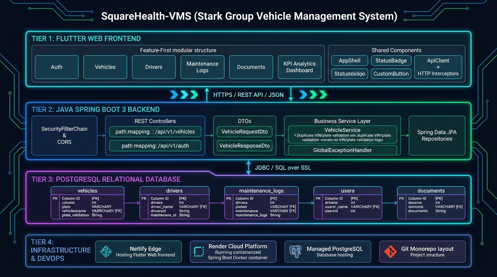
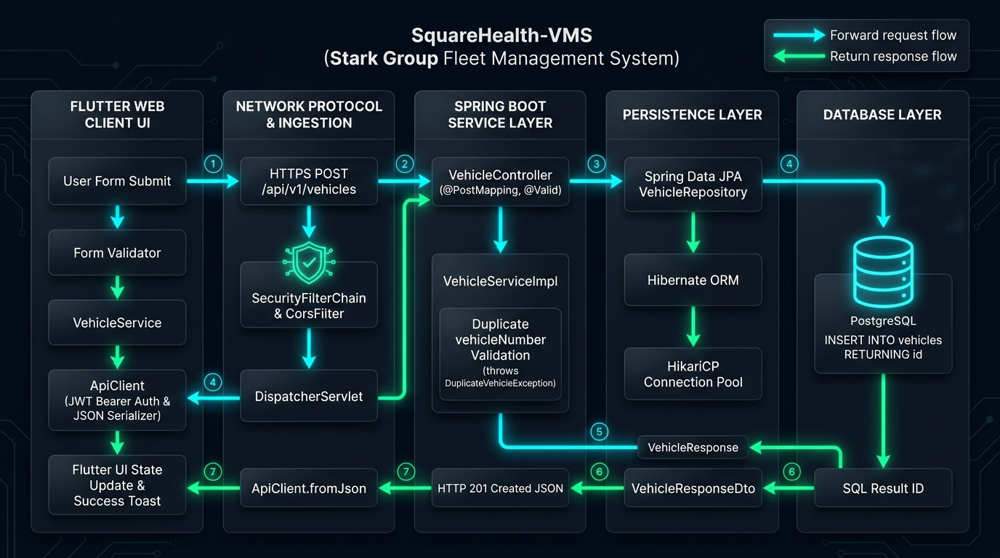
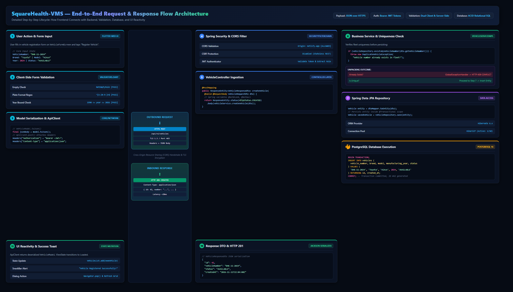

# StarkGroup-VMS (Stark Group Fleet Management System)

A full-stack, enterprise-ready Vehicle Management System developed with **Flutter Web**, **Java Spring Boot**, and **PostgreSQL/SQL Database**, paired with **Google Antigravity AI**.

---

## AI-Assisted Pair Programming Architecture



The project leverages a **Human-in-the-Loop Navigator + Autonomous Agent Driver** paradigm:
1. **Human Engineer (Navigator & Architect)**: Defines business requirements (SRS), designs system boundaries, reviews generated diffs, and validates runtime correctness. The AI never decides what to build.
2. **AI Agent (Driver & Implementer - Google Antigravity)**: Rapidly synthesizes boilerplate, scaffolds clean architecture, executes surgical fixes from error stack traces, runs single-pass audits, and automates Git synchronization.
3. **6-Stage Interactive Loop**: Context Grounding (`@workspace`) ➔ Atomic Micro-Prompting ➔ Diff Inspection ➔ Runtime Verification (Mockito/MockMvc/Flutter) ➔ Diagnostic Self-Correction ➔ Attestation & Git Sync.

---

## System Architecture

### High-Level System Architecture


### Deep Technical Architecture Blueprint


### 4-Tier Visual Architecture Blueprint


### Architectural Layers in Detail

1. **Client Layer (Flutter Web Frontend)**
   - **Framework**: Flutter Web 3.x (Dart) compiling to WebAssembly / CanvasKit for 60fps responsive desktop web experiences.
   - **Styling**: Stark Group Material 3 Design System (`#0A192F` Deep Navy, `#3B82F6` Electric Blue, `#10B981` Emerald).
   - **Feature-First Architecture**:
     - `features/dashboard`: Fleet KPI cards, fleet utilization metrics, alert banners.
     - `features/vehicles`: Paginated vehicle registry table, status chips (Available, Maintenance, In-Trip), modal CRUD forms.
     - `features/drivers`: Driver license records, shift assignments, status management.
     - `features/maintenance`: Periodic maintenance logs, service costs, odometer trackers.
     - `features/documents`: Vehicle registration certificates, fitness licenses, insurance expiry tracking.
     - `features/auth`: Corporate login, session persistence, secure token storage.
   - **Core & Networking**:
     - `ApiClient`: Centralized HTTP REST client with Bearer JWT injection and timeout interceptors.
     - `VehicleModel`: Bidirectional JSON serialization (`fromJson`/`toJson`) and immutability.
     - `Mock Data Fallback`: `assets/mock_data/vehicles_mock.json` allowing independent frontend verification without a live backend.

2. **API & Business Logic Layer (Java Spring Boot)**
   - **Framework**: Spring Boot 3.2.x on Java 17/21.
   - **REST API Endpoints**:
     - `GET /api/v1/vehicles`: Paginated retrieval of vehicles mapped to `VehicleResponseDto`.
     - `POST /api/v1/vehicles`: Creation of new vehicle with `@Valid` payload validation.
     - `GET /api/v1/vehicles/{id}`: Retrieval of specific vehicle details.
     - `PUT /api/v1/vehicles/{id}`: Update of existing vehicle attributes.
     - `DELETE /api/v1/vehicles/{id}`: Soft/hard removal returning HTTP 204.
     - `POST /api/v1/auth/login`: Authentication returning JWT bearer token.
   - **Business Rules Enforcement**:
     - `VehicleServiceImpl`: Enforces uniqueness on vehicle registration number via `vehicleRepository.existsByVehicleNumber(dto.getVehicleNumber())`. Throws `DuplicateVehicleException` on collision.
   - **Error Handling & Security**:
     - `GlobalExceptionHandler` (`@RestControllerAdvice`): Uniform error envelope (`ErrorResponseDto`) returning standard HTTP 400, 404, and 409 responses.
     - `CorsConfig` & `SecurityConfig`: Cross-Origin controls for Netlify frontend origin and stateless REST security.

3. **Data Layer (PostgreSQL Relational Database)**
   - **Persistence Provider**: Spring Data JPA with Hibernate ORM and HikariCP connection pool.
   - **Relational Schema**:
     - `vehicles`: `id` (PK), `vehicle_number` (UNIQUE NOT NULL), `brand`, `model`, `manufacturing_year`, `status`, `daily_rate`, `created_at`, `updated_at`.
     - `drivers`: `id` (PK), `full_name`, `license_number` (UNIQUE), `phone`, `status`.
     - `maintenance_logs`: `id` (PK), `vehicle_id` (FK referencing `vehicles.id`), `service_type`, `cost`, `service_date`, `description`.
     - `users`: `id` (PK), `username` (UNIQUE), `password_hash`, `role`.

4. **DevOps, Testing & Cloud Infrastructure**
   - **Monorepo Design**: Clean technical separation between `vms-frontend/` and `vms-backend/`.
   - **Test Pyramid**:
     - Mockito Unit Tests (`VehicleServiceTest`): Business validation logic verification in isolation.
     - MockMvc Integration Tests (`VehicleControllerTest`): End-to-end HTTP contract testing.
   - **Cloud Targets**:
     - **Netlify Edge**: Automated web build via `flutter build web --release`.
     - **Render Cloud**: Dockerized containerized backend service running the Spring Boot fat JAR connected to managed PostgreSQL.

---

## Request-Response Lifecycle Architecture

The following diagrams illustrate the end-to-end communication sequence when a user triggers an action (e.g. creating a vehicle) from the Flutter Web client to the Java Spring Boot backend, through validation and persistence in PostgreSQL, and back to the reactive UI:

### End-to-End Request Flow Sequence Diagram


### Detailed Request-Response Technical Specification


### Step-by-Step Execution Lifecycle

1. **User Action & Client Validation (Flutter Web)**:
   - User submits form on `VehicleFormScreen`.
   - `lib/core/utils/validators.dart` runs client-side format checks (license plate regex, bounds).
   - Form data converts to `VehicleModel` and serialized via `toJson()`.
2. **Network Transmission & Headers**:
   - `ApiClient` attaches `Content-Type: application/json` and `Authorization: Bearer <JWT>`.
   - Transmitted securely via HTTPS `POST /api/v1/vehicles`.
3. **Gateway & Security Filtering (Spring Boot)**:
   - `CorsConfig` checks request origin against allowed whitelist.
   - `SecurityConfig` validates session / JWT token and populates `SecurityContextHolder`.
4. **Controller Ingestion & DTO Validation**:
   - `DispatcherServlet` routes payload to `VehicleController.createVehicle()`.
   - Hibernate Validator verifies `@Valid @RequestBody VehicleRequestDto`.
5. **Business Logic & Duplicate Rule Check (`VehicleServiceImpl`)**:
   - Invokes `vehicleRepository.existsByVehicleNumber(dto.getVehicleNumber())`.
   - If duplicate found: Throws `DuplicateVehicleException` -> `GlobalExceptionHandler` responds with `409 Conflict`.
   - If unique: Proceeds to map DTO into JPA `Vehicle` entity.
6. **Persistence & SQL Execution (PostgreSQL)**:
   - `VehicleRepository.save(entity)` triggers Hibernate ORM.
   - Connection acquired from HikariCP pool.
   - Executes SQL `INSERT INTO vehicles (...) VALUES (...) RETURNING id`.
7. **Response Serialization & UI Reactivity**:
   - Entity mapped to `VehicleResponseDto` and returned with `HTTP 201 Created`.
   - `ApiClient` receives JSON and deserializes via `VehicleModel.fromJson()`.
   - Flutter state appends new record, closes modal dialog, and displays green SnackBar alert.

---

```
StarkGroup-VMS/
├── Data_Ingestion/                      # Multi-source requirement ingestion pipeline & normalized data
│   ├── Document/                        # Source Word specifications
│   ├── UdemyScrapper/                   # Scraped course curriculum (7 sections)
│   ├── YoutubeScrapper/                 # Audio files (.mp3) & session transcripts (.md)
│   ├── Requirement Gathering.png        # Ingestion architecture diagram
│   └── DataIngestiion.md                # Consolidated Single Ingestion Specification
├── requirements/                        # Dedicated Project Requirements Specification
│   └── PROJECT_REQUIREMENTS.md          # Comprehensive Functional & Non-Functional Requirements
├── vms-frontend/                        # Flutter Web client (Feature-First Architecture)
│   ├── lib/
│   │   ├── core/                        # Theme, constants, networking, utilities
│   │   ├── features/                    # Auth, Vehicles, Maintenance, Documents, Drivers, Dashboard
│   │   └── shared/                      # Reusable widgets (AppShell, StatusBadge)
│   ├── web/                             # Web bootstrap files
│   └── test/                            # Flutter widget tests
├── vms-backend/                         # Java Spring Boot service (Layered Architecture)
│   ├── src/main/java/com/starkgroup/vms/
│   │   ├── controller/                  # REST Controllers (/api/v1/vehicles, /api/v1/auth)
│   │   ├── service/                     # Business logic & Duplicate Vehicle validation
│   │   ├── repository/                  # Spring Data JPA repositories
│   │   ├── entity/                      # Relational JPA entities
│   │   ├── dto/                         # Request & Response DTOs
│   │   ├── exception/                   # Global exception handling
│   │   └── config/                      # CORS & Security configs
│   └── src/test/java/                   # Unit (Mockito) & Integration (MockMvc) test suite
├── commands/                            # Developer CLI command guide & execution references
│   └── COMMAND_GUIDE.md                 # Maven & Flutter CLI cheat sheet
├── notebook/                            # Kid-friendly comprehensive technology guide
│   └── Notebook.md                      # Complete story and tech breakdown for a 10-year-old
├── AI_Pair_Programming/                 # Dedicated AI Agent Pair-Programming & Meta-Specifications
│   ├── chat/                            # Conversation logs & prompt session history (chat.md)
│   ├── Generic_Project_Template/        # Reusable framework-agnostic blueprints & skill docs
│   ├── requirements/                    # Dedicated project requirements specifications
│   ├── specifications/                  # Centralized technical engineering specifications (Steps 1–8)
│   ├── project status/                  # Implementation audit across all 8 steps
│   ├── scripts/                         # Rendering scripts & zero-failure audit tool
│   ├── FOLDER_STRUCTURE.md              # Detailed architecture manual
│   └── *.png / *.jpg                    # Visual blueprints & flow sequence diagrams
```

---

## 🛠️ Developer CLI Execution Guide

Complete, step-by-step terminal commands for running, building, testing, and managing both the backend and frontend are documented in [`commands/COMMAND_GUIDE.md`](file:///c:/Users/USER/Documents/.MYGITHUB/SquareHealth-VMS/commands/COMMAND_GUIDE.md).

- **Run Backend Server (Spring Boot)**:
  ```powershell
  cd vms-backend
  .\mvnw.cmd spring-boot:run
  ```
- **Run Frontend Client (Flutter Web)**:
  ```powershell
  cd vms-frontend
  flutter run -d chrome
  ```

---

## Completed Phases

- **Step-1: Requirement Gathering**
  - Architecture for requirement gathering documented and visualized.
  - Audio file (`002 - Session  Weekly Support 01...mp3`) transcribed into Markdown (`002 - Session  Weekly Support 01...md`).
  - Exhaustive consolidated requirements document created at [DataIngestiion.md](file:///c:/Users/USER/Documents/.MYGITHUB/SquareHealth-VMS/Data_Ingestion/DataIngestiion.md) with every requirement citing its source in brackets `[Source: ...]`.
  - Dedicated, enterprise Functional and Non-Functional Requirements (FR & NFR) specification authored at [`requirements/PROJECT_REQUIREMENTS.md`](file:///c:/Users/USER/Documents/.MYGITHUB/SquareHealth-VMS/requirements/PROJECT_REQUIREMENTS.md).
- **Step-2: Folder Structure**
  - Official Flutter Web (frontend) and Spring Boot (backend) folder structures analyzed from official documentation.
  - Merged into a unified monorepo folder structure and created on disk.
  - Comprehensive explanation and architectural rationale documented in [FOLDER_STRUCTURE.md](file:///c:/Users/USER/Documents/.MYGITHUB/SquareHealth-VMS/FOLDER_STRUCTURE.md).
- **Step-3: Data Contracts, Mock Repository & UI Prototype**
  - Centralized API data contract and DTO JSON schemas defined to eliminate schema drift and AI field hallucination.
  - Mock datasets created at [`assets/mock_data/vehicles_mock.json`](file:///c:/Users/USER/Documents/.MYGITHUB/SquareHealth-VMS/vms-frontend/assets/mock_data/vehicles_mock.json) covering all domain states.
  - Client presentation layer (theme, responsive AppShell, forms with regex validation) verified in browser.
  - Detailed technical blueprint and engineering rationale documented in [`Generic_Project_Template/Any Project Skill.docx`](file:///c:/Users/USER/Documents/.MYGITHUB/SquareHealth-VMS/Generic_Project_Template/Any%20Project%20Skill.docx).
- **Step-4: Database Architecture, Relational Schema & Migration Engine**
  - Relational persistence architecture, ER diagram, and Data Dictionary formalized in [`STEP_4_DATABASE_SPECIFICATION.md`](file:///c:/Users/USER/Documents/.MYGITHUB/SquareHealth-VMS/specifications/STEP_4_DATABASE_SPECIFICATION.md).
  - Storage-level invariants enforced: `UNIQUE(vehicle_number)`, check constraints on lifecycle statuses, and B-Tree performance indexes.
  - Version-controlled migration pipeline configured using Flyway with executable DDL (`V1__initial_schema.sql`) and baseline seed data (`V2__seed_baseline_data.sql`).
  - Documented in [`Generic_Project_Template/Any Project Skill.docx`](file:///c:/Users/USER/Documents/.MYGITHUB/SquareHealth-VMS/Generic_Project_Template/Any%20Project%20Skill.docx) with engineering rationale.

