# SquareHealth-VMS — System Requirements & UML Architecture Blueprint

This document provides the unified, production-grade **System Requirements Specification (SRS)** and **Unified Modeling Language (UML) Architectural Blueprint** for **SquareHealth-VMS (Stark Group Fleet Management System)**. It formalizes both the problem space (*what* must be built) and the solution space (*how* the system is architected, modeled, and verified).

---

## 📑 Document Structure

```mermaid
flowchart TD
    ROOT["SquareHealth-VMS Specification"] --> P1["PART I: System Requirements (SRS)"]
    ROOT --> P2["PART II: UML Architecture Blueprints"]
    ROOT --> P3["PART III: Traceability & Directives"]

    P1 --> S1["1. Requirements Taxonomy"]
    P1 --> S2["2. Scope & Goals"]
    P1 --> S3["3. HLD vs LLD Matrix"]
    P1 --> S4["4. Functional Requirements (FR-01 - FR-10)"]
    P1 --> S5["5. Canonical NFR Matrix"]
    P1 --> S6["6. Scale & Capacity Estimation"]
    P1 --> S7["7. System Constraints & Invariants"]

    P2 --> S8["8. UML Taxonomy"]
    P2 --> S9["9. System Use Case Diagram"]
    P2 --> S10["10. Sequence Diagrams"]
    P2 --> S11["11. Vehicle State Machine Diagram"]
    P2 --> S12["12. Activity Diagram"]
    P2 --> S13["13. Domain Class Diagram"]
    P2 --> S14["14. Clean 4-Tier Component Diagram"]
    P2 --> S15["15. Cloud Deployment Diagram"]

    P3 --> S16["16. Unified Traceability Matrix (RTM)"]
    P3 --> S17["17. Downstream Engineering Directives"]
```

---

# PART I: SYSTEM REQUIREMENTS ENGINEERING (SRS)

## 📌 1. Taxonomy of System Requirements

System requirements bridge the enterprise fleet management business problem with concrete technical architecture across the Flutter Web client, Spring Boot application engine, and PostgreSQL persistence layer:

```mermaid
flowchart TD
    SR["System Requirements (SquareHealth-VMS)"] --> FR["Functional Requirements (FR)"]
    SR --> NFR["Non-Functional Requirements (NFR)"]
    SR --> CON["System Constraints & Boundaries"]

    FR --> FR_CORE["Core Fleet Management (FR-01 - FR-05)"]
    FR --> FR_ADV["Advanced Fleet Operations (FR-06 - FR-10)"]

    FR_CORE --> FC1["FR-01: Auth, Session & RBAC"]
    FR_CORE --> FC2["FR-02: Operating Entity & Company Classification"]
    FR_CORE --> FC3["FR-03: Vehicle Master CRUD Engine"]
    FR_CORE --> FC4["FR-04: Duplicate Plate Prevention Guard"]
    FR_CORE --> FC5["FR-05: Executive Analytics Dashboard"]

    FR_ADV --> FA1["FR-06: Driver Dynamic Assignment"]
    FR_ADV --> FA2["FR-07: Compliance & Document Expiry Tracking"]
    FR_ADV --> FA3["FR-08: Maintenance & Service History"]
    FR_ADV --> FA4["FR-09: Fuel Reserves Monitoring"]
    FR_ADV --> FA5["FR-10: Immutable Audit Logging"]

    NFR --> NFR_PERF["Performance & Latency (P95 < 200ms)"]
    NFR --> NFR_SCALE["Scalability & Capacity (10,000+ Vehicles)"]
    NFR --> NFR_AVAIL["Availability & Reliability (99.9% Uptime)"]
    NFR --> NFR_SEC["Security & Compliance (JWT, BCrypt, CORS)"]
    NFR --> NFR_INT["Data Integrity (ACID, UNIQUE Invariants)"]
    NFR --> NFR_OBS["Observability (RFC 7807, SLF4J, Health Probes)"]

    CON --> CON_ENV["Cloud Deployment (Netlify Edge & Render)"]
    CON --> CON_REG["Regulatory Standards (BRTA Compliance)"]
    CON --> CON_ISO["Decoupled Monorepo & DTO Isolation"]
```

---

## 🎯 2. Scope & Goals

### 2.1 Mission Statement & Objective
SquareHealth-VMS is an enterprise-grade, cloud-ready Fleet Management System engineered to provide a centralized single source of truth for the corporate vehicles, emergency ambulances, logistics vans, drivers, legal compliance certificates, and maintenance workflows of Stark Group.

### 2.2 In-Scope Capabilities
- **Fleet Ownership & Operating Entity Classification**: Categorizing and filtering fleet assets by operating company or division (e.g., "Stark Group", "Stark Logistics", "Apex Pharma") with full search and filter capabilities.
- **Vehicle Master Lifecycle & Server-Side Querying**: Full CRUD lifecycle operations for corporate fleet categories (`CAR`, `SUV`, `VAN`, `MICROBUS`, `BUS`, `TRUCK`, `PICKUP`, `MOTORCYCLE`, plus specialized medical `AMBULANCE`), with server-side search (by vehicle number, brand, model, driver), multi-criteria filtering, sorting, and pagination (`PagedResponse`), plus initial `DataSeeder` (20 mock vehicles on empty DB).
- **Core Invariant Enforcement**: Triple-tier duplicate vehicle license plate detection and rejection returning RFC 7807 HTTP 409 Conflict envelopes.
- **Executive Fleet Analytics**: Real-time aggregate KPI metrics, graphical charts, and readiness distribution ratios.
- **Driver Management (CRUD) & Assignment**: Full CRUD for certified driver profiles and dynamic assign/change/unassign workflows with mutual exclusivity invariants on active routes.
- **Document Upload & Compliance Expiry Monitoring**: Multipart upload for vehicle photos and legal documents (Registration Certificates, Tax Tokens, Insurance Policies, Fitness Certificates, Route Permits) with automatic `VALID` / `EXPIRING_SOON` / `EXPIRED` status tracking.
- **Maintenance & Per-Vehicle Service History**: Maintenance logging (`date`, `type`, `cost`, `vendor`, `notes`, `odometer`), per-vehicle service history timelines, and low fuel alerting (threshold <= 20%).
- **Dual-Mode & Responsive/Adaptive Networking**: Decoupled Flutter Web presentation (Retrofit + Dio, Riverpod, `shadcn_ui`, `infinite_scroll_pagination`, `hive_ce`) with responsive/adaptive layouts and in-memory offline mock fallback (`useMock: true/false`).

### 2.3 Out-of-Scope Capabilities
- Physical on-board OBD-II hardware GPS satellite tracking device manufacturing or firmware programming.
- Automated payment gateway integration with third-party commercial fuel station POS terminals.
- Consumer-facing ride-hailing / peer-to-peer taxi dispatch services.
- Synchronization with legacy on-premises SAP/COBOL mainframe enterprise ledgers.

---

## 📐 3. High-Level Design (HLD) vs Low-Level Design (LLD) Requirements

| Perspective | System Requirements in HLD | System Requirements in LLD |
|---|---|---|
| **Primary Scope** | Monorepo service topology, Flutter Web client, Spring Boot REST gateway, PostgreSQL persistence | Package boundaries, Controller/Service/Repository classes, DTO immutability, HikariCP pool |
| **Capacity Scoping** | Peak 175 QPS, 500 DAU, 10,000+ vehicles, 5-year 25 GB storage footprint | In-memory JVM heap allocation (512 MB - 1 GB), HikariCP (30 max connections), Flutter widget tree |
| **Protocol & APIs** | Stateless REST JSON over HTTPS, Bearer JWT authentication, RFC 7807 error envelopes | Java interfaces (`VehicleService`), method signatures, `@Valid` Jakarta validation, `@Transactional` boundaries |
| **Key Invariants** | High Availability (99.9%), ACID durability, Network error resilience | Uniqueness constraint (`vehicle_number`), thread safety, duplicate exception interception |

---

## ⚙️ 4. Functional Requirements (FR)

### FR-01: Authentication, Session Management & Role-Based Access Control (RBAC)
- **Workflow & Trigger**: A corporate user navigates to the portal and enters credentials via the Corporate Sign-in card (`/api/v1/auth/login`).
- **Pre-conditions**: The user account must be active in the `users` database table; passwords must be hashed using BCrypt.
- **System Behavior & Output**:
  - The backend validates credentials and issues an HMAC-SHA256 signed JWT Bearer token with claims: `sub`, `roles`, `companyId`, `iat`, `exp` (8 hours).
  - Four distinct roles are enforced via Spring Security `@PreAuthorize`:
    1. `ADMIN`: Universal read/write/delete privileges across all fleets and audit logs.
    2. `FLEET_MANAGER`: Operational CRUD on vehicles, drivers, and service tickets for their assigned company or division.
    3. `DISPATCHER`: Operational status updates (`AVAILABLE`, `IN_TRIP`), fuel logging, and driver route monitoring.
    4. `DRIVER`: Read-only mobile/web access to assigned vehicle specifications and compliance certificates.
- **Post-conditions**: Flutter client securely stores the JWT in persistent session memory and injects `Authorization: Bearer <token>` into all subsequent HTTP requests.
- **Error Handling**: Invalid credentials return HTTP 401 Unauthorized (`"Invalid username or password"`).

---

### FR-02: Operating Entity & Company Classification
- **Workflow & Trigger**: An operator assigns or updates the operating company or division for a vehicle during registration or editing.
- **Business Context**: Stark Group manages vehicles allocated across different business divisions, logistics partners, or corporate entities (e.g., `"Stark Group"`, `"Stark Logistics"`, `"Apex Pharma"`). `[Source: Udemy - Section 02 / 06; Section 03 / 05]`
- **Pre-conditions**: Vehicle registration or edit form is active in Flutter Web UI or REST client.
- **System Behavior & Output**:
  - Requires `company` as a non-blank String field on every `Vehicle` entity and DTO.
  - Enables instant server-side and client-side multi-field filtering by company (`GET /api/v1/vehicles?company=...`).
  - Groups fleet summaries by operating company on the analytics dashboard.
- **Post-conditions**: Vehicle record is persisted with its associated company string; displayed in table views and filters.

---

### FR-03: Vehicle Master Data CRUD Engine, Search, Filter, Sort & Pagination
- **Workflow & Trigger**: An authorized Fleet Manager creates, inspects, searches, filters, sorts, modifies, or retires a corporate vehicle via `VehicleFormDialog`/`VehicleFormScreen` or REST endpoints (`/api/v1/vehicles` or `/api/vehicles`).
- **Mandatory & Extended Attributes**:
  - `id`: Database-assigned 64-bit primary key (`Long`).
  - `vehicleNumber`: Unique alphanumeric license plate string (e.g., `"DHAKA-METRO-GA-11-2233"`).
  - `company`: Operating entity or corporate division string (e.g., `"Stark Group"`, `"Stark Logistics"`, `"Apex Pharma"`).
  - `vehicleType`: Enum (`CAR`, `SUV`, `VAN`, `MICROBUS`, `BUS`, `TRUCK`, `PICKUP`, `MOTORCYCLE`, `AMBULANCE`).
  - `brand`: Manufacturer name (`"Toyota"`, `"Hyundai"`, `"Nissan"`, `"Mercedes-Benz"`, `"Isuzu"`).
  - `model`: Specific model designation (`"Corolla"`, `"HiAce Emergency ICU"`, `"Mighty"`, `"Sprinter"`).
  - `manufacturingYear`: Integer (`>= 1900`, nullable).
  - `color`: Exterior vehicle color string (nullable).
  - `fuelType`: Enum (`PETROL`, `DIESEL`, `OCTANE`, `CNG`, `LPG`, `HYBRID`, `ELECTRIC`).
  - `seatingCapacity`: Positive integer passenger capacity (nullable).
  - `status`: Operational state (`"AVAILABLE"`, `"ACTIVE"` / `"IN_USE"`, `"MAINTENANCE"`, `"INACTIVE"`, `"RETIRED"`).
  - `fuelLevel`: Integer percentage (`0` to `100`).
  - `driverName` / `driverPhone` / `assignedDriverId`: Assigned certified driver reference and contact (nullable).
  - `department`: Internal cost center department (e.g., `"Emergency Response Hub"`).
- **CRUD & Server-Side Query Specifications**:
  - `GET /api/v1/vehicles?page=0&size=10&sort=createdAt,desc&search=...&status=...&vehicleType=...&company=...&expiryStatus=...`: Returns a `PagedResponse<VehicleResponseDto>` (`content`, `hasNext`, `totalElements`) supporting server-side full-text search (by `vehicleNumber`, `brand`, `model`, `driverName`), multi-criteria filtering, sorting, and pagination.
  - `GET /api/v1/vehicles/{id}`: Returns detailed vehicle metadata; throws `ResourceNotFoundException` (HTTP 404) if missing.
  - `POST /api/v1/vehicles`: Validates inputs (`@Valid`), executes duplicate check, persists entity, and returns HTTP 201 Created with assigned ID.
  - `PUT /api/v1/vehicles/{id}`: Updates existing attributes with dirty-checking; validates license plate uniqueness if modified. Returns HTTP 200 OK.
  - `DELETE /api/v1/vehicles/{id}`: Checks referential integrity; returns HTTP 204 No Content upon removal.
  - **Startup Data Seeding**: On application boot, `DataSeeder` checks `vehicleRepository.count() == 0` and populates 20 realistic sample fleet records so fresh environments are immediately testable.
- **Post-conditions**: Database state reflects the modification; client updates Riverpod/Provider state, invalidates/refreshes paginated cache, and displays notification.

---

### FR-04: Mandatory Invariant — Duplicate Vehicle License Plate Prevention
- **Workflow & Trigger**: A user attempts to create or update a vehicle with a license plate string that already exists in the system.
- **Business Rule Invariant**: A vehicle license plate uniquely identifies a physical road transport asset. Duplicate license numbers are strictly rejected across the entire fleet.
- **Triple-Layer Enforcement Architecture**:
  1. **Application Service Guard**: `VehicleServiceImpl` queries `vehicleRepository.existsByVehicleNumber(dto.getVehicleNumber())`. If true, raises `DuplicateVehicleException`.
  2. **Database Schema Invariant**: Enforces `CONSTRAINT uq_vehicles_vehicle_number UNIQUE (vehicle_number)`.
  3. **Global Exception Mapping**: `GlobalExceptionHandler` intercepts the collision and returns an RFC 7807 HTTP 409 Conflict envelope:
     ```json
     {
       "timestamp": "2026-11-18T10:00:00Z",
       "status": 409,
       "error": "Conflict",
       "message": "Vehicle with number 'DHAKA-METRO-GA-11-2233' already exists in the fleet.",
       "path": "/api/v1/vehicles"
     }
     ```
  4. **Client-Side Reactive Alert**: Flutter Web catches HTTP 409 and renders a prominent red alert banner without closing the modal or clearing user input.

---

### FR-05: Executive Analytics Dashboard & Fleet Statistics
- **Workflow & Trigger**: An Administrator views the dashboard (`/api/v1/dashboard/stats`).
- **System Behavior & Output**:
  - Computes real-time aggregate fleet counters and graphical statistics:
    - `totalVehicles`: Total registered fleet assets.
    - `availableVehicles`: Count of vehicles ready for immediate dispatch (`AVAILABLE`).
    - `activeVehicles`: Count of vehicles currently active / on the road (`ACTIVE` / `IN_USE` / `IN_TRIP`).
    - `inactiveVehicles`: Count of parked/deactivated vehicles (`INACTIVE`).
    - `maintenanceVehicles`: Count of vehicles in workshop repair (`MAINTENANCE`).
    - `expiringSoonDocuments` / `expiredDocuments`: Counts of compliance documents requiring renewal.
    - `fleetEfficiency`: Average fleet fuel efficiency standard (12.4 km/L).
    - `fuelAlerts`: Total vehicles operating with low fuel reserves (<= 20%).
  - Dynamically calculates the Fleet Readiness Ratio bar and renders interactive graphical charts (status distribution, company breakdown, monthly maintenance cost trends).
- **Post-conditions**: Reactively refreshes whenever a vehicle, document, or maintenance log is created, updated, or removed.

---

### FR-06: Driver Management (CRUD) & Driver Assignment / Reassignment
- **Workflow & Trigger**: An authorized operator creates/edits/deletes driver profiles (`/api/v1/drivers`) or assigns/changes a driver for a specific vehicle (`/api/v1/vehicles/{id}/driver`).
- **Pre-conditions**: Driver must possess an active, unexpired Commercial Driver License (CDL).
- **System Behavior & Output**:
  - **Driver CRUD (`/api/v1/drivers`)**: Full Create, Read (paginated & searchable), Update, and Delete operations for driver profiles: Full Name, National ID, License Number, License Expiry Date, Phone, Emergency Contact, Medical Clearance Status, and Active status.
  - **Driver Assignment & Reassignment**: Allows assigning an available driver to a vehicle, changing (reassigning) the current driver to another certified driver, or unassigning a driver.
  - **Mutual Exclusivity Invariant**: A driver cannot be simultaneously assigned to more than one vehicle currently marked `ACTIVE` / `IN_USE`.
- **Error Handling**: Attempting to assign an already-dispatched driver or a driver with an expired license returns HTTP 400 Bad Request (`"Driver is already assigned to active transit vehicle"`).

---

### FR-07: Document Upload & Vehicle Compliance Expiry Tracking
- **Workflow & Trigger**: User uploads vehicle photos or legal documents via `multipart/form-data` (`POST /api/v1/vehicles/{id}/documents`), alongside an automatic daily batch job and on-demand UI inspection of legal vehicle documents.
- **Tracked Compliance Documents & Media**:
  1. Vehicle Registration Certificate (`REGISTRATION`)
  2. Annual Road Tax Token (`TAX_TOKEN`)
  3. Comprehensive Commercial Insurance Policy (`INSURANCE`)
  4. Government Motor Vehicle Fitness Certificate (`FITNESS`)
  5. Commercial Route Permit (`ROUTE_PERMIT`)
  6. Vehicle Photo / Picture (`VEHICLE_PHOTO`)
- **Traffic-Light Expiry Alert Logic**:
  - `VALID` (Green badge): Expiry date is > 30 calendar days in the future.
  - `EXPIRING_SOON` (Amber badge): Expiry date is within 1 to 30 calendar days.
  - `EXPIRED` (Red badge): Expiry date has passed.
- **Operational Enforcement**: Vehicles with expired Fitness, Insurance, or Tax tokens are flagged with prominent `EXPIRED` / `EXPIRING_SOON` badges, filterable server-side (`?expiryStatus=EXPIRED`), and locked from `AVAILABLE` dispatch until renewed.

---

### FR-08: Maintenance Workflow & Per-Vehicle Service History
- **Workflow & Trigger**: A Maintenance Engineer logs a routine service, emergency breakdown, or preventative repair (`POST /api/v1/vehicles/{id}/maintenance`), or inspects a vehicle's complete maintenance history (`GET /api/v1/vehicles/{id}/maintenance`).
- **Attributes Recorded**: Maintenance Date (`serviceDate`), Maintenance Type (`type`: Oil Change, Brake Overhaul, Engine Diagnostics, Tire Replacement, Bodywork, Periodic Inspection), Total Cost (`cost`), Workshop Vendor (`vendor`), Notes (`notes`), Odometer Mileage (`serviceOdometer`), and Invoice Number.
- **Per-Vehicle History & State Machine Integration**: Displays a chronological, per-vehicle maintenance timeline with cumulative cost aggregation. Shifting vehicle status to `MAINTENANCE` locks the asset from dispatcher selection; upon technician clearance, status transitions back to `AVAILABLE` / `ACTIVE`.

---

### FR-09: Fuel Reserves Monitoring & Consumption Auditing
- **Workflow & Trigger**: Telemetry updates or driver fuel entry submissions.
- **System Behavior & Output**:
  - Tracks fuel tank capacity (liters) and current fuel percentage.
  - Vehicles with fuel levels <= 20% automatically trigger Amber/Red low-fuel alert chips in the UI and dashboard.
  - Tracks fuel logs: Date, liters pumped, price per liter, fuel station vendor, and odometer reading.

---

### FR-10: Immutable Audit Logging & Activity History
- **Workflow & Trigger**: Any state-modifying action (vehicle creation, plate modification, driver reassignment, status transition, record deletion).
- **Recorded Attributes**: Entity Type, Entity ID, Action (`CREATE`, `UPDATE`, `DELETE`, `STATUS_CHANGE`), User ID, Timestamp (UTC ISO 8601), Old Value, New Value, Client IP.
- **Storage Rule**: Audit log tables are append-only; update and delete operations on audit tables are prohibited at the database permission level.

---

## 🛡️ 5. Non-Functional Requirements (NFR / Quality Attributes)

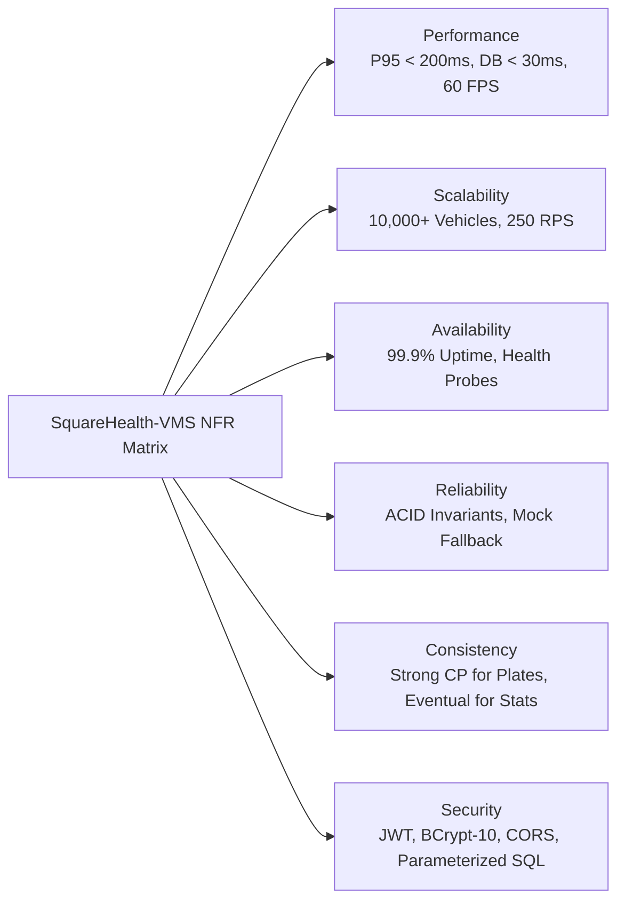

### 5.1 Canonical NFR Matrix

| Quality Attribute | Target Metric / SLA | Architectural Implementation |
|---|---|---|
| **Performance (Latency)** | P95 REST response < 200 ms under 250 RPS<br>Single-row query execution < 30 ms<br>Web FCP < 1.5 seconds | B-Tree indexes on `vehicle_number`, `status`, `company_id`. Spring Boot lightweight fat JAR. Flutter CanvasKit web optimization. |
| **Scalability (Throughput)** | 10,000+ vehicle records<br>50,000+ maintenance/fuel logs<br>500+ daily active users | Completely stateless backend service suitable for horizontal container replication. HikariCP connection pooling (max 30 connections). |
| **Availability (Uptime)** | 99.9% service uptime (< 8.76 hours unplanned downtime/year) | Render automated container restart (< 15 seconds). Spring Boot Actuator `/actuator/health` liveness/readiness probes. |
| **Reliability & Durability** | Zero data loss on committed writes<br>Graceful network degradation | PostgreSQL WAL (Write-Ahead Logging). Dual-mode Flutter `ApiClient` providing graceful offline mock fallback mode. |
| **Data Consistency** | Strong Consistency (CP) for vehicle uniqueness & lifecycle<br>Eventual Consistency for aggregated dashboard KPIs | ACID transactions with `@Transactional` boundaries. Database constraints (`UNIQUE`, `CHECK`, `NOT NULL`). |
| **Security & Privacy** | OWASP Top 10 compliance<br>Zero plaintext credentials<br>CORS origin whitelisting | HMAC-SHA256 signed Bearer JWTs. BCrypt password hashing (cost factor >= 10). Spring Data JPA parameterized queries (zero SQLi). |
| **Observability** | End-to-end request tracing & structured logs | SLF4J and Logback structured JSON logs. RFC 7807 standardized `ErrorResponseDto` envelope across all exception handlers. |
| **Usability & Accessibility** | WCAG 2.1 AA Compliance (4.5:1 text contrast)<br>Sustained 60 FPS UI rendering | Stark Group Material 3 design system. Deep Navy (`#0A192F`), Electric Blue (`#2563EB`), Emerald (`#10B981`). Strict 8px spacing grid. |
| **Maintainability** | 100% test pass rate on core business rules<br>Zero linter warnings | Clean 4-tier layered architecture. Test pyramid: JUnit 5, Mockito unit tests, Spring MockMvc contract tests. |

---

## 📊 6. Scale & Capacity Estimation

### 6.1 User & Traffic Scoping
- **Daily Active Users (DAU)**: ~500 enterprise operators across Stark Group operations (50 simultaneous dispatchers, 400 drivers, 50 administrators).
- **Peak Request Rate**:
  - Read Queries: **150 QPS** (dashboard refreshes, multi-filter vehicle searches, driver assignment looks).
  - Write Queries: **25 QPS** (trip dispatches, vehicle registrations, fuel and maintenance logging).
  - **Read/Write Ratio**: **6 : 1** (predominantly read-heavy fleet monitoring workload).

### 6.2 Storage Volume Sizing (5-Year Growth Model)
- **Vehicle Entity Size**: ~1.2 KB per vehicle record (including strings, timestamps, foreign keys).
  - 10,000 vehicles = ~12 MB.
- **Maintenance & Trip Log Entity Size**: ~500 bytes per event.
  - Average 2,000 trip/maintenance/fuel events per calendar day.
  - Daily Ingestion: 2,000 events x 500 bytes approximately 1 MB / day.
  - Annual Ingestion: approximately 365 MB / year.
  - 5-Year Log Storage: approximately 1.83 GB.
- **Compliance Documents (Binary Metadata)**: ~2 KB per certificate record with external cloud object URLs (10,000 vehicles x 5 documents = 50,000 records approximately 100 MB).
- **Database Index Overhead & WAL**: Estimated at 100% of data volume.
- **Total Estimated 5-Year Persistent Database Footprint**: **`< 10 GB`**, comfortably fitting within managed Cloud PostgreSQL starter/growth tiers with zero sharding required.

### 6.3 Network Bandwidth Projections
- **Inbound Traffic**: Peak write throughput approximately 25 QPS x 2 KB = 50 KB/s (0.4 Mbps).
- **Outbound Traffic**: Peak read throughput approximately 150 QPS x 10 KB (JSON payload) = 1.5 MB/s (12 Mbps).

---

## 🔒 7. System Constraints & Architectural Boundaries

1. **Decoupled Monorepo Isolation**:
   - The Flutter Web client (`vms-frontend/`) and Java Spring Boot backend (`vms-backend/`) must maintain completely decoupled runtimes (Dart/CanvasKit vs JVM). Cross-boundary interaction occurs exclusively over HTTP/JSON REST contracts.
2. **DTO Invariant & Domain Segregation**:
   - Database `@Entity` classes must never be serialized directly to the external network. All external communications must utilize immutable DTO schemas (`VehicleRequestDto`, `VehicleResponseDto`).
3. **Database Migration & Seeding Standard**:
   - All schema changes must be versioned via Flyway migration scripts located in `db/migration/`. Manual schema edits in production are forbidden.
   - Local/demo environments support automatic `DataSeeder` initialization (20 sample vehicles when `vehicleRepository.count() == 0`) across both MySQL (local dev) and PostgreSQL (production).
4. **Regulatory & Geographic Constraints**:
   - Vehicle registration numbers must conform to Bangladesh Road Transport Authority (BRTA) formatting patterns (e.g., `DHAKA-METRO-GA-11-2233`).
5. **Frontend Reference Stack & Responsive/Adaptive Standards**:
   - The Flutter Web client (`vms-frontend/`) uses **Riverpod** for state management, **Retrofit + Dio** with **`json_serializable`** (`build_runner`) for type-safe API contracts, **`shadcn_ui`** + **`skeletonizer`** for Material 3/modern UI polish, **`infinite_scroll_pagination`** for server-side paging (`PagedResponse`), and **`hive_ce`** for local caching/persistence.
   - Layouts must support responsive/adaptive breakpoints across Desktop Web, Tablet, and Mobile viewports.
6. **Two-Phase Delivery Roadmap (Assignment 1 & Assignment 2 Alignment)**:
   - **Phase 1 (Core VMS Skeleton)**: Paginated Vehicle List, Single Vehicle Details, Create/Update/Delete Vehicle, `DataSeeder`, and basic Search/Filter UI.
   - **Phase 2 (Extended Advanced Fleet Management)**: Document & Photo Upload, Expiry Tracking (`EXPIRED` / `EXPIRING_SOON`), Maintenance Logging & Per-Vehicle History, Status (`ACTIVE`, `INACTIVE`, `MAINTENANCE`), Server-Side Search/Filter/Sort/Pagination, Driver Management CRUD & Assignment/Reassignment, Statistical Dashboard, and RBAC Authentication.

---

# PART II: UNIFIED MODELING LANGUAGE (UML) ARCHITECTURAL BLUEPRINTS

## 📐 8. UML Architecture Taxonomy

The visual system architecture is formalized through complementary behavioral and structural UML diagrams:

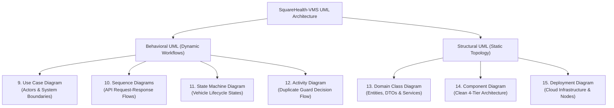

---

## 👥 9. Behavioral Modeling: System Use Case Diagram

The Use Case Diagram defines external actors and their direct interactions across system boundaries, enforcing the functional requirements (FR-01 through FR-10).

### 9.1 Actors Definition
1. **Fleet Manager**: Primary administrative operator managing fleet assets, registrations, and rental approvals.
2. **Fleet Operator / Staff**: Operational personnel executing daily check-ins, check-outs, and inspection logging.
3. **Maintenance Technician**: Specialized staff logging workshop service items, parts costs, and odometer intervals.
4. **System Administrator**: IT administrator managing user access, security roles, and system audit logs.

### 9.2 System Use Case Model

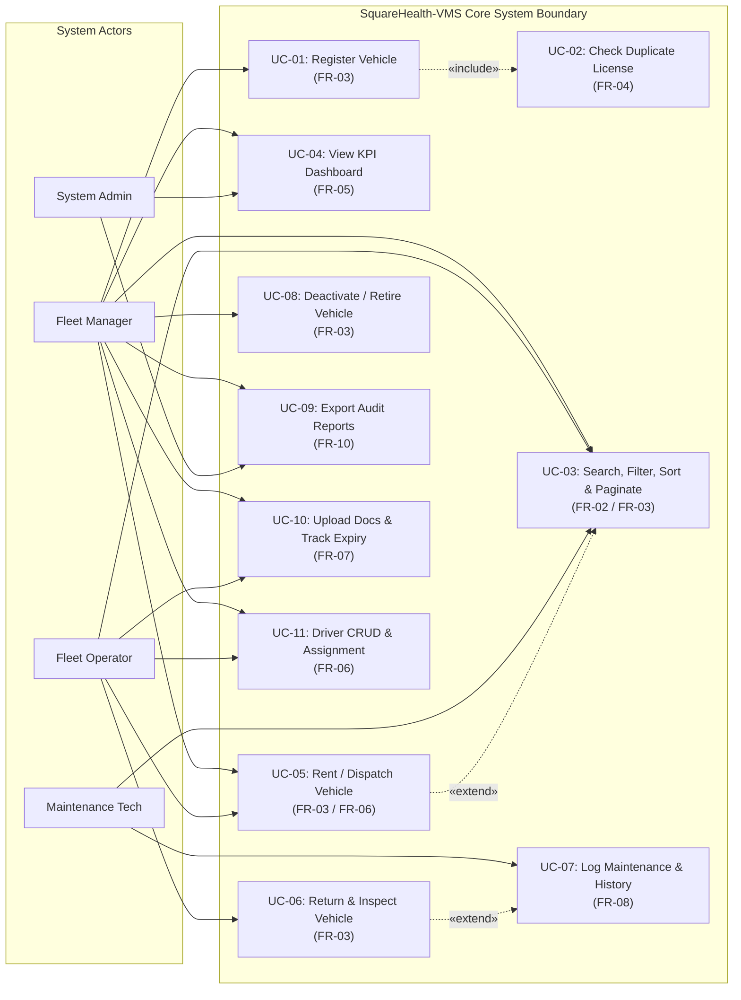

---

## 🔄 10. Behavioral Modeling: Sequence Diagrams

### 10.1 Sequence 1: Vehicle Registration with Duplicate License Plate Guard (FR-01 & FR-02)
This sequence illustrates the end-to-end execution of registering a new corporate vehicle, verifying license plate uniqueness, and handling either `201 Created` or `409 Conflict`.

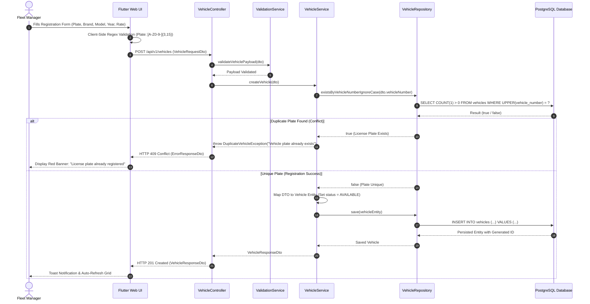

### 10.2 Sequence 2: Vehicle Rental Allocation Flow (FR-03)
This sequence details renting an available vehicle to a designated corporate driver, computing rental billing, and transitioning entity state.

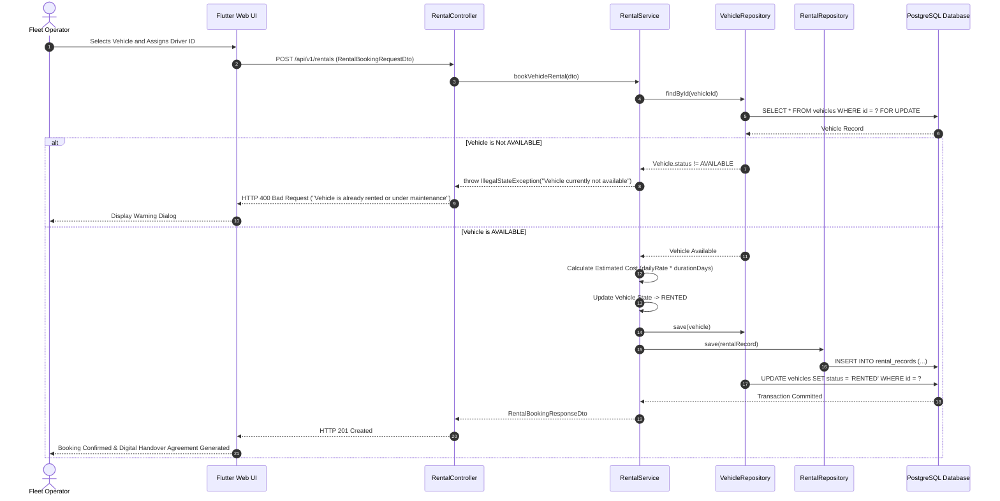

---

## 🚦 11. Behavioral Modeling: Vehicle State Machine Diagram

The State Machine Diagram formalizes all valid lifecycle states and transition guards for the `Vehicle` entity, preventing illegal business operations (e.g., renting a vehicle currently in workshop maintenance).

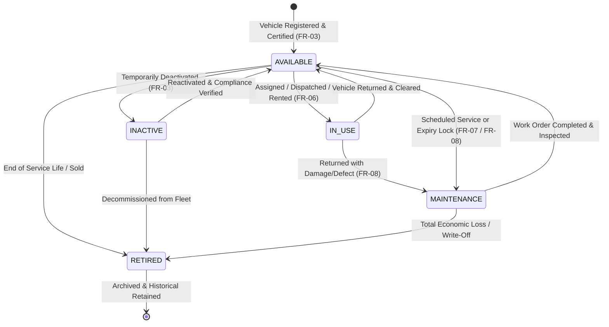

### State Transition Invariant Table
| Current State | Target State | Triggering Event | Guard Condition |
|---|---|---|---|
| `AVAILABLE` | `IN_USE` | `allocateOrDispatch()` | Driver license valid, compliance docs not `EXPIRED` |
| `IN_USE` | `AVAILABLE` | `returnVehicle()` | Inspection passed, zero mechanical faults |
| `IN_USE` | `MAINTENANCE` | `reportDamageOnReturn()` | Fault logged, maintenance work order created |
| `AVAILABLE` | `MAINTENANCE` | `scheduleService()` | Odometer threshold exceeded or periodic inspection |
| `MAINTENANCE` | `AVAILABLE` | `completeWorkOrder()` | Technician sign-off, road test cleared |
| `AVAILABLE` | `INACTIVE` | `deactivateVehicle()` | No active trip/rental, fleet manager authorization |
| `INACTIVE` | `AVAILABLE` | `reactivateVehicle()` | Registration, Tax Token & Insurance `VALID` |
| `AVAILABLE` / `INACTIVE` | `RETIRED` | `decommissionVehicle()` | Vehicle age > 10 yrs or salvage decision |

---

## 📊 12. Behavioral Modeling: Activity Diagram

### Duplicate Detection & Registration Decision Flow

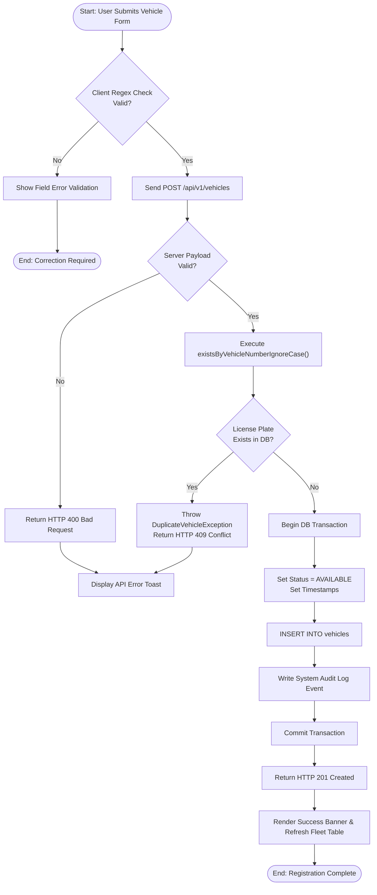

---

## 🏛️ 13. Structural Modeling: Domain & Architecture Class Diagram

This class diagram defines the complete domain model, service layer contracts, repository interfaces, and Data Transfer Objects (DTOs) for the Spring Boot backend engine.

```mermaid
classDiagram
    class VehicleStatus {
        <<enumeration>>
        AVAILABLE
        ACTIVE
        IN_USE
        MAINTENANCE
        INACTIVE
        RETIRED
    }

    class VehicleType {
        <<enumeration>>
        CAR
        SUV
        VAN
        MICROBUS
        BUS
        TRUCK
        PICKUP
        MOTORCYCLE
        AMBULANCE
    }

    class FuelType {
        <<enumeration>>
        PETROL
        DIESEL
        OCTANE
        CNG
        LPG
        HYBRID
        ELECTRIC
    }

    class DocumentType {
        <<enumeration>>
        REGISTRATION
        TAX_TOKEN
        INSURANCE
        FITNESS
        ROUTE_PERMIT
        VEHICLE_PHOTO
    }

    class ExpiryStatus {
        <<enumeration>>
        VALID
        EXPIRING_SOON
        EXPIRED
    }

    class Vehicle {
        -Long id
        -String vehicleNumber
        -String company
        -VehicleType vehicleType
        -String brand
        -String model
        -Integer manufacturingYear
        -String color
        -Integer seatingCapacity
        -VehicleStatus status
        -BigDecimal dailyRate
        -FuelType fuelType
        -Integer odometerKm
        -String driverName
        -String driverPhone
        -Driver assignedDriver
        -String department
        -LocalDateTime createdAt
        -LocalDateTime updatedAt
        +isAvailable() Boolean
        +markInUse() void
        +markAvailable() void
        +markInactive() void
        +sendToMaintenance() void
        +retire() void
    }

    class Driver {
        -Long id
        -String nationalId
        -String fullName
        -String licenseNumber
        -LocalDate licenseExpiryDate
        -String phone
        -String emergencyContact
        -Boolean medicalCleared
        -Boolean active
        +isEligible() Boolean
    }

    class VehicleDocument {
        -Long id
        -Vehicle vehicle
        -DocumentType documentType
        -String fileName
        -String fileUrl
        -LocalDate expiryDate
        -ExpiryStatus expiryStatus
        -LocalDateTime uploadedAt
        +computeExpiryStatus() ExpiryStatus
    }

    class RentalBooking {
        -Long id
        -Vehicle vehicle
        -Driver driver
        -LocalDateTime startDate
        -LocalDateTime expectedReturnDate
        -LocalDateTime actualReturnDate
        -BigDecimal totalCost
        -String status
        +closeRental(LocalDateTime returnDate) void
    }

    class MaintenanceLog {
        -Long id
        -Vehicle vehicle
        -LocalDate serviceDate
        -String maintenanceType
        -BigDecimal serviceCost
        -String workshopVendor
        -String notes
        -Integer serviceOdometer
        -String invoiceNumber
    }

    class PagedResponse~T~ {
        +List~T~ content
        +Boolean hasNext
        +Long totalElements
    }

    class VehicleRequestDto {
        +String vehicleNumber
        +String company
        +VehicleType vehicleType
        +String brand
        +String model
        +Integer manufacturingYear
        +String color
        +Integer seatingCapacity
        +FuelType fuelType
        +VehicleStatus status
        +BigDecimal dailyRate
        +String driverName
        +String driverPhone
        +String department
    }

    class VehicleResponseDto {
        +Long id
        +String vehicleNumber
        +String company
        +VehicleType vehicleType
        +String brand
        +String model
        +Integer manufacturingYear
        +String color
        +Integer seatingCapacity
        +FuelType fuelType
        +VehicleStatus status
        +BigDecimal dailyRate
        +String driverName
        +String driverPhone
        +LocalDateTime createdAt
        +LocalDateTime updatedAt
    }

    class VehicleController {
        -VehicleService vehicleService
        +getVehicles(int page, int size, String search, String status, String sort) ResponseEntity
        +getVehicleById(Long id) ResponseEntity
        +createVehicle(VehicleRequestDto dto) ResponseEntity
        +updateVehicle(Long id, VehicleRequestDto dto) ResponseEntity
        +deleteVehicle(Long id) ResponseEntity
        +assignDriver(Long id, Long driverId) ResponseEntity
    }

    class VehicleService {
        «Interface»
        +getVehicles(int page, int size, String search, String status, String sort) PagedResponse~VehicleResponseDto~
        +getVehicleById(Long id) VehicleResponseDto
        +createVehicle(VehicleRequestDto dto) VehicleResponseDto
        +updateVehicle(Long id, VehicleRequestDto dto) VehicleResponseDto
        +deleteVehicle(Long id) void
        +assignDriver(Long vehicleId, Long driverId) VehicleResponseDto
    }

    class VehicleServiceImpl {
        -VehicleRepository vehicleRepository
        -DriverRepository driverRepository
        -VehicleMapper vehicleMapper
        +getVehicles(int page, int size, String search, String status, String sort) PagedResponse~VehicleResponseDto~
        +createVehicle(VehicleRequestDto dto) VehicleResponseDto
    }

    class VehicleRepository {
        «Interface»
        +existsByVehicleNumberIgnoreCase(String plate) Boolean
        +findByStatus(VehicleStatus status) List~Vehicle~
        +findByBrandContainingIgnoreCase(String brand) List~Vehicle~
    }

    Vehicle --> VehicleStatus : has status
    Vehicle --> VehicleType : has type
    Vehicle --> FuelType : uses fuel
    Vehicle --> Driver : assigned to
    VehicleDocument --> Vehicle : attached to
    VehicleDocument --> DocumentType : categorized as
    VehicleDocument --> ExpiryStatus : tracks expiry
    RentalBooking --> Vehicle : references
    RentalBooking --> Driver : booked by
    MaintenanceLog --> Vehicle : repairs
    VehicleController --> VehicleService : delegates to
    VehicleServiceImpl ..|> VehicleService : implements
    VehicleServiceImpl --> VehicleRepository : persists through
    VehicleController ..> VehicleRequestDto : accepts
    VehicleController ..> VehicleResponseDto : produces
    VehicleController ..> PagedResponse : paginates with
```

---

## 🧱 14. Structural Modeling: Clean 4-Tier Component Diagram

The Component Diagram visualizes high cohesion and loose coupling across system layers, enforcing dependency inversion.

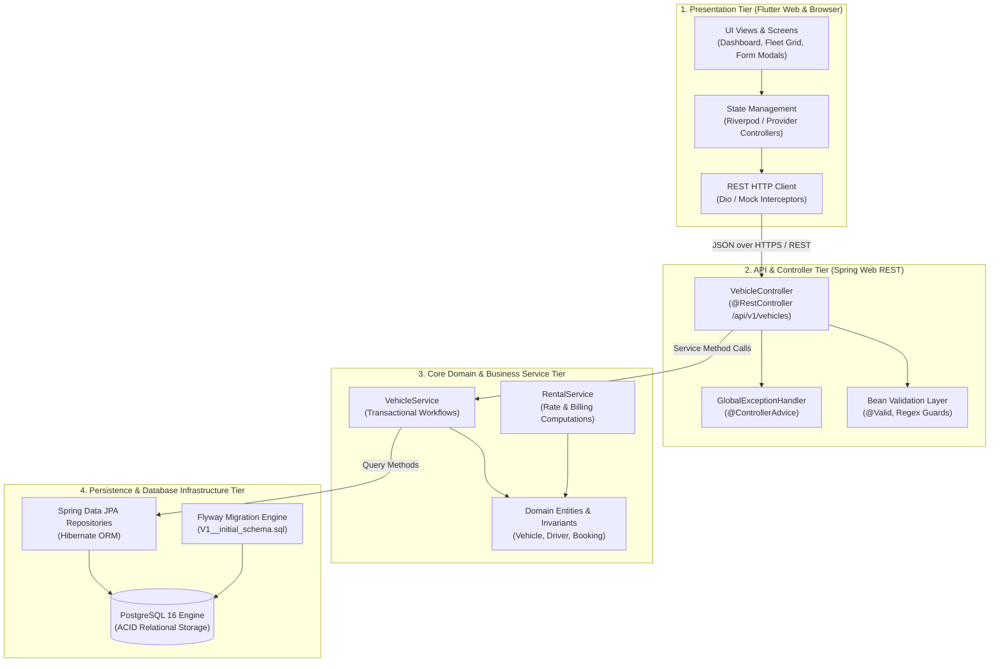

---

## 🌐 15. Structural Modeling: Production Deployment Diagram

The Deployment Diagram details physical execution environments, network protocols, containerization boundaries, and external ports.

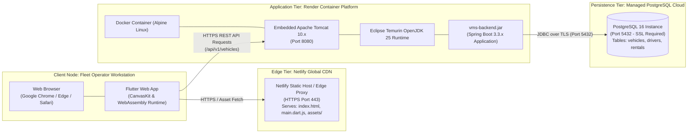

---

# PART III: TRACEABILITY & DOWNSTREAM DIRECTIVES

## 🗺️ 16. Unified Requirements & UML Traceability Matrix (RTM)

| Req ID | Category | Target Architectural Layer | Core UML Artifact | Implemented Artifact / Specification |
|---|---|---|---|---|
| **FR-01** | Authentication & RBAC | SecurityFilter / Controller | Use Case (`UC-01`), Component Tier 2 | `AuthController.java`, `login_screen.dart` |
| **FR-02** | Operating Company Classification | Entity / Service / UI | Class Diagram (`Vehicle.company`), Component Tier 1 | `Vehicle.java`, `vehicles_mock.json` |
| **FR-03** | Vehicle Master CRUD, Search, Filter, Sort & Pagination | Service / Controller / UI | Sequence 1 (`10.1`), Class (`Vehicle`, `PagedResponse`, `VehicleType`) | `VehicleController.java`, `PagedResponse.java`, `DataSeeder.java`, `vehicle_form_dialog.dart` |
| **FR-04** | Duplicate Plate Prevention | Business Rule & DB Invariant | Sequence 1 (`10.1`), Activity Diagram | `VehicleServiceImpl.java`, `VehicleControllerTest.java` |
| **FR-05** | Executive Analytics | Service / Controller / UI | Use Case (`UC-04`), Component Tier 1 | `DashboardController.java`, `dashboard_screen.dart` |
| **FR-06** | Driver CRUD & Assignment / Reassignment | Service / Persistence / UI | Use Case (`UC-11`), Class (`Driver`, `RentalBooking`) | `DriverController.java`, `Vehicle.java`, `V1__init_schema.sql` |
| **FR-07** | Document Upload & Compliance Expiry | Domain Logic / Storage / UI | Use Case (`UC-10`), Class (`VehicleDocument`, `ExpiryStatus`), State Machine | `DocumentController.java`, `validators.dart`, `vehicles_mock.json` |
| **FR-08** | Maintenance & Per-Vehicle History | State Machine / Service / DB | Use Case (`UC-07`), Class (`MaintenanceLog`), State Machine (Section 11) | `MaintenanceController.java`, `V1__init_schema.sql`, `Vehicle.java` |
| **FR-09** | Fuel Reserves Alerting | Domain Logic / Analytics | Class (`Vehicle.fuelType`, DTOs) | `DashboardStatsDto.java`, `VehicleRequestDto.java` |
| **FR-10** | Immutable Audit Trail | Persistence / Entity | Activity Diagram (Audit step) | `V1__init_schema.sql` |
| **NFR-01** | Latency & Performance | Database & Backend | Class Diagram, Indexes | `V1__init_schema.sql` B-Tree indexes |
| **NFR-02** | Scalability & Connection Pool | Infrastructure / Backend | Component Tier 4 (HikariCP) | `application.properties` |
| **NFR-03** | Availability & Uptime | Infrastructure | Deployment Diagram (Render) | `application.properties` |
| **NFR-04** | Security & CORS | Filter / Web Security | Component Tier 2 | `CorsConfig.java` |
| **NFR-05** | Data Integrity & ACID | Database Schema | Class Diagram Constraints | `V1__init_schema.sql` |
| **NFR-06** | Material 3 UI & WCAG | Client Presentation | Component Tier 1 (Flutter) | `app_theme.dart`, `app_colors.dart` |
| **NFR-07** | Layered Clean Architecture | Codebase Topology | Component Diagram (4-Tier) | `vms-backend/src/test/...` |
| **NFR-08** | Containerization | DevOps | Deployment Diagram (Docker) | `vms-backend/Dockerfile`, `vms-frontend/Dockerfile` |
| **NFR-09** | RFC 7807 Observability | Framework / ControllerAdvice | Sequence 1 (`ErrorResponseDto`) | `GlobalExceptionHandler.java`, `ErrorResponseDto.java` |
| **NFR-10** | Disaster Recovery | Database Storage | Deployment Diagram (Managed DB) | Cloud PostgreSQL specification |

---

## 🚀 17. Downstream Engineering Directives

1. **For Database Generation**: Use the **Domain Class Diagram** (Section 13) and **State Machine Diagram** (Section 11) to implement Flyway DDL tables, foreign keys, and check constraints for [STEP_4_DATABASE_SPECIFICATION.md](file:///c:/Users/HP/Documents/GitHub/SquareHealth-VMS/AI_Pair_Programming/query/specifications/STEP_4_DATABASE_SPECIFICATION.md).
2. **For Spring Boot Controllers & Services**: Follow the **Sequence Diagrams** (Section 10) to implement REST controllers, `@Valid` DTO validation, service transactions, and global exception mapping for [STEP_5_BACKEND_SPECIFICATION.md](file:///c:/Users/HP/Documents/GitHub/SquareHealth-VMS/AI_Pair_Programming/query/specifications/STEP_5_BACKEND_SPECIFICATION.md).
3. **For Frontend Development**: Bind Flutter UI screens, dialogs, and error alerts according to the **Activity Diagram** (Section 12) and **Component Diagram** (Section 14).
4. **For DevOps & Cloud Engineering**: Implement the containerized orchestration following the **Deployment Diagram** (Section 15) for [STEP_8_DEPLOYMENT_SPECIFICATION.md](file:///c:/Users/HP/Documents/GitHub/SquareHealth-VMS/AI_Pair_Programming/query/specifications/STEP_8_DEPLOYMENT_SPECIFICATION.md).
