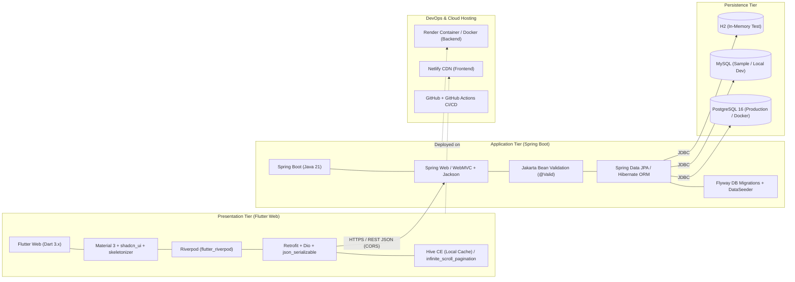

# SquareHealth-VMS (Stark Group VMS) — Complete Technology Stack

This document defines the complete, end-to-end **Technology Stack** for **SquareHealth-VMS (Stark Group Vehicle Management System)**, synthesized from all sources in `System_Requirements/Data_Ingestion/` (the Udemy curriculum, YouTube Kickoff & Weekly Support Sessions 01–02, `Projecet Requirements DataV.docx`, `Assignment-2.png`, and the `stark-vms-backend.zip` / `stark_vms-frontend.zip` reference projects) alongside the active monorepo configuration.

---

## 1. High-Level Stack Topology

---

## 2. Frontend Technology Stack (`vms-frontend` & Reference `stark_vms`)

| Layer / Capability | Technology / Package | Version / Details | Source & Role |
|---|---|---|---|
| **Core Framework** | **Flutter Web** | Dart SDK `^3.0.0` / `^3.13.4` | Cross-platform UI framework targeting Web (CanvasKit / WASM), with responsive/adaptive support for Desktop, Tablet, and Mobile viewports. |
| **Design System & UI** | **Material 3** + **`shadcn_ui`** | `shadcn_ui: ^0.59.0` | Modern enterprise UI components, cards, dialogs, badges (`AVAILABLE`, `IN_USE`, `MAINTENANCE`, `INACTIVE`, `EXPIRED`, `EXPIRING_SOON`). |
| **Loading & UX Polish** | **`skeletonizer`** | `skeletonizer: ^3.0.0` | Skeleton loading placeholders during async API fetches. |
| **State Management** | **Riverpod** (`flutter_riverpod`) | `flutter_riverpod: ^3.5.0` | Reactive provider-based state management for vehicle lists, filters, search, and CRUD mutations. |
| **Networking & REST Client** | **Dio** + **Retrofit** | `dio: ^5.11.1`, `retrofit: ^4.10.0` | Annotation-driven HTTP client (`@GET`, `@POST`, `@PUT`, `@DELETE`, multipart uploads) with timeout/error interceptors. *(Workspace baseline also supports `http: ^1.2.0` with mock fallback).* |
| **JSON Serialization** | **`json_annotation`** + **`json_serializable`** | `^4.12.0` / `^6.15.2` | Type-safe `fromJson` / `toJson` code generation (`*.g.dart`) for `Vehicle`, `PageResponse`, and `ApiError`. |
| **Pagination** | **`infinite_scroll_pagination`** | `^5.1.1` | Server-side paginated list/grid rendering (`page`, `size`, `PagedResponse`). |
| **Local Storage / Cache** | **Hive CE** (`hive_ce`, `hive_ce_flutter`) | `^2.23.3` / `^2.5.0` | Lightweight local key-value persistence and offline caching. |
| **Code Generation** | **`build_runner`** + **`retrofit_generator`** | `^2.17.1` / `^10.3.3` | Generates `.g.dart` bindings via `dart run build_runner build`. |
| **Icons & Linting** | `cupertino_icons`, `flutter_lints` | `^1.0.8`, `^3.0.0` / `^6.0.0` | Vector icon sets and strict Dart static analysis rules. |

---

## 3. Backend Technology Stack (`vms-backend` & Reference `stark-vms-backend`)

| Layer / Capability | Technology / Dependency | Version / Details | Source & Role |
|---|---|---|---|
| **Language & Runtime** | **Java** (OpenJDK / Eclipse Temurin) | **Java 21** (Prod container: OpenJDK 21 / 25) | Strongly-typed JVM runtime with modern records/switch expressions. |
| **Application Framework** | **Spring Boot** | `3.2.3` (Workspace Maven) / `4.1.2` (Sample Gradle) | Embedded Apache Tomcat, auto-configuration, production-ready REST APIs. |
| **Build Tools** | **Apache Maven** / **Gradle** | Maven (`pom.xml`) / Gradle (`build.gradle`) | Dependency management and executable fat-JAR packaging. |
| **Web / REST Layer** | `spring-boot-starter-web` / `webmvc` | Included in Spring Boot | `@RestController`, `@CrossOrigin`, Jackson JSON serialization (`sort-properties-alphabetically=false`), RFC 7807 error envelopes. |
| **ORM & Persistence** | `spring-boot-starter-data-jpa` | Hibernate ORM + Spring Data JPA | Repository abstractions (`VehicleRepository`), pagination (`Page<T>` / `PagedResponse<T>`), `@CreationTimestamp`, `@UpdateTimestamp`. |
| **Validation** | `spring-boot-starter-validation` | Jakarta Bean Validation (`@Valid`, `@NotBlank`, `@NotNull`, `@Min`, `@Positive`) | Request payload enforcement at controller boundaries. |
| **Boilerplate Reduction** | **Project Lombok** | `org.projectlombok:lombok` | `@Getter`, `@Setter`, `@NoArgsConstructor`, `@AllArgsConstructor`, `@Builder` (used in `stark-vms-backend`). |
| **Startup Data Seeding** | `DataSeeder` (`CommandLineRunner`) | Application startup hook | Checks `vehicleRepository.count() == 0` and seeds 20 mock fleet vehicles automatically. |
| **File / Document Upload** | Spring `MultipartFile` | `multipart/form-data` | Supports Assignment-2 uploads for Vehicle Photo, Registration, Tax Token, and Insurance documents. |

---

## 4. Database & Persistence Layer

| Environment | Database Engine | Driver / Tooling | Purpose |
|---|---|---|---|
| **Production / Docker** | **PostgreSQL 16** (`postgres:16-alpine`) | `org.postgresql:postgresql` + **Flyway** (`flyway-core`) | ACID-compliant relational storage, versioned DDL migrations (`db/migration/`), `UNIQUE` constraint on `vehicle_number`. |
| **Sample Project / Local Dev** | **MySQL** (`localhost:3306/stark_group_vms`) | `com.mysql:mysql-connector-j` | Used in `stark-vms-backend` and Session 01–02 live demos (`spring.jpa.hibernate.ddl-auto=update`). |
| **Automated Testing** | **H2 Database** | `com.h2database:h2` | Fast in-memory SQL database for isolated unit/integration tests. |

---

## 5. Security, Authentication & Compliance Stack

- **Authentication & Authorization (Assignment 2 / Extended Scope)**:
  - **Spring Security** with Role-Based Access Control (`ADMIN`, `FLEET_MANAGER`, `DISPATCHER`, `DRIVER`).
  - **JWT (JSON Web Tokens)** signed with HMAC-SHA256 for stateless Bearer authentication.
  - **BCrypt** password hashing (never storing or logging plaintext passwords).
- **API & Data Integrity**:
  - **CORS Configuration** (`@CrossOrigin` / `CorsConfig`) for decoupled Flutter Web origins.
  - **Triple-Layer Duplicate Plate Guard**: Service pre-check (`existsByVehicleNumberIgnoreCase`), DB `UNIQUE` constraint, and `GlobalExceptionHandler` returning HTTP `409 Conflict`.
  - **Parameterized JPA Queries**: Prevents SQL injection across search, filter, and sort queries.

---

## 6. Testing & Quality Assurance Stack

| Scope | Framework / Tool | Purpose |
|---|---|---|
| **Backend Unit & API Tests** | **JUnit 5** (`junit-platform-launcher`), **Mockito**, **Spring MockMvc** (`spring-boot-starter-test`) | Tests service business rules (duplicate vehicle plate rejection), controller REST contracts (`VehicleControllerTest`), and HTTP status codes (`200`, `201`, `204`, `400`, `404`, `409`). |
| **Frontend Tests & Linting** | **Flutter Test** (`flutter_test`), **`flutter_lints`** | Widget tests (`widget_test.dart`), form validation tests, and static Dart lint enforcement. |
| **E2E Verification** | Live Frontend ↔ Backend integration | Verifies paginated fetch, search, filter, create, update, delete, and error banners end-to-end. |

---

## 7. DevOps, Containerization & Cloud Deployment

| Component | Technology / Platform | Configuration & Role |
|---|---|---|
| **Containerization** | **Docker** & **Docker Compose** | Multi-container orchestration via `docker-compose.yml` (`postgres:16-alpine` on `:5432`, `vms-backend` on `:8080`, `vms-frontend` on `:3000`). |
| **Frontend Hosting** | **Netlify** | Static/CDN deployment of `flutter build web --release` over HTTPS. |
| **Backend & DB Hosting** | **Render** | Containerized Spring Boot service connected to managed Cloud PostgreSQL. |
| **Version Control & CI/CD** | **Git**, **GitHub**, **GitHub Desktop**, **GitHub Actions** | Monorepo version control, automated build/test pipelines, and continuous deployment. |

---

## 8. AI Pair-Programming & Developer Tooling

- **Google Antigravity IDE**: Primary AI pair-programming environment used for full-stack code generation, refactoring, and verification (powered by **Gemini** models).
- **IntelliJ IDEA**: Java / Spring Boot IDE for backend execution, debugging, and database inspection.
- **Flutter SDK & Dart CLI**: Local web/mobile compilation and `build_runner` code generation.

---

## 9. Source Traceability (`Data_Ingestion`)

- **[DataIngestiion.md](file:///c:/Users/USER/Documents/.MYGITHUB/SquareHealth-VMS/System_Requirements/Data_Ingestion/DataIngestiion.md)**: Core Flutter Web, Spring Boot, PostgreSQL/MySQL, Git/GitHub, Netlify, Render, and Google Antigravity stack.
- **[Assignment-2.png](file:///c:/Users/USER/Documents/.MYGITHUB/SquareHealth-VMS/System_Requirements/Data_Ingestion/Document%26Images/Assignment-2.png)**: Extended feature requirements driving multipart document upload, server-side search/filter/sort/pagination, driver CRUD, maintenance history, and analytics dashboard.
- **[003 - session_weekly_support_02 Transcript.md](file:///c:/Users/USER/Documents/.MYGITHUB/SquareHealth-VMS/System_Requirements/Data_Ingestion/YoutubeScrapper/003%20-%20session_weekly_support_02%20Transcript.md)**: Retrofit + Dio, `json_serializable` + `build_runner`, `DataSeeder`, MySQL, Responsive vs. Adaptive Flutter UI, Clean/MVVM architecture, and optional RBAC authentication.
- **[stark-vms-backend.zip](file:///c:/Users/USER/Documents/.MYGITHUB/SquareHealth-VMS/System_Requirements/Data_Ingestion/SampleProject/stark-vms-backend.zip)** & **[stark_vms-frontend.zip](file:///c:/Users/USER/Documents/.MYGITHUB/SquareHealth-VMS/System_Requirements/Data_Ingestion/SampleProject/stark_vms-frontend.zip)**: Exact Gradle/Java 21/Lombok/MySQL backend dependencies and `pubspec.yaml` (`riverpod`, `retrofit`, `dio`, `shadcn_ui`, `skeletonizer`, `infinite_scroll_pagination`, `hive_ce`, `json_serializable`) frontend dependencies.
