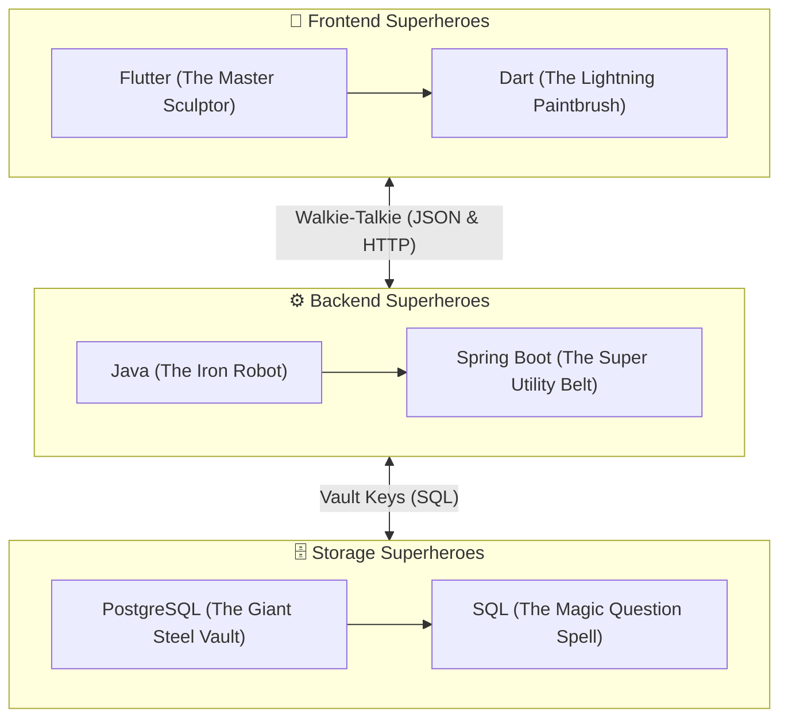
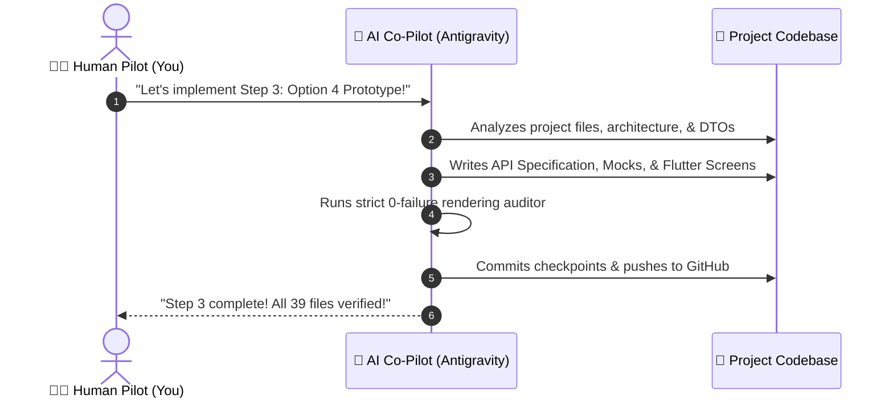
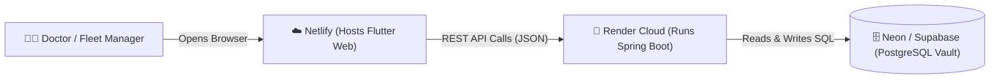

# 🚗 The Super Cool Stark Group Vehicle Guide (Explain-to-a-10-Year-Old Edition)

> **Welcome, Young Engineer!**  
> Imagine you have been hired as the Chief Commander of a giant fleet of ambulances, emergency medicine delivery vans, and doctor cars across Bangladesh. How do you make sure no car gets lost, every sick patient gets their medicine on time, and every ambulance has enough fuel and working tires?  
>
> You build a **Vehicle Management System (VMS)**!  
> This notebook is your secret guide. It explains every single piece of technology, every step we took, and every smart trick we used—so simply that even a 10-year-old kid can understand it all!

---

## 🌟 Table of Contents
1. [Chapter 1: The Big Story — Why Are We Building This?](#chapter-1-the-big-story--why-are-we-building-this)
2. [Chapter 2: The Three Magical Parts of Every App](#chapter-2-the-three-magical-parts-of-every-app)
3. [Chapter 3: Meet the Technology Superheroes](#chapter-3-meet-the-technology-superheroes)
4. [Chapter 4: The Secret Language of Computers (JSON & HTTP Walkie-Talkies)](#chapter-4-the-secret-language-of-computers-json--http-walkie-talkies)
5. [Chapter 5: The Time Machine & Magic Cloud Vault (Git & GitHub)](#chapter-5-the-time-machine--magic-cloud-vault-git--github)
6. [Chapter 6: AI-Assisted Pair Programming (The Pilot & The Robot Co-Pilot)](#chapter-6-ai-assisted-pair-programming-the-pilot--the-robot-co-pilot)
7. [Chapter 7: Step-by-Step — How We Built the VMS Project](#chapter-7-step-by-step--how-we-built-the-vms-project)
   - [Step 1: Gathering the Story & Rules (Requirements)](#step-1-gathering-the-story--rules-requirements)
   - [Step 2: Designing the 4-Floor Castle (Architecture)](#step-2-designing-the-4-floor-castle-architecture)
   - [Step 3: Building the Wooden Toy Model First (Contract + Prototype)](#step-3-building-the-wooden-toy-model-first-contract--prototype)
   - [Step 4: Digging the Underground Steel Vault (Database & SQL)](#step-4-digging-the-underground-steel-vault-database--sql)
   - [Step 5: Building the Real Heavy Metal Engine (Spring Boot)](#step-5-building-the-real-heavy-metal-engine-spring-boot)
   - [Step 6: Plugging the Wires Together (Full-Stack Integration)](#step-6-plugging-the-wires-together-full-stack-integration)
   - [Step 7: The Crash-Test Dummies (Quality Testing)](#step-7-the-crash-test-dummies-quality-testing)
   - [Step 8: Flying to the Cloud (Worldwide Deployment)](#step-8-flying-to-the-cloud-worldwide-deployment)
8. [Chapter 8: The Kid's Tech Dictionary (Glossary)](#chapter-8-the-kids-tech-dictionary-glossary)

---

## Chapter 1: The Big Story — Why Are We Building This?

Imagine you own a huge hospital group called **Stark Group** in Bangladesh.
Every day, amazing things happen:
- An ambulance needs to rush to pick up an injured grandfather.
- A delivery van with boxes of life-saving medicine must drive from Dhaka to Chittagong before sunset.
- A doctor needs a safe car to visit an emergency clinic.

Now, imagine doing this with **sticky paper notes**:
- *"Wait, who took Ambulance #4?"*
- *"Oh no, Delivery Van #12 has a broken wheel and is stuck in the garage!"*
- *"Someone wrote the wrong license plate number on paper, and now two drivers are arguing over the same vehicle!"*

Chaos, right?

That is why we build **Software**!
A **Vehicle Management System (VMS)** is like an **Air Traffic Control Tower**, but for vehicles on the road. On a glowing computer screen, the fleet manager can see:
1. Every car that is **AVAILABLE** (ready to zoom!).
2. Every car that is **IN TRIP** (currently on the road delivering medicine).
3. Every car that is in **MAINTENANCE** (at the workshop getting an oil change or new brakes).

No lost cars. No forgotten repairs. Patients get helped on time, every time!

---

## Chapter 2: The Three Magical Parts of Every App

Think of a computer application like a **Restaurant**:

```
 _________________________________________________________________________
|                                                                         |
|   1. THE DINING ROOM (Frontend)                                         |
|      - Beautiful tables, menus, lights, and friendly waiters.           |
|      - What the customer sees, touches, and clicks!                     |
|                                                                         |
|                       |  (Waiter takes your order note)                 |
|                       v                                                 |
|                                                                         |
|   2. THE KITCHEN (Backend)                                              |
|      - The head chef, frying pans, fire, and secret recipes.            |
|      - Does the hard cooking work you never see from your table.        |
|                                                                         |
|                       |  (Chef opens the locked pantry)                 |
|                       v                                                 |
|                                                                         |
|   3. THE PANTRY & REFRIGERATOR (Database)                               |
|      - Cold storage shelves where fresh ingredients stay safe forever.   |
|      - Even if the restaurant closes at night, food stays inside!        |
|_________________________________________________________________________|
```

### 1. The Frontend (The Dining Room)
- This is what opens up in your web browser (like Google Chrome).
- It has colorful buttons, search boxes, badges that turn green or yellow, and picture cards.
- **Our Tool:** We use **Flutter Web** and **Dart** to build it!

### 2. The Backend (The Kitchen)
- This is an invisible computer program running on a server in the cloud.
- When you click "Register Vehicle", the frontend gives the info to the backend. The backend checks: *"Is this license plate real? Is it already in our garage?"*
- If everything is good, the backend allows it!
- **Our Tool:** We use **Java** and **Spring Boot** to build it!

### 3. The Database (The Pantry)
- If the computer turns off or loses power, the backend forgets things stored in its quick memory (RAM).
- The Database is like a giant, magical, fireproof steel notebook. It writes down every vehicle, driver, and trip on disk so it is **never lost**.
- **Our Tool:** We use **PostgreSQL** and **SQL** to run it!

---

## Chapter 3: Meet the Technology Superheroes

Let's meet each technology used in our project as if they were comic book heroes:



### 1. Flutter (The Master Sculptor)
- **What is it?** A toolkit made by Google.
- **Kid Analogy:** Imagine you have an endless box of snap-together LEGO bricks. One LEGO brick is a blue button. Another brick is a card with a picture of an ambulance. Flutter lets you snap these LEGO bricks (called **Widgets**) together to build any screen you can imagine!
- **Superpower:** Flutter can paint your app on a laptop, an iPhone, an Android phone, or a web browser, and it looks super smooth everywhere.

### 2. Dart (The Lightning Paintbrush)
- **What is it?** The programming language used to talk to Flutter.
- **Kid Analogy:** If Flutter is the box of LEGO bricks, Dart is the set of instructions that says: *"When the user taps the red button, make a sound and show a dialog box!"*
- **Superpower:** It is super fast and catches typos before you even run your app.

### 3. Java (The Iron Robot)
- **What is it?** One of the most famous, rock-solid programming languages in the world.
- **Kid Analogy:** Java is like a giant iron robot. It does not allow sloppy behavior. If you tell it a vehicle number must be letters and numbers, it stands at the door and guards it with laser eyes.
- **Superpower:** Banks, space shuttles, and giant hospitals use Java because it never falls asleep and never breaks down.

### 4. Spring Boot (The Super Utility Belt)
- **What is it?** A framework that sits on top of Java.
- **Kid Analogy:** Imagine Batman without his gadgets—he is still strong, but with his utility belt, he can climb walls, throw batarangs, and call the Batmobile! Spring Boot gives Java a full utility belt: instant web servers, security guards, and database connectors.

### 5. PostgreSQL & SQL (The Giant Steel Vault)
- **What is it?** A world-class relational database.
- **Kid Analogy:** Think of a spreadsheet with millions of rows and columns, but locked inside a bank vault. **SQL** is the secret spell you whisper into the microphone:
  `SELECT * FROM vehicles WHERE status = 'AVAILABLE';`
  Instantly, the vault door slides open and shows only the vehicles that are ready to drive!

---

## Chapter 4: The Secret Language of Computers (JSON & HTTP Walkie-Talkies)

How do the **Frontend** (Flutter) and the **Backend** (Spring Boot) talk to each other if they are running in different places?

They use two things:
1. **HTTP** (The Walkie-Talkie channel).
2. **JSON** (The Secret Folded Notes).

### The Four Walkie-Talkie Commands (HTTP Methods)

When Flutter picks up the walkie-talkie to talk to Spring Boot, it has 4 buttons:

| Walkie-Talkie Button | Computer Name | What It Means to a 10-Year-Old |
|---|---|---|
| **GET** | `GET` | *"Hey backend, show me what you got!"* (Read the list of ambulances) |
| **POST** | `POST` | *"Hey backend, here is a brand new toy! Add it to the toy chest!"* (Register a new car) |
| **PUT** | `PUT` | *"Hey backend, this car got a new coat of paint. Update its information!"* (Edit car details) |
| **DELETE** | `DELETE` | *"Hey backend, this car was sold or scrapped. Take it off the list!"* (Remove a car) |

### The Walkie-Talkie Status Codes

When Spring Boot replies over the walkie-talkie, it starts with a three-digit secret code:

- **`200 OK`**: *"Roger that! Here is the information you asked for."*
- **`201 Created`**: *"Awesome! I just built and saved your new vehicle in the database!"*
- **`204 No Content`**: *"Done! I deleted that car. Nothing left to see."*
- **`400 Bad Request`**: *"Wait, what? You forgot to write the license plate number! Try again."*
- **`401 Unauthorized`**: *"Stop right there! You didn't give me the secret password badge!"*
- **`404 Not Found`**: *"I searched every shelf in the vault, and that car does not exist!"*
- **`409 Conflict`**: *"Hold on! You are trying to register a car with a license plate that already exists!"*

### JSON: The Folded Note Format

Instead of writing a long messy paragraph, computers use **JSON** (JavaScript Object Notation). It looks like a neat shopping list with curly braces:

```json
{
  "id": 1,
  "vehicleNumber": "DHAKA-METRO-GA-11-2233",
  "company": "Stark Group",
  "type": "Ambulance",
  "brand": "Toyota",
  "model": "HiAce",
  "status": "AVAILABLE"
}
```

Notice how easy that is? Even a human can read it!
- Left side: What the property is (e.g., `"brand"`).
- Right side: What the value is (e.g., `"Toyota"`).

---

## Chapter 5: The Time Machine & Magic Cloud Vault (Git & GitHub)

Have you ever played a video game with **Checkpoint Saves**?  
Right before you fight the big dragon boss, the game saves your progress. If the dragon breathes fire and you lose, you don't start the whole game over from level 1—you reload your checkpoint!

That is exactly what **Git** and **GitHub** do for programmers:

```
  Checkpoint 1 (Step 1)       Checkpoint 2 (Step 2)       Checkpoint 3 (Step 3)
   [ Requirements OK ]  -->   [ Architecture OK ]   -->   [ Mock & UI OK ]
            |                          |                          |
            \--------------------------+--------------------------/
                                       |
                              Saved Forever in
                           GitHub Cloud Fortress
```

### Git: The Time Machine on Your Laptop
- Every time we finish building something cool, we type `git commit`.
- That takes a permanent photograph of every file, word, and line of code.
- If we accidentally spill digital juice on our code and break something, Git lets us rewind the clock!

### GitHub: The Cloud Fortress
- Your laptop could run out of battery, get dropped, or be left at school.
- GitHub is a giant, secure computer bank on the internet.
- When we type `git push origin main`, all our checkpoints are teleported into the cloud so our teammates can see them and work together.

---

## Chapter 6: AI-Assisted Pair Programming (The Pilot & The Robot Co-Pilot)

Have you ever seen **Iron Man** flying in his armor while talking to **J.A.R.V.I.S.**?
- Tony Stark (the Human) says: *"Jarvis, we need extra power to the thrusters and a scan of the city building!"*
- Jarvis (the AI) computes the math, scans the blueprint, and warns Tony: *"Sir, oxygen levels are dropping, watch your altitude!"*

In our project, we use **AI-Assisted Pair Programming**:



1. **The Human Pilot** is the boss:
   - Sets the vision, picks the strategy (like choosing Option 4), and makes the high-level business decisions.
2. **The AI Co-Pilot** is the high-speed builder:
   - Writes the code, checks for typos, builds diagrams, audits rendering, and makes sure not a single comma is out of place.

Together, they can build in 2 hours what used to take a whole team 2 weeks!

---

## Chapter 7: Step-by-Step — How We Built the VMS Project

Here is the exact step-by-step story of how our project was created from scratch.

---

### Step 1: Gathering the Story & Rules (Requirements)

Before a builder hammers a single nail into wood, what do they do? They look at the blueprint and ask the customer what kind of house they want!

1. **The Scraping Mission**:
   - We took course lecture videos, support recordings, and PDF documents.
   - We used custom transcription tools to turn 76 minutes of spoken Bangla lecture audio into written text notes.
2. **The Ground Rules We Discovered**:
   - Every car must have a **unique** vehicle license plate number (no two cars can share a plate).
   - Only 3 official operational states exist:
     - `AVAILABLE`: In the parking lot, washed, tank full, ready to go!
     - `IN_TRIP`: Currently driving on a mission.
     - `MAINTENANCE`: At the repair shop.
   - Operating companies include: **Stark Group**, **Stark Industries**, **Stark Medical**, **Stark Logistics**.

All of this was locked into a master document named [`REQUIREMENTS.md`](file:///c:/Users/USER/Documents/.MYGITHUB/SquareHealth-VMS/1.Requirement_Gathering/REQUIREMENTS.md).

---

### Step 2: Designing the 4-Floor Castle (Architecture)

Next, we drew the structural blueprints. Imagine a 4-floor castle:

```
  Floor 4: The Observation Deck (Frontend - Flutter Web)
  -------------------------------------------------------------
  Floor 3: The Castle Gate & Guards (API Gateway & Security)
  -------------------------------------------------------------
  Floor 2: The Royal Kitchen & Brains (Backend - Spring Boot)
  -------------------------------------------------------------
  Floor 1: The Underground Steel Vault (Database - PostgreSQL)
```

We split our project folders so that everything has its own neat room:
- `vms-frontend/`: Contains only Flutter UI code, colors, widgets, and buttons.
- `vms-backend/`: Contains only Java Spring Boot controllers, entities, and server logic.
- `scripts/`: Contains helper tools, like our automated rendering auditor.
- `chat/`: Contains the complete, unedited conversation history between Pilot and Co-Pilot.

---

### Step 3: Building the Wooden Toy Model First (Contract + Prototype)

Why did we build **Step 3** before building the real database?
Imagine you are building a real rocket ship. Would you start by pouring hot rocket fuel into a giant metal cylinder, or would you first build a small wind-tunnel model out of light balsa wood to see if the wings fly straight?

You build the prototype first! This is called **Option 4: Contract + Prototype**.

```
    Phase 3A: The Rulebook           Phase 3B: The Pretend Data           Phase 3C: The Interactive Screen
   (specifications/STEP_3_SPECIFICATION.md)       -->     (vehicles_mock.json)        -->     (Flutter Web Prototype)
   "Signed contract between             "8 pretend ambulances &             "Clickable buttons, live search,
   Frontend & Backend teams"            medicine vans in memory"            modal forms & real-time badges"
```

#### What We Built in Step 3:

1. **The Contract ([`specifications/STEP_3_SPECIFICATION.md`](file:///c:/Users/USER/Documents/.MYGITHUB/SquareHealth-VMS/specifications/STEP_3_SPECIFICATION.md))**:
   - We wrote down the exact name of every single field:
     - `vehicleNumber` (text with regex rule `^[A-Z0-9-]+$`)
     - `company` (text)
     - `type` (Ambulance, Delivery Van, Microbus, Executive Sedan)
     - `brand` (Toyota, Hyundai, Nissan, etc.)
     - `model` (HiAce, Noah, Mighty, etc.)
     - `status` (`AVAILABLE`, `IN_TRIP`, `MAINTENANCE`)
   - Now, the Frontend team and Backend team will never argue over spelling or names!

2. **The Pretend Data ([`vehicles_mock.json`](file:///c:/Users/USER/Documents/.MYGITHUB/SquareHealth-VMS/vms-frontend/assets/mock_data/vehicles_mock.json))**:
   - We loaded 8 realistic vehicles:
     - 🚑 `DHAKA-METRO-GA-11-2233`: Toyota HiAce Ambulance (Ready!)
     - 🚚 `DHAKA-METRO-CHA-44-5566`: Hyundai Mighty Medicine Van (In Trip!)
     - 🚐 `DHAKA-METRO-BA-77-8899`: Toyota Noah Microbus (Under Repair!)
     - Plus 5 more vehicles across Stark Medical and Stark Logistics!

3. **The In-Memory Brain ([`VehicleService.dart`](file:///c:/Users/USER/Documents/.MYGITHUB/SquareHealth-VMS/vms-frontend/lib/features/vehicles/services/vehicle_service.dart))**:
   - We taught Flutter how to store these cars in memory.
   - If you search for `"Ambulance"`, it instantly filters the list!
   - If you try to register a car with an existing plate, it rings a red alarm: **"409 Conflict: Vehicle already exists!"**

4. **The Beautiful Screens**:
   - **Login Screen ([`login_screen.dart`](file:///c:/Users/USER/Documents/.MYGITHUB/SquareHealth-VMS/vms-frontend/lib/features/auth/presentation/login_screen.dart))**: A corporate sign-in card with one-click demo credentials (`admin` / `Password123!`).
   - **Dashboard ([`dashboard_screen.dart`](file:///c:/Users/USER/Documents/.MYGITHUB/SquareHealth-VMS/vms-frontend/lib/features/dashboard/presentation/dashboard_screen.dart))**: Big colorful cards showing Total Fleet count, Available count, In-Trip count, and progress bars showing readiness percentages!
   - **Vehicle List ([`vehicle_list_screen.dart`](file:///c:/Users/USER/Documents/.MYGITHUB/SquareHealth-VMS/vms-frontend/lib/features/vehicles/presentation/vehicle_list_screen.dart))**: Search bar, status filter buttons, edit buttons, and trash cans to remove old cars.
   - **Register & Edit Dialog ([`vehicle_form_dialog.dart`](file:///c:/Users/USER/Documents/.MYGITHUB/SquareHealth-VMS/vms-frontend/lib/features/vehicles/presentation/vehicle_form_dialog.dart))**: A pop-up window where you fill out the details with instant validation!

---

### Step 4: Digging the Underground Steel Vault (Database & SQL)

*(Coming Next in our journey!)*

Once our wooden prototype is tested and everyone loves it, we will build the real database:
- We will install **PostgreSQL**.
- We will create a table named `vehicles`:
  ```sql
  CREATE TABLE vehicles (
      id BIGSERIAL PRIMARY KEY,
      vehicle_number VARCHAR(50) UNIQUE NOT NULL,
      company VARCHAR(100) NOT NULL,
      type VARCHAR(50) NOT NULL,
      brand VARCHAR(50) NOT NULL,
      model VARCHAR(50) NOT NULL,
      status VARCHAR(20) NOT NULL DEFAULT 'AVAILABLE'
  );
  ```
- Notice that magic word `UNIQUE`? That tells the database: *"If someone tries to save a duplicate license plate, reject it immediately!"*

---

### Step 5: Building the Real Heavy Metal Engine (Spring Boot)

*(Coming Next in our journey!)*

We will bring the Java Spring Boot server to life:
1. **The Entity (`Vehicle.java`)**: A Java class that mirrors the database table.
2. **The Repository (`VehicleRepository.java`)**: The vault key that knows how to run SQL queries.
3. **The Service (`VehicleService.java`)**: The brain that checks business rules (e.g. *"Can this ambulance be scheduled if it's currently broken?"*).
4. **The Controller (`VehicleController.java`)**: The walkie-talkie antenna that listens for HTTP requests from Flutter!

---

### Step 6: Plugging the Wires Together (Full-Stack Integration)

Remember in Step 3 how Flutter used `vehicles_mock.json` for pretend data?
In Step 6, we flip **one single switch**:
```dart
// Change this:
final vehicleService = VehicleService(useMock: true);

// To this:
final vehicleService = VehicleService(useMock: false, apiClient: ApiClient(baseUrl: 'http://localhost:8080/api/v1'));
```
And boom!  
The Flutter steering wheel is now wired to the real Spring Boot engine! When you click "Register Vehicle" on your laptop screen, it travels over HTTP into Java, Java validates it, saves it in PostgreSQL, and replies with `201 Created`!

---

### Step 7: The Crash-Test Dummies (Quality Testing)

Before a car company sells a car, they put crash-test dummies inside and smash it into a wall to make sure the airbags deploy.

We do the same with code using **Automated Testing**:
1. **Unit Tests**: Test a single small function (e.g., *"Does our license plate validator reject lowercase letters?"*).
2. **Integration Tests**: Send a fake HTTP request to the Spring Boot server and check if the database saves it.
3. **The Duplicate Test**: We intentionally try to register the exact same car twice. If the second request gets rejected with `409 Conflict`, the test passes with flying colors!

---

### Step 8: Flying to the Cloud (Worldwide Deployment)

Finally, we put our app on the internet so doctors and fleet managers across Bangladesh can use it on their phones, tablets, and laptops!



1. **Flutter Web &rarr; Netlify**:
   - Free, super fast worldwide content delivery. When you open the website link, the buttons and screens load in less than 1 second.
2. **Spring Boot Backend &rarr; Render**:
   - A cloud server that runs our Java code 24 hours a day, 7 days a week, 365 days a year without ever falling asleep.
3. **PostgreSQL &rarr; Neon / Supabase**:
   - A managed cloud database with automatic backups. Even if an earthquake hits a data center, all vehicle records are safely mirrored in another city.

---

## Chapter 8: The Kid's Tech Dictionary (Glossary)

Whenever you hear software engineers use big, fancy words, open this dictionary to see what they really mean:

| Fancy Word | What It Actually Means |
|---|---|
| **API** *(Application Programming Interface)* | A magic walkie-talkie menu that lets two different computer programs talk to each other. |
| **Backend** | The invisible engine and kitchen of an app running on a server. |
| **Bug** | A silly mistake or typo in computer code that makes something not work right. |
| **Cache** | A quick-access snack pocket where a computer saves things it just looked up so it doesn't have to search again. |
| **Commit** | A permanent checkpoint photograph taken by Git so you can rewind time if something breaks. |
| **Database** | A giant, organized, fireproof filing cabinet that stores information forever. |
| **DTO** *(Data Transfer Object)* | A neat little envelope containing only the exact information needed for a single letter. |
| **Endpoint** | The specific walkie-talkie address you call (e.g., `/api/v1/vehicles`). |
| **Frontend** | Everything you see on your computer screen that you can look at, click, or tap with your finger. |
| **JSON** | A clean, human-readable way to write lists and notes using `{}` curly braces. |
| **Mock Data** | Pretend toy data used for testing before the real database is hooked up. |
| **Regex** *(Regular Expression)* | A strict magnifying glass pattern (like `^[A-Z0-9-]+$`) that ensures text matches exact rules. |
| **Repository** | A special folder where all code, pictures, blueprints, and history of a project live together. |
| **State** | What an app is remembering right now (e.g., *"Am I logged in?"* or *"What car did I click?"*). |
| **Status Code** | A 3-digit walkie-talkie number (like `200` for OK, or `404` for Not Found). |
| **Widget** | A single digital LEGO brick in Flutter, like a button, a card, or a line of text. |

---

## 🏆 Summary Checklist: You Are Now a Junior Software Architect!

Now you know:
- ✅ Why Stark Group needs a Vehicle Management System.
- ✅ How Flutter draws screens and how Spring Boot manages rules.
- ✅ How PostgreSQL remembers every vehicle in a secure vault.
- ✅ How HTTP and JSON act like walkie-talkies and folded secret notes.
- ✅ Why building a toy prototype in Step 3 saves weeks of wasted time.
- ✅ How AI pair programming gives human developers superhero powers.

Keep this notebook open whenever you want to remember how modern full-stack web applications are built! 🚀

