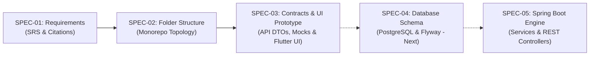

# SquareHealth-VMS — Centralized Engineering Specifications

Welcome to the centralized specification repository for the **SquareHealth-VMS** platform. Every technical phase, contract, and presentation standard is formalized here to ensure zero schema drift, strict architectural compliance, and complete engineering traceability.

---

## 📑 Specification Catalog

| Specification File | Phase / Task | Description | Status |
|---|---|---|:---:|
| [`STEP_1_REQUIREMENTS_SPECIFICATION.md`](./STEP_1_REQUIREMENTS_SPECIFICATION.md) | **Step-1: Requirements** | Multi-source ingestion pipeline, audio-to-speech transcription protocol, and bracketed citation standards (`[Source: ...]`). | **Approved** |
| [`STEP_2_FOLDER_STRUCTURE_SPECIFICATION.md`](./STEP_2_FOLDER_STRUCTURE_SPECIFICATION.md) | **Step-2: Folder Structure** | Unified monorepo topology, official Flutter & Spring Boot layered architectures, and module isolation rules. | **Approved** |
| [`STEP_3_SPECIFICATION.md`](./STEP_3_SPECIFICATION.md) | **Step-3: Data Contracts, Mocks & UI Prototype** | Canonical REST API contracts, DTO schemas, regex validation rules, `ErrorResponseDto` envelope, in-memory mock repository, responsive Flutter Web prototype, and high-resolution graphical UI demo. | **Approved** |

---

## 🏛️ Engineering Traceability Workflow

---

## 🔍 How to Use These Specifications
1. **For Frontend Developers**: Consult [`STEP_3_SPECIFICATION.md`](./STEP_3_SPECIFICATION.md) to inspect API contracts, DTO field mappings, and UI validation rules.
2. **For Backend Developers**: Consult [`STEP_3_SPECIFICATION.md`](./STEP_3_SPECIFICATION.md) (Sections 3–5) for canonical REST endpoints, DTO schemas, and duplicate constraint rules.
3. **For Quality Assurance (QA)**: Reference the acceptance criteria, status code tables, and regex rules in [`STEP_3_SPECIFICATION.md`](./STEP_3_SPECIFICATION.md) to construct automated integration and E2E test suites.
