# SquareHealth-VMS — Centralized Engineering Specifications

Welcome to the centralized specification repository for the **SquareHealth-VMS** platform. Every technical phase, contract, and presentation standard is formalized here to ensure zero schema drift, strict architectural compliance, and complete engineering traceability.

---

## 📑 Specification Catalog

| Specification File | Phase / Task | Description | Status |
|---|---|---|:---:|
| [`STEP_1_REQUIREMENTS_SPECIFICATION.md`](./STEP_1_REQUIREMENTS_SPECIFICATION.md) | **Step-1: Requirements** | Multi-source ingestion pipeline, audio-to-speech transcription protocol, and bracketed citation standards (`[Source: ...]`). | **Approved** |
| [`STEP_2_FOLDER_STRUCTURE_SPECIFICATION.md`](./STEP_2_FOLDER_STRUCTURE_SPECIFICATION.md) | **Step-2: Folder Structure** | Unified monorepo topology, official Flutter & Spring Boot layered architectures, and module isolation rules. | **Approved** |
| [`STEP_3_SPECIFICATION.md`](./STEP_3_SPECIFICATION.md) | **Step-3: Contracts & UI Prototype** | Canonical REST API contracts, DTO schemas, regex validation rules, `ErrorResponseDto` envelope, in-memory mock repository, responsive Flutter Web prototype, and high-resolution graphical UI demo. | **Approved** |
| [`STEP_4_DATABASE_SPECIFICATION.md`](./STEP_4_DATABASE_SPECIFICATION.md) | **Step-4: Database & Migrations** | Relational schema, ER diagram, Data Dictionary, storage invariants (`UNIQUE`, `CHECK`), B-Tree indexes, and Flyway DDL/DML scripts. | **Approved** |
| [`STEP_5_BACKEND_SPECIFICATION.md`](./STEP_5_BACKEND_SPECIFICATION.md) | **Step-5: Spring Boot Engine** | Java domain entities, Spring Data JPA repositories, business validation rules (duplicate vehicle guard), REST controllers, global exception handling, and OpenAPI. | **Approved** |
| [`STEP_6_INTEGRATION_SPECIFICATION.md`](./STEP_6_INTEGRATION_SPECIFICATION.md) | **Step-6: Full-Stack Integration** | Client-to-server wire-up, retiring mock mode (`useMock: false`), live REST networking, Bearer JWT token injection, and reactive UI data binding. | **Approved** |
| [`STEP_7_TESTING_SPECIFICATION.md`](./STEP_7_TESTING_SPECIFICATION.md) | **Step-7: Automated Testing** | Multi-tier testing pyramid: JUnit 5 & Mockito unit tests, MockMvc API integration tests, Duplicate Vehicle Rule tests (`409 Conflict`), Flutter widget tests, and E2E journeys. | **Approved** |
| [`STEP_8_DEPLOYMENT_SPECIFICATION.md`](./STEP_8_DEPLOYMENT_SPECIFICATION.md) | **Step-8: Cloud Deployment** | Multi-stage Dockerization, GitHub Actions CI/CD workflows, Netlify edge CDN hosting, Render container hosting, and managed Cloud PostgreSQL. | **Approved** |

---

## 🏛️ Engineering Traceability Workflow

```mermaid
flowchart LR
    S1["SPEC-01: Requirements\n(SRS & Citations)"] --> S2["SPEC-02: Folder Structure\n(Monorepo Topology)"]
    S2 --> S3["SPEC-03: Contracts & UI Prototype\n(API DTOs, Mocks & Flutter UI)"]
    S3 --> S4["SPEC-04: Database Schema\n(PostgreSQL & Flyway Migrations)"]
    S4 --> S5["SPEC-05: Spring Boot Engine\n(Services & REST Controllers)"]
    S5 --> S6["SPEC-06: Full-Stack Integration\n(Client-Server Live Wire-Up)"]
    S6 --> S7["SPEC-07: Automated Testing\n(Quality Gates & Safety Net)"]
    S7 --> S8["SPEC-08: Cloud Deployment\n(CI/CD, Netlify & Render)"]
```

---

## 🔍 How to Use These Specifications
1. **For Frontend Developers**: Consult [`STEP_3_SPECIFICATION.md`](./STEP_3_SPECIFICATION.md) and [`STEP_6_INTEGRATION_SPECIFICATION.md`](./STEP_6_INTEGRATION_SPECIFICATION.md) to inspect API contracts, DTO field mappings, and network transport configurations.
2. **For Backend Developers**: Consult [`STEP_4_DATABASE_SPECIFICATION.md`](./STEP_4_DATABASE_SPECIFICATION.md) and [`STEP_5_BACKEND_SPECIFICATION.md`](./STEP_5_BACKEND_SPECIFICATION.md) for canonical database tables, JPA entities, REST endpoints, and duplicate constraint rules.
3. **For Quality Assurance (QA)**: Reference [`STEP_7_TESTING_SPECIFICATION.md`](./STEP_7_TESTING_SPECIFICATION.md) and [`STEP_3_SPECIFICATION.md`](./STEP_3_SPECIFICATION.md) to construct automated integration, unit, and E2E test suites.
4. **For DevOps & Cloud Engineers**: Reference [`STEP_8_DEPLOYMENT_SPECIFICATION.md`](./STEP_8_DEPLOYMENT_SPECIFICATION.md) for Docker builds, GitHub Actions workflows, environment variables, and cloud infrastructure deployment.
