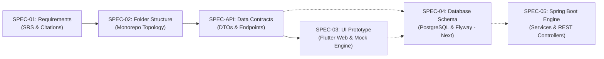

# SquareHealth-VMS — Centralized Engineering Specifications

Welcome to the centralized specification repository for the **SquareHealth-VMS** platform. Every technical phase, contract, and presentation standard is formalized here to ensure zero schema drift, strict architectural compliance, and complete engineering traceability.

---

## 📑 Specification Catalog

| Specification File | Phase / Task | Description | Status |
|---|---|---|:---:|
| [`API_SPECIFICATION.md`](./API_SPECIFICATION.md) | **API & Data Contracts** | Canonical REST endpoints, DTO schemas, regex rules, and uniform `ErrorResponseDto` envelope. | **Approved** |
| [`STEP_1_REQUIREMENTS_SPECIFICATION.md`](./STEP_1_REQUIREMENTS_SPECIFICATION.md) | **Step-1: Requirements** | Multi-source ingestion pipeline, audio-to-speech transcription, and bracketed citation standards. | **Approved** |
| [`STEP_2_FOLDER_STRUCTURE_SPECIFICATION.md`](./STEP_2_FOLDER_STRUCTURE_SPECIFICATION.md) | **Step-2: Folder Structure** | Unified monorepo topology, official Flutter & Spring Boot layered architectures, and isolation rules. | **Approved** |
| [`STEP_3_UI_PROTOTYPE_SPECIFICATION.md`](./STEP_3_UI_PROTOTYPE_SPECIFICATION.md) | **Step-3: UI Prototype** | Design tokens, responsive `AppShell`, Dashboard, Vehicle Registry, modal validation, and mock engine. | **Approved** |

---

## 🏛️ Engineering Traceability Workflow

---

## 🔍 How to Use These Specifications
1. **For Frontend Developers**: Consult [`API_SPECIFICATION.md`](./API_SPECIFICATION.md) and [`STEP_3_UI_PROTOTYPE_SPECIFICATION.md`](./STEP_3_UI_PROTOTYPE_SPECIFICATION.md) to understand models, DTO keys, and UI validation rules.
2. **For Backend Developers**: Consult [`API_SPECIFICATION.md`](./API_SPECIFICATION.md) and [`STEP_1_REQUIREMENTS_SPECIFICATION.md`](./STEP_1_REQUIREMENTS_SPECIFICATION.md) to build REST endpoints, DTOs, and duplicate vehicle constraints.
3. **For Quality Assurance (QA)**: Use the acceptance criteria and status code tables to construct automated unit, integration, and E2E test suites.
