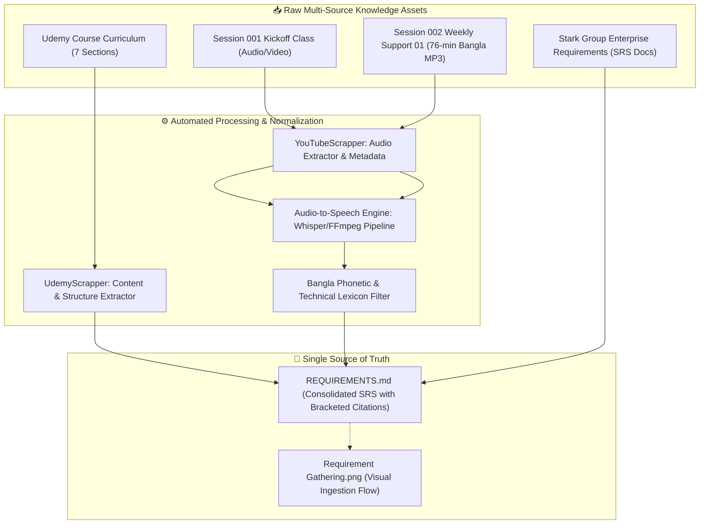

# Technical Specification: Step-1 — Requirement Gathering & Multi-Source Ingestion Pipeline

## 1. Document Control & Objective

| Property | Value |
|---|---|
| **Specification ID** | `SPEC-STEP-01` |
| **Title** | Requirement Gathering, Audio Ingestion & Traceable SRS Protocol |
| **System** | StarkGroup-VMS (Vehicle Management System) |
| **Target Phase** | Phase 1 (Foundation & Scope Definition) |
| **Status** | Approved & Implemented |

### Purpose
This specification formalizes the exact engineering standards, automated pipeline steps, and citation conventions used to discover, transcribe, consolidate, and trace software requirements for the StarkGroup-VMS enterprise platform.

---

## 2. Ingestion Pipeline Architecture

Requirements originate from disparate multimedia and document sources. The pipeline ingests, normalizes, transcribes, and consolidates these into a single traceable document:



---

## 3. Audio Ingestion & Speech-to-Text Protocol

### 3.1 Audio Ingestion Standards
1. **Audio Capture**: Long-form lecture recordings (e.g., Session `002 - Session Weekly Support 01...mp3`) stored in `1.Requirement_Gathering/YoutubeScrapper/`.
2. **Git LFS Enforcement**: Large audio binaries (`*.mp3`) tracked via Git LFS in `.gitattributes` to prevent repository bloat.
3. **Phonetic & Dialect Normalization**: Bengali/Bangla colloquial audio containing technical English terms (e.g., *"primary key"*, *"database"*, *"mock"*, *"status"*, *"license plate"*) parsed with contextual phonetic mappings.

### 3.2 Transcription Output Structure
Every transcribed audio file must produce a structured Markdown document (`.md`) containing:
* Lecture metadata (Session title, date, duration, instructor).
* Chronological timestamp markers (e.g. `[00:15:30]`).
* Segment summaries highlighting architectural choices, database decisions, and user stories.

---

## 4. Traceability & Citation Standard

Every requirement statement in the consolidated [`REQUIREMENTS.md`](../1.Requirement_Gathering/REQUIREMENTS.md) must adhere to the **Bracketed Citation Standard**:

```text
Requirement Statement + [Source: <Canonical Document or Session Name>]
```

### Citation Examples:
* *"Each vehicle must have a globally unique license plate number formatted as `[A-Z0-9-]+`."* `[Source: 002 - Session Weekly Support 01.md]`
* *"The system shall manage vehicles across three distinct operational states: `AVAILABLE`, `IN_TRIP`, and `MAINTENANCE`."* `[Source: Course Build a Full-Stack Web App with Flutter & Spring Boot_Full.md]`
* *"Vehicles are distributed across corporate sister concerns including Stark Group, Stark Industries, and Stark Medical."* `[Source: 001 - full-stack-AI-with-flutter-spring-boot kickoff Class.md]`

---

## 5. Functional Requirements Specification (FRS)

| Requirement ID | Module | Description | Invariant / Rule |
|---|---|---|---|
| **FR-01** | Fleet Registry | Register corporate fleet vehicles with license number, company, type, brand, model, and initial status. | `vehicleNumber` must be unique across the fleet. |
| **FR-02** | Uniqueness Check | Prevent duplicate vehicle registration attempts at both client form level and server persistence level. | Collision triggers `409 Conflict`. |
| **FR-03** | Status Lifecycle | Enforce transition rules between `AVAILABLE`, `IN_TRIP`, and `MAINTENANCE`. | Vehicles `IN_TRIP` cannot be assigned to another trip or deleted. |
| **FR-04** | Fleet Search & Filter | Provide real-time multi-attribute search (plate, brand, company) and status tab filtering. | Search queries case-insensitive; response time under 100ms. |
| **FR-05** | Executive KPI Dashboard | Aggregate total vehicles, available count, active transit count, and workshop maintenance count. | Counts must match sum of individual vehicle states. |
| **FR-06** | Authentication | Provide role-based sign-in for fleet administrators and operators. | Protected endpoints require Bearer JWT authentication. |

---

## 6. Non-Functional Requirements Specification (NFRS)

1. **NFR-01 (Zero-Failure Rendering)**: All architectural diagrams and documentation must pass strict rendering audits (no raw dollar signs in prose, quoted Mermaid nodes, valid image links).
2. **NFR-02 (Responsive Form Factor)**: Flutter Web UI must adapt responsively from mobile viewports (360px) to widescreen desktop monitors (1920px+).
3. **NFR-03 (Modular Decoupling)**: Requirement artifacts must remain decoupled from specific implementation frameworks to allow independent frontend and backend evolution.
4. **NFR-04 (Traceable Versioning)**: All changes committed under semantic Git standards with automatic GitHub synchronization.

---

## 7. Deliverables & Artifact Checklist

- [x] High-resolution ingestion architecture diagram: [`Requirement Gathering.png`](../1.Requirement_Gathering/Requirement%20Gathering.png)
- [x] Complete transcribed Markdown lecture: [`002 - Session  Weekly Support 01...md`](../1.Requirement_Gathering/YoutubeScrapper/002%20-%20Session%20%20Weekly%20Support%2001%20%20%20Full-Stack%20Web%20Development%20with%20Flutter%20&%20Spring%20Boot.md)
- [x] Consolidated traceable requirements specification: [`REQUIREMENTS.md`](../1.Requirement_Gathering/REQUIREMENTS.md)
- [x] Git LFS configuration for binary audio media: [`.gitattributes`](../.gitattributes)
