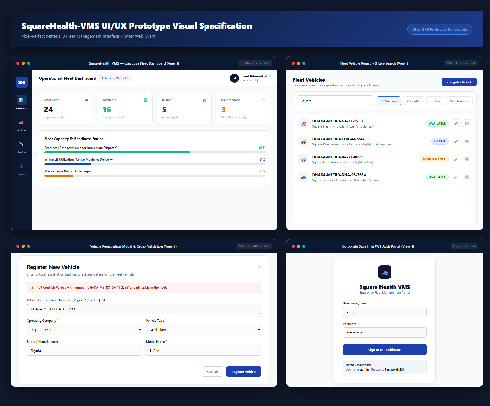
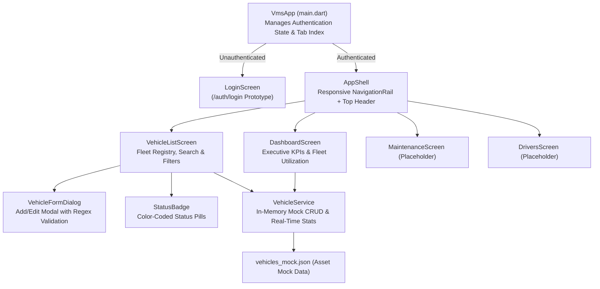

# Technical Specification: Step-3 — Interactive Flutter Web UI Prototype & Design System

## 1. Document Control & Objective

| Property | Value |
|---|---|
| **Specification ID** | `SPEC-STEP-03-UI` |
| **Title** | Flutter Web UI Prototype, Component Hierarchy & In-Memory Mock Architecture |
| **System** | SquareHealth-VMS (Vehicle Management System) |
| **Target Phase** | Phase 3 (Contract & Prototype Validation) |
| **Status** | Approved & Implemented |

### Purpose
This specification formalizes the visual tokens, component hierarchy, client-side input validation, and in-memory mock repository architecture for the **SquareHealth-VMS** interactive Flutter Web presentation layer.

---

## 2. Graphical Demonstration of UI Screens

The following visual demo showcases the exact layout, responsive components, color palette, and interactive modal dialogs implemented in the Flutter Web presentation layer:

### Key Visual Interfaces Displayed Above:
1. **Executive Fleet Dashboard (`DashboardScreen.dart`)**:
   - Deep navy sidebar navigation rail with active tab highlights.
   - 4 High-contrast executive KPI cards: Total Fleet (24), Available (16), In Trip (5), Maintenance (3).
   - Real-time calculated fleet capacity & readiness ratio progress bars.
2. **Fleet Vehicle Registry (`VehicleListScreen.dart`)**:
   - Live multi-attribute search bar and status filter chips (`All Statuses`, `Available`, `In Trip`, `Maintenance`).
   - Dynamic contextual vehicle category icons (ambulance cross, freight truck, minibus, sedan).
   - Color-coded `StatusBadge` pills and inline action buttons (Edit, Delete with confirmation modal).
3. **Vehicle Registration Modal Dialog (`VehicleFormDialog.dart`)**:
   - High-visibility `409 Conflict` duplicate prevention alert banner.
   - License plate text input with strict regex enforcement (`^[A-Z0-9-]+$`).
   - Clean dropdown selectors for Operating Company, Vehicle Type, and Initial Fleet Status.
4. **Corporate Authentication Portal (`LoginScreen.dart`)**:
   - Square Health branded sign-in card with instant demo credential helper (`admin` / `Password123!`).

---

## 3. Design System Tokens & Visual Standards

The UI strictly adheres to the **Stark Group Material 3 Enterprise Design System**:

| Token Category | Token Name | Value / Hex Code | Usage |
|---|---|---|---|
| **Primary Palette** | `primaryNavy` | `#0A192F` | Sidebar navigation rail, primary brand elements, headings |
| **Accent Palette** | `corporateBlue` | `#1E40AF` | Action buttons, active navigation indicators, hyperlinks |
| **Status (Available)** | `successGreen` | `#10B981` | Available vehicles badge, dispatch readiness indicators |
| **Status (In Trip)** | `inTripBlue` | `#3B82F6` | Active transit badge, live dispatch indicators |
| **Status (Maintenance)** | `warningAmber` | `#F59E0B` | Workshop repair badge, maintenance alerts |
| **Status (Error/Alert)** | `dangerRed` | `#EF4444` | Form errors, duplicate conflict alert, delete confirmation |
| **Neutrals** | `backgroundLight` | `#F8FAFC` | Page scaffold background |
| **Borders** | `borderSubtle` | `#E2E8F0` | Card borders, table dividers, input field outlines |

---

## 4. Component Architecture & Screen Specifications

---

### 4.1 Authentication Screen (`LoginScreen`)
* **Path**: [`vms-frontend/lib/features/auth/presentation/login_screen.dart`](../vms-frontend/lib/features/auth/presentation/login_screen.dart)
* **Visual Elements**:
  * Centered responsive card (max width 420px) on light slate background.
  * Square Health enterprise emblem and header typography.
  * Username text field with `Validators.emailOrUsername`.
  * Password text field with visibility toggle and `Validators.password`.
  * Full-width "Sign In to Dashboard" button with simulated network latency indicator.
  * Demo credentials helper card displaying `admin` / `Password123!`.

---

### 4.2 Responsive Navigation Shell (`AppShell`)
* **Path**: [`vms-frontend/lib/shared/widgets/app_shell.dart`](../vms-frontend/lib/shared/widgets/app_shell.dart)
* **Visual Elements**:
  * Fixed-width dark navy `NavigationRail` with corporate logo mark and destination tabs (Dashboard, Vehicles, Maintenance, Drivers).
  * Sign-out icon button at bottom of navigation rail.
  * Top navigation bar with active route title, environment pill badge ("Enterprise Web v1.0 (Step 3 Prototype)"), and operator profile avatar with designation ("Fleet Administrator - Square Health Logistics HQ").

---

### 4.3 Executive Dashboard (`DashboardScreen`)
* **Path**: [`vms-frontend/lib/features/dashboard/presentation/dashboard_screen.dart`](../vms-frontend/lib/features/dashboard/presentation/dashboard_screen.dart)
* **Visual Elements**:
  * **4 Primary Metric Cards**:
    1. *Total Fleet*: Total count of registered assets (Navy theme).
    2. *Available*: Ready for immediate dispatch (Emerald green theme).
    3. *In Trip*: Active transit vehicles on logistics routes (Electric blue theme).
    4. *Maintenance*: Vehicles undergoing workshop servicing (Amber warning theme).
  * **Fleet Capacity & Utilization Panel**:
    * Linear progress bars rendering real-time calculated percentages for Readiness Rate, In-Transit Utilization, and Maintenance Ratio.
  * **Operations Summary**: Active certified driver headcount and dispatch trip trackers.

---

### 4.4 Fleet Registry & Management (`VehicleListScreen`)
* **Path**: [`vms-frontend/lib/features/vehicles/presentation/vehicle_list_screen.dart`](../vms-frontend/lib/features/vehicles/presentation/vehicle_list_screen.dart)
* **Visual Elements**:
  * Header toolbar with title, subtext, "Refresh" button, and "+ Register Vehicle" primary action button.
  * Filter control card containing:
    * Real-time search field matching license plate, company name, brand, or model.
    * Status filter chips: `ALL`, `AVAILABLE`, `IN_TRIP`, `MAINTENANCE`.
  * Responsive list of vehicle cards displaying:
    * Contextual avatar icon dynamically reflecting vehicle type (ambulance cross, freight truck, minibus, sedan).
    * Bold license plate number alongside color-coded `StatusBadge`.
    * Company name, manufacturer brand, model, and vehicle category tag.
    * Action icons for "Edit Vehicle" and "Remove from Fleet".
  * Delete confirmation modal preventing accidental asset de-registration.

---

### 4.5 Vehicle Registration & Modification Modal (`VehicleFormDialog`)
* **Path**: [`vms-frontend/lib/features/vehicles/presentation/vehicle_form_dialog.dart`](../vms-frontend/lib/features/vehicles/presentation/vehicle_form_dialog.dart)
* **Form Inputs & Validations**:
  1. *Vehicle License Plate Number*:
     * Text field with uppercase transformation.
     * Validated against regex pattern: `^[A-Z0-9-]+$` via `Validators.vehicleNumber`.
     * Minimum 5 characters required.
  2. *Operating Company*:
     * Dropdown selector: `Square Health`, `Square Pharmaceuticals`, `Square Hospitals`, `Square Textiles`, `Square Toiletries`.
  3. *Vehicle Type*:
     * Dropdown selector: `Ambulance`, `Delivery Van`, `Microbus`, `Executive Sedan`, `Cargo Truck`.
  4. *Brand & Model*:
     * Mandatory text inputs (e.g. `Toyota`, `HiAce`).
  5. *Operational Status*:
     * Dropdown selector: `AVAILABLE`, `IN_TRIP`, `MAINTENANCE`.
* **Conflict & Error Banner**:
  * Inline error banner displayed dynamically when attempting to register a duplicate vehicle number (`409 Conflict`).

---

## 5. In-Memory Mock Repository & Service Specification

* **Path**: [`vms-frontend/lib/features/vehicles/services/vehicle_service.dart`](../vms-frontend/lib/features/vehicles/services/vehicle_service.dart)
* **Capabilities**:
  * **Dual-Mode Architecture**: Controlled by `bool useMock`. When `true`, all operations execute against static in-memory cache; when `false`, operations route through `ApiClient` to Spring Boot REST endpoints.
  * **Duplicate Constraint Simulation**: Scans existing mock records on `createVehicle` and `updateVehicle`; throws `ApiException(409, ...)` if license plate already exists.
  * **Dynamic ID Generation**: Auto-increments highest current numeric ID upon creation.
  * **Real-Time Aggregations**: Computes live KPI counts on demand via `getDashboardStats()`.

---

## 6. Verification Checklist

- [x] Client-side regex pattern `^[A-Z0-9-]+$` verified on input fields.
- [x] All 8 mock fleet vehicles render properly in browser.
- [x] Status badge visual variants verified for `AVAILABLE`, `IN_TRIP`, and `MAINTENANCE`.
- [x] In-memory duplicate license plate collision produces HTTP 409 error banner.
- [x] Responsive layout adapts cleanly across window resizing.

