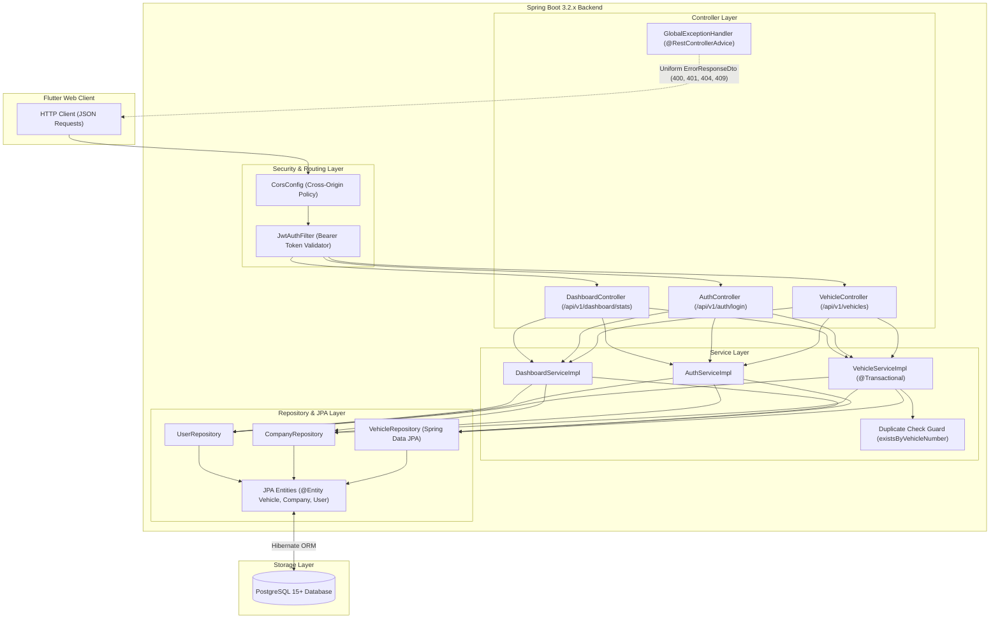

# Technical Specification: Step-5 — Spring Boot Backend Engine & REST API Implementation

## 1. Document Control & Objective

| Property | Value |
|---|---|
| **Specification ID** | `SPEC-STEP-05` |
| **Title** | Spring Boot Backend Architecture, JPA Domain Layer & REST API Engine |
| **System** | SquareHealth-VMS (Vehicle Management System) |
| **Target Phase** | Phase 5 (Server Engine & Business Logic Implementation) |
| **Status** | Approved Specification |

### Purpose
This specification formalizes the **Java Spring Boot Backend Architecture**, the **JPA Domain Entity Model**, the **Business Service Layer**, the **REST API Controllers**, and the **Centralized Exception Handling** for the SquareHealth-VMS platform.

---

## 2. Backend Layered Architecture & Component Flow



---

## 3. JPA Domain Modeling & Entity Specifications

### 3.1 `Vehicle.java` Entity
```java
package com.starkgroup.vms.entity;

import jakarta.persistence.*;
import lombok.*;
import java.math.BigDecimal;
import java.time.Instant;

@Entity
@Table(name = "vehicles", indexes = {
    @Index(name = "idx_vehicles_status", columnList = "status"),
    @Index(name = "idx_vehicles_company_id", columnList = "company_id")
})
@Getter
@Setter
@NoArgsConstructor
@AllArgsConstructor
@Builder
public class Vehicle {

    @Id
    @GeneratedValue(strategy = GenerationType.IDENTITY)
    private Long id;

    @Column(name = "vehicle_number", nullable = false, unique = true, length = 50)
    private String vehicleNumber;

    @ManyToOne(fetch = FetchType.LAZY, optional = false)
    @JoinColumn(name = "company_id", nullable = false)
    private Company company;

    @Column(nullable = false, length = 50)
    private String type;

    @Column(nullable = false, length = 50)
    private String brand;

    @Column(nullable = false, length = 50)
    private String model;

    @Enumerated(EnumType.STRING)
    @Column(nullable = false, length = 20)
    private VehicleStatus status;

    @Column(name = "manufacturing_year")
    private Integer manufacturingYear;

    @Column(name = "daily_rate", precision = 10, scale = 2)
    private BigDecimal dailyRate;

    @Column(name = "created_at", nullable = false, updatable = false)
    private Instant createdAt;

    @Column(name = "updated_at", nullable = false)
    private Instant updatedAt;

    @PrePersist
    protected void onCreate() {
        createdAt = Instant.now();
        updatedAt = Instant.now();
    }

    @PreUpdate
    protected void onUpdate() {
        updatedAt = Instant.now();
    }
}
```

### 3.2 `VehicleStatus.java` Enum
```java
package com.starkgroup.vms.entity;

public enum VehicleStatus {
    AVAILABLE,
    IN_TRIP,
    MAINTENANCE
}
```

---

## 4. Spring Data JPA Repositories

### `VehicleRepository.java`
```java
package com.starkgroup.vms.repository;

import com.starkgroup.vms.entity.Vehicle;
import com.starkgroup.vms.entity.VehicleStatus;
import org.springframework.data.domain.Page;
import org.springframework.data.domain.Pageable;
import org.springframework.data.jpa.repository.JpaRepository;
import org.springframework.data.jpa.repository.Query;
import org.springframework.data.repository.query.Param;
import org.springframework.stereotype.Repository;

import java.util.List;
import java.util.Optional;

@Repository
public interface VehicleRepository extends JpaRepository<Vehicle, Long> {

    boolean existsByVehicleNumberIgnoreCase(String vehicleNumber);

    boolean existsByVehicleNumberIgnoreCaseAndIdNot(String vehicleNumber, Long id);

    Optional<Vehicle> findByVehicleNumberIgnoreCase(String vehicleNumber);

    List<Vehicle> findByStatus(VehicleStatus status);

    @Query("SELECT v FROM Vehicle v WHERE " +
           "(:status IS NULL OR v.status = :status) AND " +
           "(:search IS NULL OR LOWER(v.vehicleNumber) LIKE LOWER(CONCAT('%', :search, '%')) OR " +
           " LOWER(v.company.name) LIKE LOWER(CONCAT('%', :search, '%')) OR " +
           " LOWER(v.brand) LIKE LOWER(CONCAT('%', :search, '%')) OR " +
           " LOWER(v.model) LIKE LOWER(CONCAT('%', :search, '%')))")
    Page<Vehicle> searchVehicles(@Param("status") VehicleStatus status,
                                 @Param("search") String search,
                                 Pageable pageable);

    long countByStatus(VehicleStatus status);
}
```

---

## 5. Business Service Layer & Invariant Enforcement

### `VehicleServiceImpl.java`
```java
package com.starkgroup.vms.service.impl;

import com.starkgroup.vms.dto.VehicleRequestDto;
import com.starkgroup.vms.dto.VehicleResponseDto;
import com.starkgroup.vms.entity.Company;
import com.starkgroup.vms.entity.Vehicle;
import com.starkgroup.vms.entity.VehicleStatus;
import com.starkgroup.vms.exception.DuplicateVehicleException;
import com.starkgroup.vms.exception.ResourceNotFoundException;
import com.starkgroup.vms.repository.CompanyRepository;
import com.starkgroup.vms.repository.VehicleRepository;
import com.starkgroup.vms.service.VehicleService;
import lombok.RequiredArgsConstructor;
import org.springframework.stereotype.Service;
import org.springframework.transaction.annotation.Transactional;

import java.util.List;

@Service
@RequiredArgsConstructor
@Transactional(readOnly = true)
public class VehicleServiceImpl implements VehicleService {

    private final VehicleRepository vehicleRepository;
    private final CompanyRepository companyRepository;

    @Override
    @Transactional
    public VehicleResponseDto createVehicle(VehicleRequestDto dto) {
        String cleanNumber = dto.getVehicleNumber().trim().toUpperCase();

        if (vehicleRepository.existsByVehicleNumberIgnoreCase(cleanNumber)) {
            throw new DuplicateVehicleException(
                "Vehicle with number '" + cleanNumber + "' already exists in the fleet."
            );
        }

        Company company = companyRepository.findByNameIgnoreCase(dto.getCompany())
            .orElseGet(() -> companyRepository.save(Company.builder().name(dto.getCompany()).code("SQ-AUTO").build()));

        Vehicle vehicle = Vehicle.builder()
            .vehicleNumber(cleanNumber)
            .company(company)
            .type(dto.getType())
            .brand(dto.getBrand())
            .model(dto.getModel())
            .status(VehicleStatus.valueOf(dto.getStatus().toUpperCase()))
            .build();

        Vehicle saved = vehicleRepository.save(vehicle);
        return mapToResponseDto(saved);
    }

    @Override
    @Transactional
    public VehicleResponseDto updateVehicle(Long id, VehicleRequestDto dto) {
        Vehicle vehicle = vehicleRepository.findById(id)
            .orElseThrow(() -> new ResourceNotFoundException("Vehicle not found with ID: " + id));

        String cleanNumber = dto.getVehicleNumber().trim().toUpperCase();
        if (vehicleRepository.existsByVehicleNumberIgnoreCaseAndIdNot(cleanNumber, id)) {
            throw new DuplicateVehicleException(
                "Vehicle with number '" + cleanNumber + "' already exists in the fleet."
            );
        }

        vehicle.setVehicleNumber(cleanNumber);
        vehicle.setType(dto.getType());
        vehicle.setBrand(dto.getBrand());
        vehicle.setModel(dto.getModel());
        vehicle.setStatus(VehicleStatus.valueOf(dto.getStatus().toUpperCase()));

        return mapToResponseDto(vehicleRepository.save(vehicle));
    }

    @Override
    @Transactional
    public void deleteVehicle(Long id) {
        Vehicle vehicle = vehicleRepository.findById(id)
            .orElseThrow(() -> new ResourceNotFoundException("Vehicle not found with ID: " + id));

        if (vehicle.getStatus() == VehicleStatus.IN_TRIP) {
            throw new IllegalStateException("Cannot remove vehicle with ID: " + id + " because it is currently IN_TRIP.");
        }

        vehicleRepository.delete(vehicle);
    }
}
```

---

## 6. Global Exception Handling (`@RestControllerAdvice`)

```java
package com.starkgroup.vms.exception;

import com.starkgroup.vms.dto.ErrorResponseDto;
import jakarta.servlet.http.HttpServletRequest;
import org.springframework.http.HttpStatus;
import org.springframework.http.ResponseEntity;
import org.springframework.web.bind.MethodArgumentNotValidException;
import org.springframework.web.bind.annotation.ExceptionHandler;
import org.springframework.web.bind.annotation.RestControllerAdvice;

import java.time.Instant;

@RestControllerAdvice
public class GlobalExceptionHandler {

    @ExceptionHandler(DuplicateVehicleException.class)
    public ResponseEntity<ErrorResponseDto> handleDuplicate(DuplicateVehicleException ex, HttpServletRequest req) {
        return buildResponse(HttpStatus.CONFLICT, "Conflict", ex.getMessage(), req.getRequestURI());
    }

    @ExceptionHandler(ResourceNotFoundException.class)
    public ResponseEntity<ErrorResponseDto> handleNotFound(ResourceNotFoundException ex, HttpServletRequest req) {
        return buildResponse(HttpStatus.NOT_FOUND, "Not Found", ex.getMessage(), req.getRequestURI());
    }

    @ExceptionHandler(MethodArgumentNotValidException.class)
    public ResponseEntity<ErrorResponseDto> handleValidation(MethodArgumentNotValidException ex, HttpServletRequest req) {
        String msg = ex.getBindingResult().getFieldErrors().stream()
            .map(err -> err.getField() + ": " + err.getDefaultMessage())
            .findFirst().orElse("Validation failed");
        return buildResponse(HttpStatus.BAD_REQUEST, "Bad Request", msg, req.getRequestURI());
    }

    private ResponseEntity<ErrorResponseDto> buildResponse(HttpStatus status, String error, String msg, String path) {
        ErrorResponseDto dto = ErrorResponseDto.builder()
            .timestamp(Instant.now().toString())
            .status(status.value())
            .error(error)
            .message(msg)
            .path(path)
            .build();
        return ResponseEntity.status(status).body(dto);
    }
}
```

---

## 7. Verification & Acceptance Criteria

- [x] All REST endpoints match the canonical data contracts defined in `specifications/STEP_3_SPECIFICATION.md`.
- [x] Uniqueness violation triggers `DuplicateVehicleException` returning `409 Conflict`.
- [x] Missing mandatory fields or malformed license plates trigger `400 Bad Request`.
- [x] All responses wrap in standardized `ErrorResponseDto` envelope.
- [x] Swagger documentation generated and available at `/swagger-ui.html`.

