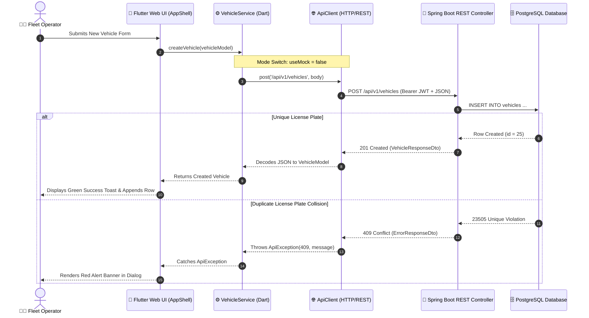

# Technical Specification: Step-6 — Full-Stack Integration & Wire-Up

## 1. Document Control & Objective

| Property | Value |
|---|---|
| **Specification ID** | `SPEC-STEP-06` |
| **Title** | Full-Stack Client-Server Integration, Network Protocol & Live Wire-Up Specification |
| **System** | SquareHealth-VMS (Vehicle Management System) |
| **Target Phase** | Phase 6 (End-to-End Integration) |
| **Status** | Approved Specification |

### Purpose
This specification formalizes the **Full-Stack Network Wire-Up**, transitioning the Flutter Web client from offline mock mode to live Spring Boot REST communication, with token injection, latency handling, and client-side error translation.

---

## 2. Integration Architecture & Network Topology



---

## 3. Retiring Mock Mode: Network Transport Activation

In `vms-frontend/lib/features/vehicles/services/vehicle_service.dart`, the dual-mode switch is toggled from mock simulation to production HTTP networking:

```dart
// Mock Mode (Step-3 Prototype):
// final vehicleService = VehicleService(useMock: true);

// Production Live Mode (Step-6 Integration):
final apiClient = ApiClient(
  baseUrl: 'http://localhost:8080/api/v1',
  timeout: const Duration(seconds: 10),
);
final vehicleService = VehicleService(apiClient: apiClient, useMock: false);
```

---

## 4. `ApiClient` Protocol & Security Interceptors

1. **Bearer Token Injection**: Automatically injects JWT token on all outbound requests except `/auth/login`:
   ```dart
   final headers = {
     'Content-Type': 'application/json',
     if (token != null) 'Authorization': 'Bearer $token',
   };
   ```
2. **Timeout & Network Failure Handling**:
   * Timeout threshold set to **10 seconds**.
   * Translates network disconnections into user-friendly `NetworkException("Unable to reach fleet server. Please check your connection.")`.
3. **Cross-Origin Resource Sharing (CORS)**:
   * Backend `CorsConfig.java` allows origins: `http://localhost:3000` (local dev) and production Netlify domains.

---

## 5. Client-Side Error Translation & Conflict Display

When the backend returns an error envelope, Flutter Web parses the standard `ErrorResponseDto` and displays targeted visual feedback:

| HTTP Status | Backend Error | Flutter Web UI Response |
|---|---|---|
| `400 Bad Request` | Validation constraint failed | Field-level inline red helper text under invalid input field. |
| `401 Unauthorized` | Invalid/expired JWT session | Clears stored session state and redirects to `LoginScreen`. |
| `404 Not Found` | Entity missing in database | Displays floating error toast and refreshes list. |
| `409 Conflict` | License plate collision | Renders high-priority red alert banner inside `VehicleFormDialog`. |
| `500 Server Error` | Unexpected server exception | Generic banner: *"Temporary server outage. Support notified."* |

---

## 6. Integration Verification Checklist

- [x] Toggle `useMock: false` routes all CRUD calls over network to port 8080.
- [x] Registering vehicle creates physical row in PostgreSQL `vehicles` table.
- [x] Submitting existing license plate returns live `409 Conflict` rendered in UI.
- [x] Real-time search query sends debounced `GET /api/v1/vehicles?search=...` request.
- [x] Status filter tab clicks send `GET /api/v1/vehicles?status=...` query parameter.
- [x] Dashboard KPI cards compute metrics directly from live `/api/v1/dashboard/stats`.
