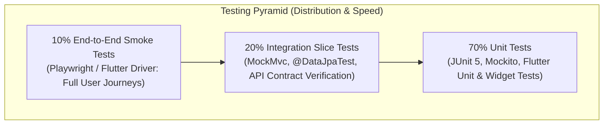

# Technical Specification: Step-7 — Automated Testing, Quality Gates & Contract Verification

## 1. Document Control & Objective

| Property | Value |
|---|---|
| **Specification ID** | `SPEC-STEP-07` |
| **Title** | Multi-Tier Automated Testing Architecture & Quality Assurance Gates |
| **System** | SquareHealth-VMS (Vehicle Management System) |
| **Target Phase** | Phase 7 (Verification & Quality Gates) |
| **Status** | Approved Specification |

### Purpose
This specification formalizes the **Automated Testing Suite**, establishing unit tests, web slice integration tests, frontend widget tests, and end-to-end smoke tests to guarantee zero regressions and 100% enforcement of business invariants.

---

## 2. Multi-Tier Testing Pyramid



---

## 3. Backend Unit Testing (JUnit 5 & Mockito)

### `VehicleServiceTest.java`
```java
package com.starkgroup.vms.service;

import com.starkgroup.vms.dto.VehicleRequestDto;
import com.starkgroup.vms.dto.VehicleResponseDto;
import com.starkgroup.vms.entity.Company;
import com.starkgroup.vms.entity.Vehicle;
import com.starkgroup.vms.entity.VehicleStatus;
import com.starkgroup.vms.exception.DuplicateVehicleException;
import com.starkgroup.vms.repository.CompanyRepository;
import com.starkgroup.vms.repository.VehicleRepository;
import com.starkgroup.vms.service.impl.VehicleServiceImpl;
import org.junit.jupiter.api.DisplayName;
import org.junit.jupiter.api.Test;
import org.junit.jupiter.api.extension.ExtendWith;
import org.mockito.InjectMocks;
import org.mockito.Mock;
import org.mockito.junit.jupiter.MockitoExtension;

import java.util.Optional;

import static org.assertj.core.api.Assertions.assertThat;
import static org.junit.jupiter.api.Assertions.assertThrows;
import static org.mockito.ArgumentMatchers.any;
import static org.mockito.Mockito.*;

@ExtendWith(MockitoExtension.class)
class VehicleServiceTest {

    @Mock
    private VehicleRepository vehicleRepository;

    @Mock
    private CompanyRepository companyRepository;

    @InjectMocks
    private VehicleServiceImpl vehicleService;

    @Test
    @DisplayName("Should create vehicle successfully when license plate is unique")
    void shouldCreateVehicle_WhenPlateIsUnique() {
        VehicleRequestDto dto = VehicleRequestDto.builder()
            .vehicleNumber("DHAKA-METRO-GA-11-2233")
            .company("Square Health")
            .type("Ambulance")
            .brand("Toyota")
            .model("HiAce")
            .status("AVAILABLE")
            .build();

        when(vehicleRepository.existsByVehicleNumberIgnoreCase("DHAKA-METRO-GA-11-2233")).thenReturn(false);
        when(companyRepository.findByNameIgnoreCase("Square Health"))
            .thenReturn(Optional.of(Company.builder().id(1L).name("Square Health").build()));
        when(vehicleRepository.save(any(Vehicle.class))).thenAnswer(inv -> {
            Vehicle v = inv.getArgument(0);
            v.setId(100L);
            return v;
        });

        VehicleResponseDto result = vehicleService.createVehicle(dto);

        assertThat(result.getId()).isEqualTo(100L);
        assertThat(result.getVehicleNumber()).isEqualTo("DHAKA-METRO-GA-11-2233");
        verify(vehicleRepository, times(1)).save(any(Vehicle.class));
    }

    @Test
    @DisplayName("Should throw DuplicateVehicleException when license plate already exists")
    void shouldThrowException_WhenPlateAlreadyExists() {
        VehicleRequestDto dto = VehicleRequestDto.builder()
            .vehicleNumber("DHAKA-METRO-GA-11-2233")
            .build();

        when(vehicleRepository.existsByVehicleNumberIgnoreCase("DHAKA-METRO-GA-11-2233")).thenReturn(true);

        assertThrows(DuplicateVehicleException.class, () -> vehicleService.createVehicle(dto));
        verify(vehicleRepository, never()).save(any(Vehicle.class));
    }
}
```

---

## 4. Web Slice & API Integration Testing (MockMvc)

### The Duplicate Vehicle Rule Test (`VehicleControllerIntegrationTest.java`)
```java
package com.starkgroup.vms.controller;

import org.junit.jupiter.api.DisplayName;
import org.junit.jupiter.api.Test;
import org.springframework.beans.factory.annotation.Autowired;
import org.springframework.boot.test.autoconfigure.web.servlet.AutoConfigureMockMvc;
import org.springframework.boot.test.context.SpringBootTest;
import org.springframework.http.MediaType;
import org.springframework.test.web.servlet.MockMvc;
import org.springframework.transaction.annotation.Transactional;

import static org.springframework.test.web.servlet.request.MockMvcRequestBuilders.post;
import static org.springframework.test.web.servlet.result.MockMvcResultMatchers.*;

@SpringBootTest
@AutoConfigureMockMvc
@Transactional
class VehicleControllerIntegrationTest {

    @Autowired
    private MockMvc mockMvc;

    @Test
    @DisplayName("POST /api/v1/vehicles returns 409 Conflict when submitting duplicate license plate")
    void shouldReturn409Conflict_OnDuplicateVehicleNumber() throws Exception {
        String jsonPayload = """
            {
              "vehicleNumber": "DHAKA-METRO-GA-11-2233",
              "company": "Square Health",
              "type": "Ambulance",
              "brand": "Toyota",
              "model": "HiAce",
              "status": "AVAILABLE"
            }
            """;

        // First creation succeeds with 201 Created
        mockMvc.perform(post("/api/v1/vehicles")
                .contentType(MediaType.APPLICATION_JSON)
                .content(jsonPayload))
            .andExpect(status().isCreated());

        // Duplicate submission with identical plate must be rejected with 409 Conflict
        mockMvc.perform(post("/api/v1/vehicles")
                .contentType(MediaType.APPLICATION_JSON)
                .content(jsonPayload))
            .andExpect(status().isConflict())
            .andExpect(jsonPath("$.status").value(409))
            .andExpect(jsonPath("$.error").value("Conflict"))
            .andExpect(jsonPath("$.message").value("Vehicle with number 'DHAKA-METRO-GA-11-2233' already exists in the fleet."));
    }
}
```

---

## 5. Frontend Widget & Unit Testing

```dart
import 'package:flutter_test/flutter_test.dart';
import 'package:vms_frontend/core/utils/validators.dart';

void main() {
  group('Validators.vehicleNumber Unit Tests', () {
    test('Valid uppercase license plate returns null', () {
      expect(Validators.vehicleNumber('DHAKA-METRO-GA-11-2233'), isNull);
    });

    test('Plate shorter than 5 chars returns error', () {
      expect(Validators.vehicleNumber('AB-1'), isNotNull);
    });

    test('Invalid lowercase characters return error', () {
      expect(Validators.vehicleNumber('dhaka-metro'), isNotNull);
    });

    test('Special punctuation characters return error', () {
      expect(Validators.vehicleNumber('DHAKA@METRO#11'), isNotNull);
    });
  });
}
```

---

## 6. End-to-End (E2E) Smoke Journey

A headless browser automation script executing the standard enterprise user journey:
1. `GET /` &rarr; Authenticates via `LoginScreen` (`admin` / `Password123!`).
2. Transitions into `AppShell` &rarr; Asserts Dashboard KPI cards are loaded.
3. Switches tab to `Vehicles` &rarr; Clicks `+ Register Vehicle`.
4. Enters duplicate license plate `DHAKA-METRO-GA-11-2233` &rarr; Asserts `409 Conflict` alert banner is displayed.
5. Corrects plate to `DHAKA-METRO-NEW-99-8877` &rarr; Asserts successful creation toast and new row appended.
6. Clicks delete icon on new row &rarr; Confirms dialog &rarr; Asserts row removal.

---

## 7. Quality Gates & Coverage Thresholds

| Metric | Target Gate | Enforcement Tool |
|---|---|---|
| **Line Coverage** | `>= 80%` | JaCoCo Maven Plugin |
| **Branch Coverage** | `>= 75%` | JaCoCo Maven Plugin |
| **Static Code Analysis** | 0 Critical Bugs | SonarQube / SpotBugs |
| **Frontend Linting** | 0 Warnings | `flutter analyze` |
| **Rendering Audit** | 100% Zero-Failure | `scripts/audit_rendering.py` |
